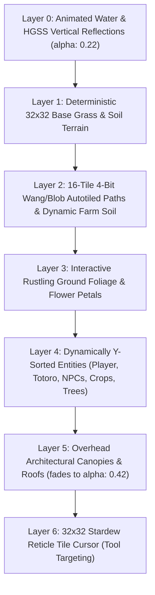
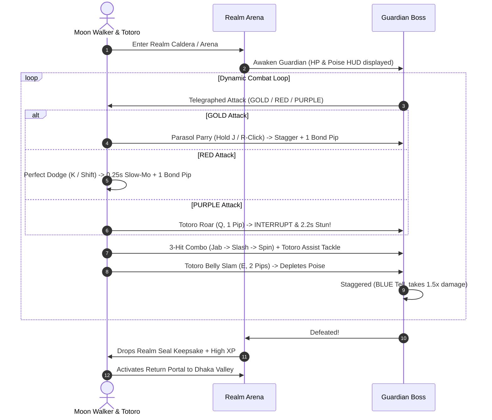

# 🌸 Totoro & Moon Walker: Chronicles of the Six Realms
## Universal Master Game Specification & AI Context Manifest
*Single Source of Truth for Architecture, Lore, World Maps, Mechanics, Characters, and Asset Pipelines*

> ⚠️ **MANDATORY INSTRUCTION FOR ALL FUTURE AI CODING SESSIONS & AGENTS**:
> This document is the definitive, comprehensive context document for **Totoro & Moon Walker: Chronicles of the Six Realms**. Any AI assistant or developer modifying, extending, refactoring, or updating this codebase **MUST UPDATE THIS FILE (`GAME_CONTEXT.md`)** in the exact same turn to reflect all changes, new mechanics, questlines, NPC dialogues, asset bindings, or configuration updates. Never let this document desynchronize from the repository state.

---

## 📑 Table of Contents
1. [Executive Summary & Game Overview](#1-executive-summary--game-overview)
2. [Technical Architecture & Stack](#2-technical-architecture--stack)
3. [World Map Directory (8 Playable Environments)](#3-world-map-directory-8-playable-environments)
4. [Protagonists & Companion System](#4-protagonists--companion-system)
5. [Complete Overworld Character Directory (38 NPCs & Entities)](#5-complete-overworld-character-directory-38-npcs--entities)
6. [Dhaka Heritage Date Activities & Mini-Quests](#6-dhaka-heritage-date-activities--mini-quests)
7. [Stardew Valley 32×32 Grid & Farming Engine](#7-stardew-valley-3232-grid--farming-engine)
8. [Action RPG Combat, Guardian Bosses & Progression](#8-action-rpg-combat-guardian-bosses--progression)
9. [Atmosphere, Weather & Calendar Time Engine](#9-atmosphere-weather--calendar-time-engine)
10. [Living-World NPC Behavior Engine (Stardew Valley & Pokémon HGSS Architecture)](#10-living-world-npc-behavior-engine-stardew-valley--pokémon-hgss-architecture)
11. [Audio Pipeline & SoundEngine Architecture](#11-audio-pipeline--soundengine-architecture)
12. [Hybrid External/Procedural Asset Adapter & Specifications](#12-hybrid-externalprocedural-asset-adapter--specifications)
13. [State Management, Quests & Persistence](#13-state-management-quests--persistence)
14. [Deployment, Build Commands & Verification Protocol](#14-deployment-build-commands--verification-protocol)
15. [Protocol for Future AI Modifications](#15-protocol-for-future-ai-modifications)

---

## 1. Executive Summary & Game Overview

**Totoro & Moon Walker: Chronicles of the Six Realms** (also known as *Dhaka Date RPG*) is a rich top-down 2D Life-Sim & Action RPG set in the vibrant cultural heart of Dhaka, Bangladesh (Curzon Hall, Fuller Road, TSC, Nilkhet, Charukola, and Dhanmondi Lake) intertwined with Ghibli fantasy realms. 

Players assume the role of **Moon Walker** (inspired by Satsuki Kusakabe from Studio Ghibli's *My Neighbor Totoro*), accompanied by the giant forest spirit **Totoro**. Together, they explore a nostalgic 16-bit retro world rendered on an authentic **Stardew Valley & Pokémon HeartGold/SoulSilver (HGSS) 32×32 pixel grid**. 

The narrative bridges real-world Dhaka romance and campus nostalgia (sipping clay-cup malai cha at TSC, crunching spicy Naga fuchka, exploring antique books at Nilkhet, listening to acoustic folk songs, riding painted cycle rickshaws, and stargazing from lantern rowboats on Dhanmondi Lake) with an epic multi-realm journey to heal a reality-shattering **Chrono-Fracture** across six mystical realms.

---

## 2. Technical Architecture & Stack

*(For the dedicated modular subsystem architecture guide, see [`docs/ARCHITECTURE.md`](docs/ARCHITECTURE.md) and [`KART_GAME_CONTEXT.md`](KART_GAME_CONTEXT.md)).*

| Layer | Technology | Details |
| :--- | :--- | :--- |
| **Game Engine** | [Phaser 3.87.0](https://phaser.io/) | Canvas/WebGL 2D renderer, Arcade Physics, Custom Y-sorting, Multi-camera system |
| **3D Mini-Game Engine** | [Three.js 0.186.1](https://threejs.org/) | Dedicated WebGL overlay and standalone harness for Totoro Kart (formerly MarioKart64JS; 16 GP circuits, 4 battle arenas, 8 drivers including Satsuki and Totoro, custom Ghibli 3D CGI menu backgrounds, Wii 3D karts, synthesized Web Audio) |
| **Build & Tooling** | [Vite 8](https://vitejs.dev/) | Ultra-fast HMR dev server, Rolldown code-splitting into 9 modular chunks (`phaser`, `scene-dhaka`, `graphics-world`, `graphics-creatures`, `graphics-characters`, `game-db`, `game-systems`, and lazy `three` + `race-engine`) |
| **Language** | [TypeScript 7.x](https://www.typescriptlang.org/) | Strict typing, full interfaces for state, items, crops, database indices, and asset specs |
| **Testing** | [Vitest](https://vitest.dev/) + [Playwright](https://playwright.dev/) | 223 unit & regression tests across 20 test suites (combat, farming, NPC engine, opening dialogues, database index, behaviors, 3D race kinematics, drift, turbo, surfaces, air, BVH collision, track spline, lap tracking, rescue, and countdown) + automated Playwright E2E suites (`test:race:m1`, `test:race:m2`, `test:race:m3`) + CLI track validation (`race:validate`) |
| **Database & Indexing** | IndexedDB + Memory Index Engine | High-performance IndexedDB storage with secondary $O(1)$ in-memory index engine (`src/config/databaseIndex.ts`) and paginated UI lists |
| **Audio Engine** | Web Audio API + HTML5 Audio | Dual-player 400ms cross-fading BGM player, 6-channel pooled SFX, vocal song track player (`ohona_song.mp3`), Web Audio real-time engine & drift screech synthesizers |
| **Graphic Pipeline** | Hybrid External / Procedural | External PNG overrides with auto-integer 2× nearest-neighbor upscaling, runtime 2-pass border defringing + procedural canvas fallback |
| **Mobile & PWA Engine** | Web App Manifest + MobileSupport | PWA manifest, screen wake lock API, rotate-device guidance modal, touch gesture suppression, floating fullscreen toggle |
| **Hosting & CI/CD** | [Cloudflare Pages](https://pages.cloudflare.com/) + [Vercel](https://vercel.com/) | Live Cloudflare Pages production deployment: `https://moon-walkers-day.pages.dev` (Project: `moon-walkers-day`). Vercel mirror: `https://moonwalkersday.vercel.app`. |

### Source Code Directory Layout
```
dhaka-date-rpg/
├── GAME_CONTEXT.md                  # Universal Master Game Specification (THIS FILE)
├── KART_GAME_CONTEXT.md             # Complete Totoro Kart (3D Three.js) Technical Manual & Architecture
├── AGENTS.md                        # Development, testing, deployment, and security rules
├── ASSET_CREDITS.md                 # Technical asset provenance & CC0/external credits
├── ASSET_GUIDE.md                   # Complete visual art and audio reference guide
├── ASSET_SHOPPING_LIST.md           # External 3D art acquisition backlog & specs
├── index.html                       # 2D RPG entry point with responsive retro UI HUD
├── race.html                        # Totoro Kart standalone 3D canvas harness
├── package.json                     # Node dependencies, scripts, and build targets
├── tsconfig.json                    # TypeScript compiler options
├── vite.config.ts                   # Vite bundler configuration (Rolldown code-splitting)
├── vercel.json                      # Vercel deployment & immutable cache header rules
├── docs/
│   ├── mariokart64/                 # Totoro Kart 3D Racing Subsystem Documentation
│   │   ├── CHARACTER_MODELING_SPEC.md # 3D Driver modeling pipeline (Satsuki, Totoro)
│   │   └── README.md                # MarioKart64JS engine overview & controls
│   └── npc-engine/                  # Living-World NPC Engine engineering dossier & visual proofs
│       ├── 00-audit.md              # Current-state codebase audit & frame costs
│       ├── 01-research.md           # Stardew Valley & Pokémon HGSS reverse-engineering dossier
│       ├── 02-design.md             # Complete architectural design spec & FSM diagrams
│       ├── DECISIONS.md             # Architectural Decision Records (ADR 001–007)
│       ├── PROGRESS.md              # Master progress & milestone checklist (M1–M10)
│       ├── mcp-inventory.md         # MCP tooling map
│       ├── PERF.md                  # 60 FPS performance benchmark & CPU profiling
│       └── VERIFICATION.md          # Multi-scenario browser verification log with visual proofs
├── public/                          # Static public assets
│   ├── _headers                     # Cloudflare Pages immutable caching headers
│   └── assets/
│       ├── audio/                   # Compressed BGM tracks & 16-channel SFX
│       ├── race/audio/              # External CC0 vehicle & race audio samples
│       ├── sprites/characters/      # Normalized external character & companion spritesheets
│       └── tilesets/                # Normalized external tileset sheets (16x16 and 32x32)
├── tests/
│   ├── combat/
│   │   ├── assets_validation.test.ts # Combat weapon & sprite asset specification validator
│   │   └── attacks.test.ts          # Attack formulas, cooldowns, and hitbox verifications
│   ├── npc/                         # Living-World NPC Engine unit & integration tests
│   │   ├── mover.test.ts            # Stepping controller, facing, freeze/restore (8 tests)
│   │   ├── nadia_movement.test.ts   # NPC route integration test
│   │   ├── navigator.test.ts        # In-house A* terrain cost & door pathfinding (8 tests)
│   │   ├── offscreen.test.ts        # Pure discrete offscreen analytic placement (3 tests)
│   │   ├── phulwali_movement.test.ts # NPC movement integration test
│   │   ├── resolver.test.ts         # Pure deterministic schedule resolver (20 tests)
│   │   ├── roaming.test.ts          # Idle wandering & boundary checks
│   │   ├── tania_movement.test.ts   # Multi-hop route integration test
│   │   └── validator.test.ts        # CLI validator for all 38 NPC definitions (1 test)
│   ├── race/                        # 3D Totoro Kart lifecycle & subsystem tests
│   │   └── mariokart64.test.ts      # Kart kinematics, drift, surfaces, and engine tests
│   ├── database_index.test.ts       # In-memory O(1) index & search test suite
│   ├── farming.test.ts              # Stardew farming simulation & seasons
│   ├── opening_dialogue.test.ts     # Bengali/English dialogue tree validator
│   ├── player_behaviors.test.ts     # Player state machine & combo verifications
│   ├── sound_engine.test.ts         # Dual-channel Web Audio BGM crossfader tests
│   └── stats.test.ts                # RPG combat & stats formulas
└── src/
    ├── index.ts                     # Root master barrel export (types, config, state, audio, graphics, systems, ui, scenes, debug)
    ├── main.ts                      # Slim application bootloader & Phaser Game instance
    ├── style.css                    # Retro styling, CRT scanline effects, HUD layout
    ├── vite-env.d.ts                # Vite client type definitions
    ├── audio/
    │   ├── SoundEngine.ts           # Web Audio synthesizer, BGM crossfader, SFX pool & ducking
    │   └── index.ts                 # Audio subsystem barrel export
    ├── config/
    │   ├── assetSpecs.manifest.ts   # AI-readable asset requirements manifest
    │   ├── attacks.db.ts            # Weapon attack stats, hitboxes, frame timings
    │   ├── constants.ts             # World dimensions, coordinate anchors, tile constants
    │   ├── crops.db.ts              # Seasonal crops, growth stages, yields, sell values
    │   ├── databaseIndex.ts         # O(1) in-memory index engine for fast queries
    │   ├── items.db.ts              # Weapons, armor, keepsakes, food, materials database
    │   ├── npcSchedules.db.ts       # Declarative schedules & variants for all 38 NPCs
    │   ├── openingDialogues.db.ts   # Opening story dialogue trees
    │   ├── recipes.db.ts            # Crafting recipes & material requirements
    │   ├── tracks.db.ts             # 3D Race tracks & proving ground registry
    │   ├── worlds.db.ts             # 6 Realms + Curzon Interior + Farmhouse definitions
    │   └── index.ts                 # Config subsystem barrel export
    ├── debug/
    │   ├── NpcDebugOverlay.ts       # F3 HUD overlay, route polylines, and window.__npc API
    │   └── index.ts                 # Debug subsystem barrel export
    ├── graphics/
    │   ├── CharacterSpriteGenerator.ts # Procedural pixel art character generator
    │   ├── CreatureSpriteGenerator.ts  # Procedural bosses, enemies, and farm animals
    │   ├── ExternalAssetAdapter.ts     # Universal external asset normalizer & 2x upscaler
    │   ├── GroundTileGenerator.ts      # 32x32 terrain, autotile bitmasks, water textures
    │   ├── LandmarkGenerator.ts        # Heritage buildings, stalls, rickshaws, props
    │   ├── TextureGenerator.ts         # Central procedural texture builder
    │   └── index.ts                 # Graphics subsystem barrel export
    ├── scenes/
    │   ├── DhakaValleyScene.ts      # Core scene coordinating rendering, dialogue, input & world state
    │   ├── minigames/               # Minigame simulation engines
    │   │   ├── LakeBoatEngine.ts     # Lantern Rowboat Simulation
    │   │   ├── RickshawTourEngine.ts # 2D Grand Dhaka Rickshaw Tour
    │   │   ├── StargazingEngine.ts   # Dhanmondi Lake Observatory & Constellation Cutscene
    │   │   ├── race/                # Three.js 3D Racing Engine (MarioKart64JS)
    │   │   │   ├── TotoroKartEngine.ts # Bridge & lifecycle orchestrator (iframe harness & event bus)
    │   │   │   ├── audio.js         # Web Audio synthesizer sequencing & driver voice clips
    │   │   │   ├── balloon.js       # Battle arena balloon physics & hit mechanics
    │   │   │   ├── chomps.js        # Chain Chomp track hazard logic
    │   │   │   ├── crabs.js         # Beach crab animation & collision logic
    │   │   │   ├── ferry.js         # Moving ferry boat track hazard
    │   │   │   ├── flag.js          # Dynamic cloth/flag vertex simulation
    │   │   │   ├── foliage.js       # Tree and shrub billboarding & LOD
    │   │   │   ├── hd.js            # High-resolution geometry enhancement
    │   │   │   ├── hedgehogs.js     # Track wildlife entities
    │   │   │   ├── items.js         # Authentic N64 item system, boxes, projectile logic
    │   │   │   ├── kart.js          # Kart kinematics, collision response, rivals, physics
    │   │   │   ├── kart3d.js        # Wii 3D Standard Kart & driver mesh assembler
    │   │   │   ├── lakitu.js        # Lakitu lap counter, reverse warning, and rescue
    │   │   │   ├── lakitu3d.js      # 3D Lakitu mesh and fishing rod rig
    │   │   │   ├── m64-worklet.js   # Low-latency Web Audio AudioWorklet processor
    │   │   │   ├── m64.js           # Low-level N64 audio sequencing decoder
    │   │   │   ├── main.js          # Core MarioKart64JS game loop, views, camera, controls
    │   │   │   ├── neon.js          # Candela City dynamic neon lighting shaders
    │   │   │   ├── net.js           # Multi-kart state synchronization
    │   │   │   ├── penguins.js      # Sherbet Land sliding penguin hazards
    │   │   │   ├── physics-debug.js # Real-time collision mesh wireframe visualizer
    │   │   │   ├── piranha.js       # Piranha Plant bite attack hazard logic
    │   │   │   ├── props.js         # Road signs, lampposts, grandstands, fences
    │   │   │   ├── sections.js      # Track spatial subdivision & culling
    │   │   │   ├── sharpen.js       # WebGL contrast & sharpening post-processing
    │   │   │   ├── smoke.js         # Drift smoke & exhaust particle system
    │   │   │   ├── snowmen.js       # Frappe Snowland exploding snowman obstacles
    │   │   │   ├── thwomp.js        # Bowser Castle crushing Thwomp hazards
    │   │   │   ├── title3d.js       # Studio Ghibli 3D CGI menu background scene
    │   │   │   ├── track.js         # 16 GP circuits + 4 battle arenas geometry loader
    │   │   │   ├── traffic.js       # Toad's Turnpike moving cars, trucks, and buses
    │   │   │   ├── train.js         # Kalimari Desert steam locomotive & train cars
    │   │   │   ├── yoshi-egg.js     # Rolling Yoshi Valley giant egg hazard
    │   │   │   └── index.ts         # Totoro Kart subsystem barrel export
    │   │   └── index.ts             # Minigames subsystem barrel export
    │   ├── quests/
    │   │   ├── CampusRomanceQuests.ts # Narrative romance quest saga orchestrators
    │   │   └── index.ts             # Quests subsystem barrel export
    │   ├── world/
    │   │   ├── InteriorBuilder.ts   # Curzon Hall & Green Meadows Farmhouse interiors
    │   │   ├── MinimapRenderer.ts   # Real-time multi-world radar minimap canvas renderer
    │   │   └── index.ts             # World subsystem barrel export
    │   └── index.ts                 # Scenes subsystem barrel export
    ├── state/
    │   ├── DateState.ts             # Romance affection, quest stages, inventory, world state
    │   ├── RPGStats.ts              # Combat stats (HP/SP/XP/Level/ATK/DEF), level curve
    │   ├── SaveManager.ts           # LocalStorage serialization & cloud save engine
    │   └── index.ts                 # State subsystem barrel export
    ├── systems/
    │   ├── AtmosphereSystem.ts      # Real-time color grading, shadows, weather lighting
    │   ├── CombatSystem.ts          # Hitbox calculations, combos, dashes, cooldowns
    │   ├── FarmingSystem.ts         # 32x32 grid tilling, watering, crop growth simulation
    │   ├── OpeningDialogueSystem.ts # Character introduction and opening sequence logic
    │   ├── ScheduleSystem.ts        # Living-world orchestrator, active entity lifecycle & dispatcher
    │   ├── TimeCalendarSystem.ts    # Day/Night clock, 5 Bengal seasons, event bus emitter
    │   ├── WeatherSystem.ts         # Rain particles, puddles, lightning, wind gusts
    │   ├── npc/                     # Specialized living-world NPC subsystems
    │   │   ├── NpcBehaviors.ts      # Seeded PRNG idle selection, activity badges & emotes
    │   │   ├── NpcMover.ts          # Smooth tile-stepping controller & interaction freezing
    │   │   ├── NpcNavigator.ts      # In-house A* pathfinding with terrain-cost weights
    │   │   ├── OffscreenSimulator.ts# O(1) analytic placement across maps and time jumps
    │   │   ├── ScheduleResolver.ts  # Pure deterministic schedule & variant evaluator
    │   │   └── index.ts             # NPC subsystems barrel export
    │   ├── player/                  # Player locomotion and animation subsystems
    │   │   ├── PlayerBehaviors.ts   # Directional facing, combo animations, tool swings
    │   │   └── index.ts             # Player subsystems barrel export
    │   └── index.ts                 # Systems subsystem barrel export
    ├── types/
    │   ├── npc.types.ts             # Strict living-world schedule & navigation interfaces
    │   ├── race.types.ts            # 3D race, track metadata, and race result interfaces
    │   ├── rpg.types.ts             # Combat, stats, items, recipes, dialog interfaces
    │   ├── stardew.types.ts         # 32x32 grid, farming, crops, calendar interfaces
    │   └── index.ts                 # Types subsystem barrel export
    └── ui/
        ├── MobileSupport.ts         # PWA touch controls, fullscreen toggles, orientation
        ├── TitleSlideshow.ts        # Cinematic title screen background rotator
        ├── UIController.ts          # DOM HUD controller (Bag, Craft, Dialogue, Quests, Stats)
        └── index.ts                 # UI subsystem barrel export
```

---

## 3. World Map Directory (9 Playable Environments)

The game features **9 fully realized playable maps**. Outdoor realms use an **80 × 60 tile (2560 × 1920 px)** Stardew/HGSS layout; interior and pastoral farmstead maps use a **40 × 30 tile (1280 × 960 px)** layout.

| Map ID | Display Name & Subtitle | Size (Tiles & Px) | Atmosphere / Theme | Key Landmarks & Features |
| :--- | :--- | :--- | :--- | :--- |
| `dhaka` | **Dhaka Valley**<br>*Curzon Hall, TSC, Nilkhet, Arcade & Dhanmondi Lake* | 80 × 60<br>(2560 × 1920) | Lush green, warm sunshine, falling Krishnachura petals | Curzon Hall facade, TSC Tea Stall, Nilkhet Boiwala, Charukola Art Studio, Dhaka Cyber Arcade exterior (animated neon marquee), Mintu Rd Fountain Plaza, Rickshaw Tour, Dhanmondi Lake Pier & Stargazing Telescope, Realm Portal. |
| `forest` | **Whispering Emerald Forest**<br>*Ancient Spirit Groves & Briar Sanctuary* | 80 × 60<br>(2560 × 1920) | Deep moss green, luminous cyan bioluminescence | Ancient Spirit Altar, North Banyan Tree (Ananya Ghost), Southwest Marsh (Kofil Chacha), Northeast Ruins (Prof. Shamsher), Sylvan Briar Stag Boss Arena. |
| `sunken` | **Sunken Kingdom**<br>*Coral Temples, Tidepools & Lost Relics* | 80 × 60<br>(2560 × 1920) | Azure cyan, underwater caustic rays, tide ripples | Coral Pillars, Tidekeeper Marina Shrine, Luminous Coral Tidepools, Abyssal Coral Leviathan Caldera. |
| `ember` | **Emberfall Highlands**<br>*Obsidian Forges, Lava Bridges & Dragon Territory* | 80 × 60<br>(2560 × 1920) | Volcanic amber-orange, magma embers, obsidian rock | Basalt lava bridges, Master Blacksmith Kael's Forge, Volcanic Ore veins, Ignis the Magma Drake Caldera. |
| `frost` | **Kingdom of Eternal Frost**<br>*Frozen Starlight Observatory & Glacier Ruins* | 80 × 60<br>(2560 × 1920) | Crisp glacial blue, falling snowflakes, starlight | Frozen Brass Telescope, Astronomer Lyra's Observatory, Cryo Star Berry groves, Cryon the Frost Warden Barrier. |
| `astral` | **The Astral Realm**<br>*Floating Celestial Sanctuary & Nexus of Memory* | 80 × 60<br>(2560 × 1920) | Deep cosmic violet, floating stardust, golden nebula | Celestial Chronicler Dais, Memory Anchor Pedestals, Chrono-Fracture Archon Final Arena. |
| `curzon_interior` | **Curzon Hall: Faculty of Science**<br>*Auditorium, Bose Quantum Lab & Herbarium* | 40 × 30<br>(1280 × 960) | Teak parquet flooring, velvet runners, brass chandeliers | Central Mathematics Dais (Prof. Motahar Hossain), Bose Quantum Lab (Prof. Satyendra & Faiza), Botanical Herbarium & Chemistry Lab (Prof. Sultana, Dr. Kabir, Tanvir). |
| `farmhouse` | **Green Meadows Farmhouse**<br>*Chacha Rafiq’s Pastoral Sanctuary & Animal Pastures* | 40 × 30<br>(1280 × 960) | Pastoral meadow, rural fences, duckling pond, sunflowers | Chacha Rafiq's Barn & Silo, 32×32 Tilled Crop Plots, Cow Pasture (Shuravi), Goat Pen (Kalu), Hen Coop (Tuntuni), Duckling Pond (Piku). |
| `arcade_interior` | **Dhaka Cyber Arcade**<br>*Retro Cabinets, Rhythm Stages & Claw Machines* | 40 × 30<br>(1280 × 960) | Obsidian cyber floor, 90s geometric laser carpet, neon halos | Modular 6-Slot Arcade Architecture, Grand Championship DX, Upright Pixel A & Strike DX, Tabletop Cocktail Cab, Dance Mania Stage, Twin-Cockpit Racer, Lucky Claw Crane, Brass Token Dispenser, Manager Shanto. |

---

## 4. Protagonists & Companion System

### Moon Walker (Satsuki Kusakabe)
- **Visual Design**: Authentic Pokémon HeartGold/SoulSilver (HGSS) & Emerald overworld trainer chibi style (32×64 px frame, 128×256 px 4×4 sheet). Short neat dark brown bob hair with parted bangs (zero neon/orange hair or pigtails), bright pale yellow short-sleeve collared shirt, vibrant amber-orange pinafore suspender dress with shoulder straps, white ankle socks, and dark brown loafers. Perfectly proportioned to match fellow overworld NPCs (Anamika, Ahona, Apshora).
- **Sprite Sheet Layout**: Exactly 4 columns × 4 rows in `public/assets/sprites/characters/moon_walker.png`:
  - Row 0: Facing Down (front walk cycle)
  - Row 1: Facing Left (side walk cycle, forward-facing)
  - Row 2: Facing Right (side walk cycle, forward-facing mirror)
  - Row 3: Facing Up (back walk cycle)
- **Role & Dynamic Behaviors (`PlayerBehaviors.ts`)**: Player-controlled protagonist. Features 4-directional walk cycles (`player-walk-down`, `player-walk-left`, `player-walk-right`, `player-walk-up`) and directional idles. Governed by the `PlayerBehaviors` engine:
  - **Dynamic Idle Breathing**: Rhythmic sinusoidal stretch (`scaleY: 1 ± 0.025`) when stationary.
  - **Footstep Particles**: Dynamic dust puffs on soil/grass, pier wood echoes, and water splashes in puddles.
  - **Ambient Idle Quirks**: Emits spontaneous situational emotes (`♪`, `🌸`, `☕`, `✨`) after standing still for 3–6 seconds.
  - **Companion Heart Bonding**: Spawns floating heart reaction bubbles (`♥`) and happy chirps when lingering beside Totoro.
  - **Rain Parasol**: Automatically raises a stylish amber-gold parasol with white scallops during Kalbaishakhi monsoon showers.
  - **Farming Action Feedback**: Hoe swing dirt bursts, watering arc droplets with ground ripples, and harvest sparkle bursts.
- **Origin**: Faithful recreation of Satsuki Kusakabe from Studio Ghibli's *My Neighbor Totoro*, embodying courageous curiosity, sisterly warmth, and devotion to nature.

### Totoro (Forest Spirit Avatar of Shared Affection)
- **Visual Design**: Authentic Ghibli giant grey forest spirit in Pokémon HGSS overworld follower style, scaled to a substantial 68×76 px footprint (272×304 px 4×4 sheet, ~2.5 grid tiles tall). Features a complete, realistic full-body sprite with **zero umbrella / held leaf**, free arms at his sides, cheerful smiling mouth, wide round curious eyes with black pupils, 3 black whiskers per cheek, pointed upright ears, cream belly with dark grey chevron markings, sturdy clawed feet, and a fluffy round tail visible in side and back views.
- **Sprite Sheet Layout**: Exactly 4 columns × 4 rows in `public/assets/sprites/characters/totoro.png`:
  - Row 0: Facing Down (4-frame front waddling walk cycle, smiling face)
  - Row 1: Facing Left (4-frame side walk cycle, forward-facing with visible tail)
  - Row 2: Facing Right (4-frame side walk cycle, forward-facing mirror with visible tail)
  - Row 3: Facing Up (4-frame back walk cycle with fluffy round tail and pointed ears)
- **Role & Mechanics**: Follows Moon Walker through a 16-point trailing history array with natural rubber-band smoothing. Interacts during dialogues with comforting, whimsical commentary. Enjoys fresh raindrops directly on his warm fur during Kalbaishakhi rainstorms.
- **Combat Abilities**:
  - **Spirit Roar (`Q` / `R`)**: Emits a screen-shaking spiritual bellow that breaks enemy armor, stuns mobs in an AoE radius, and shatters Guardian boss barrier shields.
  - **Belly Slam**: Devastating body slam dealing heavy physical/spiritual damage.
  - **Swiftness Aura**: Temporarily boosts Moon Walker's movement speed by +40%.

---

## 5. Complete Overworld Character Directory (38 NPCs & Entities)

Every NPC features full 4-directional walk/idle frames, unique portrait icons, localized Dhaka personality, interactive dialogues, and reactive branching questlines.

### Dhaka Valley Overworld Citizens & Vendors
1. **Anamika** (`npc_anamika.png`, Portrait: 🥙): Moon Walker's vibrant, food-loving best friend. Stationed near TSC and Nilkhet. Obsessed with Star Kebab mutton kacchi, spicy brain masala, and cold falooda. Constantly awaiting her long-distance boyfriend Shuvra (arriving by launch from Barishal with fresh Guthia Sandesh). Later co-founds the "Nodi O Jamdani" fashion enterprise with Apshora.
2. **Ahona** (`npc_ahona.png`, Portrait: 😒 / 😢 / 💑): DU student caught in romantic heartbreak and rival tension with Rakin and Apshora. Can be consoled with Beli Gajra flower garlands, leading to heartfelt reconciliation.
3. **Apshora** (`npc_apshora.png`, Portrait: ✨ / 👗 / 👑): Aspiring textile artisan and fashion designer. With Moon Walker's encouragement and Anamika's marketing, launches the "Nodi O Jamdani" handloom studio at Charukola, eventually achieving international runway acclaim in Paris, London, and Dubai.
4. **Rakin** (`npc_rakin.png`, Portrait: 💌): Sincere DU student deeply in love with Ahona. Needs Moon Walker and Totoro's advice to overcome social anxiety and express his genuine feelings.
5. **Mehjabin** (`npc_mehjabin.png`, Portrait: 💬 / 😢 / 💑): Young woman waiting by the Mintu Road Fountain Plaza, feeling emotionally neglected by her workaholic software-engineer boyfriend Iman.
6. **Iman** (`npc_iman.png`, Portrait: 💼 / 📱 / 💑): Ambitious tech engineer glued to his smartphone screen. Totoro intervenes by confiscating or silencing his notifications, teaching him to look up and cherish the present moment with Mehjabin.
7. **Arif (DU Physics Senior)** (`npc_walker1.png`, Portrait: 🎓): Senior physics scholar wandering Fuller Road, quoting wave equations while drinking tea.
8. **Nadia (Charukola Sketcher)** (`npc_walker2.png`, Portrait: 🖌️): Fine arts student sketching open-air terracotta murals, Krishnachura trees, and Totoro.
9. **Mimi (Campus Ginger Cat)** (`npc-cat`, Portrait: 🐱): Beloved stray campus cat that figure-eights around Moon Walker's ankles and curls up against Totoro's warm belly.
10. **Baki Bhai (Nilkhet Poet)** (`npc_walker3.png`, Portrait: 📜): Bohemian lyricist composing spontaneous Urdu and Bengali romantic couplets along the campus pavements.
11. **Sami (Street Photographer)** (`npc_photo.png`, Portrait: 📸): Candid street photographer capturing golden-hour snapshots of couples along Fuller Road and Dhanmondi Lake.
12. **Tania (Dhanmondi Jogger)** (`npc_jogger.png`, Portrait: 👟): Fitness jogger completing morning and evening laps around Ramna and Dhanmondi Lake.
13. **Tong-er Mama** (`npc_tea_vendor.png`, Portrait: ☕): Master tea vendor at the Fuller Road roadside stall, brewing aromatic cardamom-infused Matir Bhaar Malai Cha.
14. **TSC Acoustic Singer** (`npc_guitarist.png`, Portrait: 🎸): Folk guitarist at the TSC rotunda singing classic Bengali campus songs.
15. **Charukola Clay Artist** (`npc_clay_artist.png`, Portrait: 🎨): Terracotta artisan teaching couples how to paint personalized clay mugs.
16. **Nilkhet Boiwala** (`npc_book_vendor.png`, Portrait: 📚): Antique book merchant selling rare poetry anthologies with pressed flowers tucked inside.
17. **Phulwali** (`npc_phulwali.png`, Portrait: 🌸): Young flower seller crafting fragrant garlands of white Beli flowers and crimson roses.
18. **Mama's Naga Fuchka Vendor** (`npc_fuchka_vendor.png`, Portrait: 🥣): Street vendor preparing fiery, tamarind-soaked Naga chili fuchka in crisp puris.
19. **Pabnar Mishti Doi Vendor** (`npc_doi_vendor.png`, Portrait: 🏺): Vendor serving rich caramelized sweetened curd in earthen clay pots.

### Curzon Hall: Faculty of Science Interior NPCs
20. **Prof. Motahar Hossain** (`npc-prof-motahar`, Portrait: ♟️): Chair of Mathematics and chess master stationed at the Central Dais, challenging visitors to logical gambits.
21. **Prof. Satyendra (S.N. Bose)** (`npc_prof_satyendra.png`, Portrait: 🔬): Chair of Physics in the Bose Quantum Lab. Explains Bose-Einstein statistics and administers the Quantum Ground State Quiz (grants +60 XP & Quantum Keepsake).
22. **Faiza (Physics Undergrad)** (`npc_student_faiza.png`, Portrait: 💡): Energetic undergrad conducting laser diffraction and quantum optics experiments.
23. **Prof. Sultana (Botany Chair)** (`npc_prof_sultana.png`, Portrait: 🌿): Head of the Botanical Herbarium, identifying medicinal flora, tea varieties, and rare marsh seeds.
24. **Dr. Kabir (Chemistry Master)** (`npc_dr_kabir.png`, Portrait: ⚗️): Senior chemist synthesizing specialized fertilizers, pigments, and elemental reagents.
25. **Tanvir (Biochemistry Student)** (`npc_student_tanvir.png`, Portrait: 🧬): Graduate researcher studying agricultural enzymes and soil bio-enhancement.

### Green Meadows Farmhouse Pastoral NPCs & Animals
26. **Chacha Rafiq (Farm Master)** (`npc_farmer_rafiq.png`, Portrait: 🌾): Veteran farmer who gifts Moon Walker the Starter Hoe & Watering Can, teaching soil stewardship and seed sowing.
27. **Shuravi the Dairy Cow** (`npc-cow`, Portrait: 🐄): Placid Holstein dairy cow that responds with joyful moos and yields rich cream when brushed and petted.
28. **Kalu the Bengal Black Goat** (`npc-goat`, Portrait: 🐐): Playful pasture goat that loves head scratches and munches on leftover crop leaves.
29. **Tuntuni the Free-Range Hen** (`npc-chicken`, Portrait: 🐔): Cheerful farm hen that pecks at grain seeds and drops farm-fresh eggs.
30. **Piku the White Duckling** (`npc-duck`, Portrait: 🦆): Energetic duckling paddling in the farmhouse pond, splashing water on hot afternoons.

### Expedition Realms: Sages, Ghosts & Guardians
31. **Elder Banyan Sage** (`npc_sage.png`, Portrait: 🌿, Whispering Emerald Forest): Ancient guardian spirit offering the Forest Blessing (full HP/SP restore) and guidance on the Chrono-Fracture.
32. **Ananya the Weeping Petni** (`npc_ananya_ghost.png`, Portrait: 👻, Forest North Banyan): Grieving ghost whose sorrow stems from forgotten promises; consoled during the Ancient Spirit Altar seance.
33. **Kofil Chacha (Phantom Rickshaw Puller)** (`npc_kofil_ghost.png`, Portrait: 🛺, Forest Southwest Marsh): Ghostly rickshaw puller trapped in an eternal route; guided to rest with warm tea and compassion.
34. **Prof. Shamsher (Occult Investigator)** (`npc_shamsher.png`, Portrait: 📻, Forest Northeast Ruins): Paranormal researcher enchanted by the Nishi (Night Caller), rescued by Totoro's roar.
35. **Tidekeeper Marina** (`npc_marina.png`, Portrait: 🐚, Sunken Kingdom): Mermaid priestess protecting luminous coral reefs; grants the Ocean Blessing.
36. **Master Blacksmith Kael** (`npc_kael.png`, Portrait: ⚒️, Emberfall Highlands): Volcanic blacksmith who tempers legendary weapons using Volcanic Ember Ore.
37. **Astronomer Lyra** (`npc_lyra.png`, Portrait: ❄️, Kingdom of Eternal Frost): Celestial stargazer tracking the 4 Dhaka constellations; provides the Starlight Blessing.
38. **Celestial Chronicler** (`npc_chronicler.png`, Portrait: 🌟, Astral Sanctuary): Transcendent observer who reveals that memories forged in love are indestructible anchors against the void.

---

## 6. Dhaka Heritage Date Activities & Mini-Quests

The romance progression is measured through **Affection Hearts (0–100%)**, tracked in `DateState.ts`. Engaging in classic Dhaka date activities deepens the bond between Moon Walker and Totoro, unlocking special dialogue and keepsakes.

| Activity | Location & Coordinates | Description & Mechanics | Rewards & Impact |
| :--- | :--- | :--- | :--- |
| **Tong-er Malai Cha** | Fuller Road (`x: 272, y: 304`) | Savor piping-hot cardamom milk tea in earthen clay cups (`matir bhaar`). Features authentic tea clinking sound effects (`tea_clink.wav`). | +12 Affection, HP/SP restored, grants `item_malai_cha`. |
| **Mama's Naga Fuchka** | Curzon North (`x: 1584, y: 272`) | Street food tasting with crispy puris filled with spiced potato and fiery Naga chili tamarind water. | +15 Affection, grants `item_naga_fuchka`. |
| **Nilkhet Old Book Hunt** | Nilkhet Lane (`x: 1072, y: 272`) | Browse dusty bookshelves for vintage poetry collections; discover pressed Krishnachura blossoms between yellowed pages. | +15 Affection, grants `book_poetry` keepsake. |
| **Charukola Terracotta** | Charukola Wall (`x: 240, y: 752`) | Paint clay cups and terracotta ornaments together under the ancient banyan shade. | +18 Affection, grants `keepsake_painted_mug`. |
| **Beli Gajra Garland** | Flower Cart (`x: 1184, y: 480`) | Purchase hand-strung fragrant white Beli flower garlands and tie them around the wrist or hair. | +14 Affection, grants `flower_beli_garland`. |
| **Dhaka Cyber Arcade** | Fuller Road North (`x: 1312, y: 704`) | Step inside the retro neon gaming parlor featuring modular 6-slot arcade architecture, lucky claw crane, brass token dispenser, and arcade adda with Manager Shanto. | Unlocks arcade interior, rewards `arcade_token` currency and `plushie_totoro` keepsake (see §6.2). |
| **Pabnar Mishti Doi** | Sweet Stall (`x: 1744, y: 272`) | Taste thick, creamy, caramelized sweet yogurt served in earthen pots. | +10 Affection, boosts stamina recovery. |
| **Grand Rickshaw Tour** | Fuller Roadway (`x: 1648, y: 816`) | Board an intricately painted cycle rickshaw for an automated scenic tour across Fuller Road with rhythmic rickshaw bells (`rickshaw_bell.wav`). | +25 Affection, full stamina recovery, panorama view. |
| **MarioKart64JS Grand Prix (3D)** | Fuller Roadway (`x: 1648, y: 816`) | Enter the 3D kart racing mini-game powered by Three.js MarioKart64JS with 16 Grand Prix circuits, 4 battle arenas, 8 classic drivers, items, and Wii 3D karts toggle. | Replaces previous rickshaw prototype with full MarioKart64JS engine (see §6.1). |
| **Stargazing Telescope** | Lake Pier (`x: 1776, y: 1328`) | Peer through the brass telescope at dusk to chart 4 custom celestial constellations: The Starry Rickshaw, The Crescent Moon, The Krishnachura, and The Guardian Spirit. | +22 Affection, charts constellations in skybox. |
| **Lantern Rowboat Finale** | Dhanmondi Lake (`x: 1904, y: 1328`) | The romantic climax of the date. Row across calm waters illuminated by floating paper lanterns and vertical water reflections. | +30 Affection, unlocks Date Completion Confession Cutscene. |
| **Bose Quantum Quiz** | Curzon Lab (`x: 330, y: 322`) | Answer Prof. Satyendra's physics quiz regarding Bose-Einstein Condensation. | +60 XP, grants `keepsake_quantum_slate`. |
| **Rakin's Lakeside Concert** | Dhanmondi Lake Shore (`x: 1820, y: 1340`) | Rakin plays an acoustic guitar concert singing the romantic ballad 'Ohona' for Ahona under the weeping willow. Triggers vocal audio cutscene (`playRakinConcertForAhonaCutscene()`). | +35 Affection, unlocks Ahona's Keepsake Ribbon, plays `ohona_song.mp3`. |

### 6.1 3D Kart Racing Mini-Game — MarioKart64JS Integration
*(For the complete standalone technical manual and architecture guide, see [`KART_GAME_CONTEXT.md`](KART_GAME_CONTEXT.md)).*

At the Rickshaw Stand (`x: 1648, y: 816`) on Fuller Roadway, interacting with the painted cycle rickshaw offers a choice hub:
1. **"🛺 Grand Rickshaw Tour (Sightseeing)"**: Preserves the original 2D automated scenic tour across Dhaka Valley verbatim.
2. **"🏁 Race — Grand Prix (MarioKart64JS)"**: Seamlessly launches the MarioKart64JS 3D racing mini-game with full authentic physics, sound, and tracks.

```
┌───────────────────────────────────────────────────────────┐
│                    MarioKart64JS Engine                   │
├───────────────────────────────────────────────────────────┤
│ • Renderer: Three.js WebGL with PCF Shadows & CAS Sharpen │
│ • Tracks: All 16 Grand Prix circuits + 4 Battle Arenas   │
│ • Drivers: Mario, Luigi, Peach, Toad, Yoshi, DK, Wario,   │
│            Bowser with custom mass/handling archetypes    │
│ • Modes: 50cc, 100cc, 150cc, Extra (Mirror), Battle       │
│ • 3D Mode: Press '3' to toggle Wii 3D karts & dynamic cast│
│ • Items: Bananas, green/red/blue shells, thunderbolt, etc.│
│ • Audio: Web Audio music sequencing & original voice clips│
│ • Integration: TotoroKartEngine.launch() & /race.html       │
│ • State: Pauses Phaser scene & audio cleanly while active │
└───────────────────────────────────────────────────────────┘
```

#### Architecture & Milestone 2 Gameplay Feel Systems
- **Dedicated `<canvas>` Overlay Architecture (ADR 001):** Three.js 0.186.1 renders onto a dedicated canvas (`#race-canvas-overlay`) mounted inside `#race-container` directly on top of the Phaser canvas. This isolates WebGL2 contexts and prevents conflicts with Phaser's 2D batching pipeline.
- **Lazy-Loaded Chunks (ADR 003):** Configured via Vite Rolldown code-splitting groups (`three` and `race-engine`). Dynamic `import('./minigames/race/TotoroKartEngine')` ensures **zero initial bundle growth** (`index.js` remains 1.58 kB).
- **Overworld State Freezing (ADR 002):** Upon entry, `DhakaValleyScene.scene.pause()` and `TimeCalendarSystem.setPaused(true)` are engaged. Moon Walker's coordinates, Totoro's follower trail, in-game calendar time, weather conditions, and living-world NPC schedules remain 100% frozen. Upon pressing Esc or tapping Exit, the 3D overlay is removed, resources are disposed, overworld BGM restores smoothly, and Phaser resumes execution with zero temporal drift.
- **Drift System & Mini-Turbo (ADR 005 & 006):**
  - *Hop-to-Drift:* Pressing drift (`Shift`, `K`, gamepad shoulder, or touch drift button) while steering initiates a 0.22m vertical hop (`0.16s`) and locks the steering direction sign.
  - *Slip Angle:* Visual chassis yaw smoothly lerps $+18^\circ$ inward relative to velocity travel arc. Steering tightens the arc ($\times 1.6$) or widens/counter-steers ($\times 0.6$).
  - *3-Tier Sparks:* Drift charge accumulates while steering. Transitions through Tier 1 (Blue sparks, $+30\%$ boost for 0.8s), Tier 2 (Orange sparks, $+50\%$ boost for 1.4s), and Tier 3 (Purple sparks, $+75\%$ boost for 2.2s). Releasing drift unleashes the boost.
- **Boost Priority State Machine (ADR 006):** Stronger boosts preempt weaker boosts, equal-strength boosts refresh durations up to a 3.5s cap, and active boosts shield the kart against off-road grass and mud slowdowns.
- **3-2-1-GO Start Countdown:** Accurately times rocket starts. Hitting throttle in the $200\text{ms}$ window around GO grants a rocket start boost; hitting throttle too early triggers an engine stall spin-out penalty.
- **Analytic Surfaces (`ISurfaceQuery`, ADR 007):** Supports Asphalt ($100\%$ grip), Grass ($65\%$ speed, $1.8\times$ friction), Mud ($40\%$ speed, $2.5\times$ friction), Puddles ($82\%$ speed, slick steering, splash VFX), Petal Boost Pads (instant boost), and Launch Ramps.
- **Air Mechanics & Ramps:** Launching off ramps puts the kart in airborne gravity arc with reduced steering authority ($25\%$). Pressing trick/drift in air executes a 360° flip animation, awarding an air-trick landing boost upon clean touchdown.
- **Collision Response (`ICollisionWorld`, ADR 008):** Glancing collisions ($<40^\circ$) slide along wall normals retaining $>92\%$ speed; head-on crashes bounce with restitution ($e = 0.25$), cut speed by $40\%$, and cancel active drift.
- **Visual Juice & Instanced Particle Pools (ADR 009):** Chassis roll into corners, pitch on acceleration/braking, camera drift sway and FOV kick. Particle effects (drift sparks, tire smoke, boost flame exhaust, water splash, and skid marks) render via `THREE.InstancedMesh` with zero dynamic allocations inside the render loop (constant 2 draw calls).
- **External Audio Pipeline & Fallbacks (ADR 012):** External CC0 vehicle audio samples (Kenney engine loop, tire skids, impacts, chimes, grass rumble) loaded asynchronously with procedural Web Audio synthesizer fallbacks.
- **SuperTuxKart Native Engine & In-Engine SPMLoader:** Direct runtime support for SuperTuxKart SPM (`.spm`) binary 3D assets via `SPMLoader` (`src/scenes/minigames/race/stk/SPMLoader.ts`), completely removing the requirement for offline SPM-to-GLB conversion. The engine directly parses SPM headers, IEEE float16 UVs, 10-10-10-2 normals, vertex color streams, material bindings, and textures in the browser and headless Node runtimes. Player and AI karts (`tux.spm`, `wilber.spm`) and props load directly from `.spm`.
- **Candela City & Fuller Road Visual Integration:** Full Candela City metropolis architecture, start/finish line gantry arch, neon patterns, clocktower monument, glass elevator observation tower, Caracalla waterfall monument, monorail transit car, aerial gondola, and parked traffic cars. Filtered overhead highway loops ensure clear airspace over Fuller Road Sprint, accompanied by a 360° Candela City high-res skydome cylinder, tuned distance fog ($0.0018$), crisp painted road markings (dashed white centerline, solid outer edge lines, start/finish checkerboard stripe), dynamic ground contact shadows, and enhanced chase camera framing ($5.0\text{m}$ distance, $2.1\text{m}$ height). All procedural visual primitives have been replaced with authentic STK assets while strictly maintaining the 100% byte-identical gameplay lock.
- **Action-Map Controls (ADR 010):**
  - *Keyboard:* W/Up (Accel), S/Down (Brake/Rev), A/D/Left/Right (Steer), Shift/K (Drift/Trick), Space (Bell), C (Look-Behind), R (Reset), Esc (Exit).
  - *Gamepad API:* Left stick with 0.15 deadzone and cubic response curve, RT/A (Accel), LT/X (Brake), RB/LB (Drift), B (Bell), Y (Look-Behind), Start (Exit). Hot-plug safe.
  - *Mobile Touch:* Virtual steering buttons, Drift button, Auto-Accelerate toggle, Bell button, Brake button, Throttle button.
- **Developer Telemetry API, F4 HUD & F5 Tuning Drawer (ADR 011):**
  - `F4`: Real-time telemetry (FPS, frame time, draw calls, triangles, memory, surface, drift tier, boost state).
  - `F5` / `?race-tune`: Interactive tuning drawer with 13 sliders, "Copy JSON", "Reset", and 3 presets ("Snappy", "Floaty", "Heavy").
  - `window.__race`: Developer console API (`stats()`, `exit()`, `getKartState()`, `setKartState()`, `tune()`, `giveBoost()`, `setStats()`, `setSurfaceOverride()`, `replay`).

#### Milestone 3 — Track Pipeline, Laps & "Fuller Road Sprint" (ADR 014–016)
- **Track format (`docs/rickshaw-race/03-track-format.md`, `src/config/tracks.db.ts`)**: each track lives in `public/assets/race/tracks/<id>/` as `track.json` (spline control points, 14 checkpoint gates, 8-slot start grid, boost pads, ramps, hazards, minimap bounds, kill planes) + `collision.glb` (named materials `surf_asphalt|grass|mud|puddle|boostpad|ramp|offtrack_kill`, `wall_barrier`) + `visual.glb`. All of it is **fetched at race start only** (never bundled); `scripts/race/build-track.mjs` regenerates the files. Fuller Road Sprint: 1,316 m lap, 3 laps, 2,524 collision triangles, 468 kB total download. **Its visuals are currently PROCEDURAL primitives (see `docs/rickshaw-race/ASSETS.md` §3 and ADR 017)** — an art pass with external assets is outstanding.
- **BVH queries (`BvhGroundQuery`, `BvhCollisionWorld`, ADR 014)**: `three-mesh-bvh@0.9.16` multi-level downward ray (flyover-safe: `y + upOffset − 0.1` threshold) returns height, normal, surface type; sphere sweeps against the wall mesh give glancing-slide vs head-on-bounce response. Shared pure assembly lives in `track/TrackAssembler.ts` (browser `TrackLoader`, headless scripts and tests all use it).
- **Spline, laps, gates (`TrackSpline`, `LapTracker`)**: arc-length Catmull-Rom spline with local-window nearest search (never jumps across the flyover); continuous segment-vs-plane gate crossing (reversing rejected); ordered gates with **`any-of` groups** (`groupId`, the courtyard shortcut gates 11A/11B count as one index).
- **Rescue (`RescueSystem`)**: kill plane (`y < −10`) or 3.5 s of throttle-held standstill → respawn behind the last gate with invulnerability.
- **UI**: `RaceMinimap` (canvas radar from track data), `RaceLoadingScreen`, `RaceResults` (total time, lap splits, best-lap star, Race Again/Exit), `TrackDebugOverlay` (**F6**).
- **Tooling**: `npm run race:validate` (schema, budgets, grid/gates on ground, headless autopilot 3-lap run), `npm run test:race:m3`, `__race` additions (`getStats`, `start(trackId)`, `teleport`, `triggerRescue`, `engine`, `TrackAutopilot`). The M2 analytic arena stays available via `?race-arena` / `__race.start('arena')` as a permanent regression bed.

#### Milestone 4 — Rivals, 8-Kart Grid, AI Drivers & Race Flow (ADRs 018–022)
- **8-Kart Start Grid & Roster (`src/config/drivers.race.db.ts`, ADR 018):** 8-driver roster featuring Moon Walker (player) and 7 distinct AI rivals (Tania, Baki Bhai, Iman, Arif, Anamika, Rakin, Apshora). Each driver has custom body/canopy colors, unique weight categories (Light, Balanced, Heavy), handling (2.4–3.2 rad/s), skill rating ($0.65 - 0.95$), aggression ($0.20 - 0.85$), driftiness, mistake rates, and shortcut affinity.
- **Difficulty Tiers:** 3 selectable difficulty levels:
  - *Gorom Cha (Easy / 50cc feel):* Top speed $23.0\text{ m/s}$, relaxed AI line tracking, $0\%$ shortcut usage.
  - *Beshi Gorom (Normal / 100cc feel):* Top speed $26.0\text{ m/s}$, sharp apex tracking, occasional shortcut usage ($30\%$).
  - *Naga Jhal (Hard / 150cc feel):* Top speed $28.0\text{ m/s}$, tight apex drift lines, aggressive shortcut usage ($70\%$).
- **Pure AI Driver Kinematics (`src/scenes/minigames/race/ai/AiDriver.ts`, ADR 019):** Pure pursuit path tracking over offline-generated racing line (`build-racing-line.mjs`) with dynamic lookahead ($L = 6.0 + 0.45 \times \text{speed}$). AI drivers anticipate sharp bends ($|E| > 0.45\text{ rad}$) and apply progressive braking, initiate powerslides through designated drift zones, and trigger reverse recovery upon prolonged wall contact ($\ge 1.2\text{ s}$). Driven 100% through the same `KartController` and abstract `RaceActionInput` as human players (Fairness Invariant).
- **Multi-Kart Collision System (`src/scenes/minigames/race/core/KartCollisionSystem.ts`, ADR 020):** Circle-circle elastic collision resolution ($e = 0.35$) with mass ratio displacement ($m_1 / (m_1 + m_2)$). Includes rear-end impact speed scrub ($12\%$), drift cancellation on violent crashes ($> 10\text{ m/s}$ relative velocity), and vertical separation filter ($|\Delta y| > 2.0\text{m}$) preventing false collisions on flyover bridges and underpasses.
- **Ranking System & Bounded Rubber-Banding (`RankingSystem.ts`, `RubberBand.ts`, ADR 021):**
  - *Monotonic Progress Key:* `lap * 100,000 + gateIndex * 1,000 + (1 - gateProgress)`. Courtyard shortcut gates share group IDs to ensure fair, monotonically increasing ranking progress without artificial position jumps.
  - *Mario Kart Points:* Points awarded per finish position (1st: 15, 2nd: 12, 3rd: 10, 4th: 8, 5th: 6, 6th: 4, 7th: 2, 8th: 1).
  - *Bounded Rubber-Band:* Subtle speed modifier strictly bounded between $[0.94, 1.06]$ ($\pm 6\%$) based on gap to player. **Always 1.0 (zero assist) for the player**.
- **2.5D Billboard Drivers & Rival Presentation (`BillboardDriver.ts`, `RivalKartRenderer.ts`, ADR 022):** Authentic 2.5D pixel art characters mounted inside 3D rickshaws. Billboard drivers sample existing character spritesheets (`moon_walker`, `npc_walker1`, `npc_walker3`, `npc_iman`, `npc_anamika`, etc.) with dynamic 4-directional row switching (front, back, left, right) relative to chase camera yaw. Projected screen-space HTML name tags follow rival karts.
- **Race Flow & HUD Upgrades:** Pre-Race Setup Panel (`RacePreRacePanel.ts`) for mode/difficulty selection, live position badge (`1st / 8`), 8-driver standings ladder with gap intervals, animated "FINAL LAP!" banner, multi-blip radar minimap with distinctive driver colors, and post-race Podium finish modal (`RaceResults.ts`).
- **Telemetry & Tooling:** F7 AI Telemetry Overlay (`AiDebugOverlay.ts`) with live 8-kart tabular metrics and 3D racing line visualization, headless Monte-Carlo balancing simulator (`npm run race:simulate`), 36 new unit tests (`npm test`), and comprehensive Playwright verification (`npm run test:race:m4`).

#### Milestone 3.5 — Art Pass: SuperTuxKart Asset Integration & Fuller Road Dressing (ADRs 023–027)
- **Gameplay Lock Invariance (ADR 025):** Non-negotiable architectural invariant ensuring `collision.glb`, the centerline spline, gates, start grid, and racing line remain 100% byte-identical. Verified via SHA-256 hashes in `public/assets/race/tracks/fuller_road_sprint/gameplay.lock.json` and tested in CI (`tests/race/race_m35.test.ts`). Visual assets are strictly derived from gameplay geometry.
- **Pure Node.js SPM Binary Converter (ADR 024):** Pure TypeScript/Node decoder (`scripts/race/stk/spm-reader.mjs`) parsing SuperTuxKart `.spm` binary format (IEEE 754 float16 UVs, MiniGLM 10-10-10-2 packed normals, materials tables) and converting left-handed Irrlicht coordinates to right-handed glTF/Three.js (`convert-mesh.mjs`). Requires zero Blender or Python dependencies.
- **SuperTuxKart Asset Sourcing & Licensing (ADR 027):** Acquired 8 models, 6 textures, 3 VFX particle sprites, and high-energy background music (`garden.ogg` by DJHelium) from STK upstream repositories under CC-BY-SA 4.0, CC-BY-SA 3.0, and GPL 2.0+. Complete survey documented in `docs/rickshaw-race/STK_SURVEY.md`, machine-readable index in `import-manifest.json`, and attribution compiled into `ASSET_CREDITS.md`.
- **Declarative Track Dressing (`scripts/race/dress-track.mjs`, `npm run race:dress`):** Compiles `visual.glb` (262 kB) and `props.json` (136 instanced props):
  - Textured asphalt road ribbon with raised Dhaka curbs (checkered red) and pedestrian brick sidewalks.
  - Steel barrier guardrails placed along collision boundary walls (±0.3m).
  - Concrete flyover bridge support piers and elevated road deck.
  - Kitbashed Dhaka Campus Landmarks: Curzon Hall Mughal-Gothic red-brick verandas, TSC green-domed rotunda with white colonnade, and Central Shaheed Minar monumental frame with red sun disc.
  - Start/Finish Gantry Arch spanning the road with bilingual banner ("Grand Prix" / "গ্রাঁ প্রি") and celebratory hanging red lanterns.
  - Glowing petal boost pad overlays and mud/puddle surface decals.
- **Batch Scenery Instancing & Scalability (`PropInstancer.ts`, `GfxQuality.ts`, ADR 026):** Roadside props (street lamps, benches, Krishnachura trees, shrubs, barrels, lanterns) rendered via `THREE.InstancedMesh` with 1 draw call per prop type. Scalable via `?race-gfx=low|med|high`.
- **Rickshaw Kart Articulation & Visuals:** Added driver and passenger attachment anchors, spinning spoke wheels with front steering pivot, 8 unique rival color tints, and a swinging red rescue lantern.
- **Race BGM Loop & Audio Ducking:** Seamless loop playback of `garden.ogg` via Web Audio API, automatically ducked on pause menu and race finish.
- **QA Tooling:** Visual Art Gallery modal (`RaceGallery.ts`, `?race-gallery`), 8-vantage-point screenshot tour (`screenshot-tour.mjs`, `docs/rickshaw-race/art-pass/`), and Playwright E2E verification script (`npm run test:race:m35`).

#### Milestone 5 — Dhaka Street Items, Street Hazards & Parallel Downloader (ADRs 028–030)
- **Multi-Channel Parallel Download Manager (`parallel-download.mjs`, ADR 029):** High-throughput IDM-style parallel downloader with 4-stream range requests, dynamic segment work-stealing, single-stream fallback, retry with exponential backoff & jitter, and SHA-256 integrity verification pinned in `downloads.lock.json`. 7.86× acceleration measured on throttled servers (`npm run race:dl:bench`).
- **SuperTuxKart Architecture Port (ADR 030):** Ported probability distributions and algorithms from SuperTuxKart's `data/powerup.xml`, `powerup_manager.cpp`, `flyable.cpp`, and `skidding_ai.cpp` with GPL-2.0+ headers; 1000-sum probability table across 8 positions in `itemWeights.race.json`.
- **6 Dhaka Street Items (`src/config/items.race.db.ts`):**
  - *Malai Cha (চা):* +6.0 m/s sustained nitro boost for 2.5s.
  - *Naga Fuchka (ফুচকা):* Ballistic red-chili projectile (35 m/s, forward or backward, 3 wall bounces).
  - *Mishti Doi (দই):* Stationary sweet yogurt trap causing spin-out.
  - *Parasol Shield (ছাতা):* 7.5s protective dome deflecting 1 projectile.
  - *Rickshaw Bell (বেল):* Radial sonic shockwave stunning rivals within 6m.
  - *Ghuri Kite (ঘুড়ি):* Homing kite flyer targeting 1st place leader with 38 m/s speed and explosion hit.
- **Tiffin Item Boxes & Hazards (`scripts/race/build-items.mjs`, `items.json`):** 16 data-driven tiffin boxes (3.5s respawn) and street hazards (crossing rickshaws, fallen Krishnachura petal slicks) along Fuller Road Sprint; SHA-256 pinned in `gameplay.lock.json`.
- **HitReaction State Machine (`src/scenes/minigames/race/core/HitReaction.ts`):** Deterministic states (`spin_out`, `explosion`, `squash`, `stun`), speed damping, control locks, visual juice offsets (yaw spin, tumble pitch, squash scale), and post-hit invulnerability windows.
- **AI ItemBrain (`src/scenes/minigames/race/ai/ItemBrain.ts`):** Ported from STK `skidding_ai.cpp` with forward projectile targeting cone ($< 38$m, $|\Delta\theta| < 0.38$ rad), backward defense ($< 16$m, $|\Delta\theta| < 0.30$ rad), and shield deployment on incoming threat.
- **HUD & 3D Renderers:** Mario Kart style roulette item slot (`ItemSlotHud.ts`), incoming projectile threat warning banner (`IncomingWarning.ts`), 3D item instances (`ItemRenderer.ts`), hazard visuals (`HazardRenderer.ts`), and F8 telemetry overlay (`ItemsDebugOverlay.ts`).
- **Testing & Balancing:** 73 unit tests in `race_m5.test.ts` (283/283 total race tests green), 30-race Monte-Carlo simulation with items/hazards (99.6% finish rate, monotonic pace, bit-exact determinism), and Playwright E2E automation in `scripts/test_race_m5.js` passing all 9 phases with zero errors.

### 6.2 Dhaka Cyber Arcade Engine & Game Slot Architecture

#### Overview & Lore
The **Dhaka Cyber Arcade** (`arcade_interior`) is a premier retro entertainment destination situated on Fuller Road North (`x: 1312, y: 704`, Col 41, Row 22). It embodies the nostalgic Dhaka video-game parlor culture of the late 90s and 2000s, where university students and gamers gathered for coin-op fighting matches, rhythm dance battles, and high-speed driving simulators.

#### Spatial Realignment & Decongestion in Dhaka Valley
To provide a clean, uncluttered layout along Fuller Road, adjacent landmarks and props were realigned:
- **Dhaka Cyber Arcade Exterior**: `x: 1312, y: 704` (animated 4-frame neon marquee sign, cyan/magenta sidewalk reflections).
- **Phulwali Flower Cart**: Shifted to `x: 1184, y: 448` with streetlamp at `(1184, 416)` and light source at `(1184, 432)`.
- **Ramna Park Bench**: Shifted to `x: 1520, y: 448` with streetlamp at `(1520, 416)` and light source at `(1520, 416)`.
- **Dhaka Rickshaw Stand**: Stationed at `x: 1648, y: 816`.

#### Modular Game Slot Architecture (`ArcadeSlotManager.ts`)
The arcade's software architecture is engineered specifically to allow custom playable games to be hot-swapped or mounted into physical cabinet slots at any time without modifying core scene logic.

Each cabinet is registered as an `ArcadeGameSlot`:
```typescript
export interface ArcadeGameSlot {
  id: ArcadeSlotId;
  name: string;
  genre: string;
  desc: string;
  cabinetStyle: 'deluxe' | 'upright' | 'cocktail' | 'dance' | 'racing';
  x: number;
  y: number;
  width: number;
  height: number;
  spriteKey: string;
  isInstalled: boolean;
  creditsRequired: number;
  author?: string;
  version?: string;
  launch?: (scene: any) => void;
  onExit?: () => void;
}
```

#### Pre-Configured Hardware Slots
| Slot ID | Cabinet Style & Dimensions | Hardware Name & Theme | Default Standby State |
| :--- | :--- | :--- | :--- |
| `slot_grand_championship` | Deluxe Marquee (128×96 px) | **Slot #1: Grand Championship Cabinet**<br>*Flagship Tournament Dual CRT* | Standby. Plays BIOS v2.4 hardware diagnostic on inspect. |
| `slot_retro_pixel_a` | Candy Upright (64×80 px) | **Slot #2: Retro Pixel Arcade A**<br>*8-Bit / 16-Bit Platformer / Brawler* | Standby. Microswitch & Sanwa stick calibration report. |
| `slot_fighting_clash` | Upright Fighter (64×80 px) | **Slot #3: Super Battle Strike DX**<br>*2-Player Competitive Versus Fighter* | Standby. 6-button harness diagnostic report. |
| `slot_cocktail_table` | Glass Tabletop (96×64 px) | **Slot #4: Tabletop Glass Cocktail Lounge**<br>*Sit-Down Strategy / Maze Action* | Standby. Top-down CRT cocktail table diagnostics. |
| `slot_rhythm_beat` | Dance Stage (80×80 px) | **Slot #5: Beat Mania & Dance Pad Zone**<br>*Rhythm / Dance Stage Simulator* | Standby. 4-way pressure footpad diagnostic report. |
| `slot_racing_twin` | Twin Cockpit (112×80 px) | **Slot #6: Dhaka Cyber Speed Twin-Cockpit**<br>*Force-Feedback Twin Racing Simulator* | Standby. Steering wheel & pedal calibration report. |

#### Developer API: Registering New Playable Games
Developers can plug playable games into any cabinet slot with a single invocation:
```typescript
ArcadeSlotManager.registerGame('slot_grand_championship', {
  name: 'Dhaka Grand Prix 2D',
  genre: 'Retro Top-Down Racer',
  desc: 'High-octane retro racing across Dhaka avenues!',
  creditsRequired: 2,
  launch: (scene) => {
    // Custom scene launch or mini-game modal trigger here
  }
});
```

#### Cinematic Narrative Cutscenes (`ArcadeCutscenes.ts`)
1. **Arcade Exterior Discovery Cutscene (`playArcadeDiscoveryCutscene`)**:
   - Triggers on first approach to the arcade exterior.
   - Smooth camera pan up to the flashing chasing neon marquee.
   - Totoro jumps with joy and discovers a velvet pouch of 5 brass Cyber Tokens (`DateState.arcadeTokens = 5`).
2. **First Interior Entrance Cutscene (`playFirstInteriorCutscene`)**:
   - Triggers when entering `arcade_interior` for the first time.
   - Panoramic camera pan over obsidian cyber flooring and 90s geometric laser carpets.
   - Welcome monologue from **Manager Shanto**, explaining the modular game slot architecture.
3. **Hardware Diagnostic Cutscene (`playCabinetTestCutscene`)**:
   - Triggers when inspecting an unpopulated slot.
   - CRT flash animation, audio scan, and terminal BIOS diagnostic report displaying hardware specs and developer instructions.
4. **Lucky Claw Crane Interactive Cutscene (`playClawMachineCutscene`)**:
   - Spend 1 token to drop the mechanical crane arm.
   - Rewards the rare keepsake **Neon Arcade Totoro Plushie** (`plushie_totoro`) and plushie sweets.
5. **Vintage Brass Token Dispenser (`playTokenDispenser`)**:
   - Interactive dialog to exchange 10 Taka for 5 brass tokens.

---

## 7. Stardew Valley 32×32 Grid & Farming Engine

The farming simulation is integrated into **Green Meadows Farmhouse** and explorable soil patches in Dhaka Valley, built strictly upon Stardew Valley mechanics.

### The 7-Layer Rendering Pipeline


### Farming Grid Workflow
1. **Soil Preparation (Hoeing)**: Using the Hoe tool on untilled grass turf converts the tile into a **32×32 Tilled Soil cell**. Neighboring tilled cells connect seamlessly via 4-bit Wang bitmasking.
2. **Moisture System (Watering Can)**: Using the Watering Can transitions tilled soil into **Watered Soil** (dark, glistening loam). Soil retains moisture for 24 in-game hours before drying.
3. **Seed Sowing**: Sowing seasonal seeds binds a dynamic `CropEntity` instance to the cell grid.
4. **Growth Stages (0 to 5)**:
   - **Stage 0**: Seed packet in furrow.
   - **Stage 1**: Small green seedling sprout.
   - **Stage 2**: Established stalk / young plant.
   - **Stage 3**: Flowering / budding vegetation.
   - **Stage 4**: Full mature harvestable crop (golden glow particle indicator).
   - **Stage 5**: Regrowth state (for multi-harvest crops like Tea and Mango) or withered post-harvest soil.
5. **Harvesting**: Interacting with mature crops yields items into the inventory, awards Farming XP, and triggers item acquisition fanfares.

### Seasonal Crop Manifest (`src/config/crops.db.ts`)
| Crop ID | Crop Name | Seasons | Seed Item ID | Harvest Item ID | Growth Stages | Regrows? | Sell Price |
| :--- | :--- | :--- | :--- | :--- | :--- | :--- | :--- |
| `rajshahi_mango` | **Rajshahi Fazli Mango** | Summer | `seed_mango` | `fruit_mango` | 4 stages (3 days/stage) | Yes (2 days) | ৳120 |
| `sylhet_tea` | **Sylhet Camellia Tea Bush** | Spring, Monsoon, Autumn | `seed_tea` | `leaves_tea` | 4 stages (2 days/stage) | Yes (1 day) | ৳45 |
| `dhaka_jute` | **Golden Valley Jute** | Monsoon | `seed_jute` | `fiber_jute` | 5 stages (2 days/stage) | No | ৳85 |
| `beli_flower` | **Curzon Beli Garland Bloom** | Spring, Summer | `seed_beli` | `flower_beli` | 4 stages (1 day/stage) | Yes (2 days) | ৳60 |
| `naga_morich` | **Sreemangal Naga Fire Chili**| Summer, Autumn | `seed_naga` | `chili_naga` | 4 stages (2 days/stage) | Yes (3 days) | ৳150 |
| `spirit_dew_melon`| **Whispering Spirit Melon** | Spring, Summer, Autumn | `seed_spirit_melon` | `spirit_dew` | 5 stages (3 days/stage) | No | ৳280 |
| `frost_star_berry`| **Cryo Star Berry** | Winter | `seed_star_berry` | `frost_crystal` | 4 stages (2 days/stage) | Yes (2 days) | ৳220 |

---

## 8. Action RPG Combat, Guardian Bosses & Progression

Combat in the expedition realms features an overhauled, responsive, data-driven action RPG engine combining tight player frame data, readable telegraphs, poise/stagger mechanics, and a 4-pip Totoro Bond gauge.

### 8.1 Data-Driven Attack Framework (`src/config/attacks.db.ts`)
All player, enemy, and boss attacks are configured as data structures conforming to `AttackDef`:
- `id`, `name`, `windupMs`, `activeMs`, `recoveryMs`.
- `hitbox`: `shape` (`circle` | `arc` | `line` | `cone`), size parameters (`radius`, `angleDeg`, `width`, `length`).
- `damageMult`, `poiseDamage`, `knockback`, `hitStopMs`, `shake`.
- `cancelInto`: Array of attack IDs that can interrupt recovery frames.
- `telegraph`: Real-time telegraph decal configuration (`shape`, `color`, `fillStyle`).
- `parryable`, `dodgeOnly`, `totoroInterrupt`.

#### Strict Telegraph Color Language
- 🟡 **GOLD**: Ground / body glow = **Parry-able** with Parasol Parry (150ms window).
- 🔴 **RED**: Heavy strike = **Dodge only**, cannot be blocked or parried (breaks guard).
- 🟣 **PURPLE**: Lethal charge / channeling = **Totoro Interrupt** required (Spirit Roar `Q` or Belly Slam `E`).
- 🔵 **BLUE**: Dazed stagger tell / safe vulnerability window (1.5× damage multiplier).

### 8.2 Player Combat Spec: Frame Data & Feel
- **Jab (Step 0)**: 70ms windup, 60ms active, 110ms recovery, 10px lunge, 45ms hit-stop, cancelable into Slash at 60% recovery.
- **Slash (Step 1)**: 90ms windup, 80ms active, 130ms recovery, 14px lunge, 60ms hit-stop, wide forward arc.
- **Spin Finisher (Step 2)**: 120ms windup, 140ms active, 260ms recovery, 360° hit radius, 90ms hit-stop, high knockback. Automatically triggers **Totoro Assist Tackle** if Totoro is within 220px.
- **Input Buffer**: 150ms buffer window for smooth combo chaining without mash-dropping.
- **Soft Aim Assist**: Automatically steers player attack facing vector toward the closest enemy within 60px.
- **Combo Idle Reset**: Combo resets to Step 0 after 600ms of inactivity.

### 8.3 Defensive Mechanics: Parasol Parry & Dash
- **Parasol Parry & Guard (`Hold J` / Right-Click)**:
  - **Perfect Parry**: Active during the initial 150ms of guard startup. Successfully parrying a GOLD attack staggers the attacker for 1.2s, refunds +10 SP, awards **+1 Bond Pip**, and triggers a 120ms slow-mo freeze.
  - **Sustained Guard**: Holding guard after 150ms blocks 70% of incoming damage while draining 8 SP per blocked hit. Cannot block RED attacks (guard broken).
- **Dash / Dodge (`K` / Shift)**:
  - Consumes 15 SP. Grants 200ms of invulnerability frames (i-frames) with a 500ms cooldown. Cancels any attack recovery immediately.
  - **Perfect Dodge**: Dashing through an active enemy telegraph in its final 100ms awards **+1 Bond Pip** and triggers 0.25s time dilation.

### 8.4 Totoro Bond System (0 – 4 Pips)
Totoro's abilities are powered by a 4-pip Affection Bond Gauge (`DateState.bond`), replacing raw SP costs:
- **Bond Fills From**: Landing combo strikes (+0.08), Perfect Parry (+1.0), Perfect Dodge (+1.0), and passive proximity (<70px, +0.05 pips/sec).
- **Spirit Roar (`Q`, 1 Pip)**: AoE soundwave stun for 2.2s within 140px. Breaks shields and **interrupts PURPLE attacks**.
- **Seismic Belly Slam (`E`, 2 Pips)**: Totoro leaps high and crashes down with a massive shockwave, dealing 50 poise damage to break boss poise and force a **Dazed Vulnerability Stagger**.
- **Leaf Swiftness (`F`, 1 Pip)**: Grants Moon Walker +40% movement speed for 6 seconds and clears environmental hazards.
- **Totoro Assist Tackle (Free, 0 Pips)**: Automatically executed when Moon Walker lands the 3rd combo hit (Spin Finisher), lunging 55px forward for bonus impact damage.

### 8.5 RPG Attributes, Damage Formula & Poise System
- **Hyperbolic Damage Formula**:
  $$\text{Damage} = \text{ATK} \times \text{damageMult} \times \left(\frac{50}{50 + \text{DEF}}\right) \pm 8\% \text{ variance (min 1)}$$
  Eliminates hard floor clipping of flat subtraction formulas when DEF scales high.
- **Poise / Stagger Meter**:
  - Every enemy and boss possesses a Poise meter (`maxPoise`).
  - Depleting Poise to 0 inflicts **Stagger for 1.5s**, during which the target takes **1.5× critical damage** with orbiting stun stars.
  - Bosses display a dedicated Poise Bar under their Boss HP bar (`#boss-poise-fill`) and enter a **Dazed Blue Telegraph** state when broken. Poise regenerates after stagger recovery.

### 8.6 Realm Enemies & Guardian Bosses (`src/config/worlds.db.ts`)


| Realm | Mob Enemy | Enemy Stats | Guardian Boss | Boss HP / Poise / ATK | Unique Drop / Seal | External Art Status |
| :--- | :--- | :--- | :--- | :--- | :--- | :--- |
| **Forest** | Briar Bogling | HP: 55, Poise: 30, ATK: 10 | **Sylvan Briar Stag** | HP: 260, Poise: 80, ATK: 18 | `seal_forest` (Forest Realm Seal) | **Integrated External Pixel Art** (`briar_bogling.png` 64x64 4x4 & `sylvan_briar_stag.png` 128x128 4x4 with `.anim.json`) |
| **Sunken** | Tidepool Crabler | HP: 90, Poise: 45, ATK: 16 | **Abyssal Coral Leviathan** | HP: 420, Poise: 110, ATK: 24 | `seal_sunken` (Sunken Realm Seal) | Placeholder Fallback |
| **Ember** | Cinder Hound | HP: 135, Poise: 60, ATK: 22 | **Ignis, the Magma Drake** | HP: 620, Poise: 140, ATK: 32 | `seal_ember` (Ember Realm Seal) | Placeholder Fallback |
| **Frost** | Glacier Wraith | HP: 180, Poise: 75, ATK: 28 | **Cryon, Warden of Eternal Frost**| HP: 850, Poise: 175, ATK: 38 | `seal_frost` (Frost Realm Seal) | Placeholder Fallback |
| **Astral** | Void Echo | HP: 230, Poise: 90, ATK: 34 | **Chrono-Fracture Archon** | HP: 1200, Poise: 220, ATK: 45| `seal_astral` (Master Reality Seal) | Placeholder Fallback |

### 8.7 External Enemy & Boss Spritesheet Pipeline
Forest biome entities feature authentic downloaded external pixel art assets registered through `ExternalAssetAdapter.ts`:
- **Briar Bogling (`enemy-slime`)**: CC0 1.0 animated slime spritesheet (`public/assets/sprites/enemies/briar_bogling.png`, 256×256 px, 4×4 grid of 64×64 frames). Authored timing via `public/assets/sprites/enemies/briar_bogling.anim.json`:
  - Row 0: Idle (frames 0-3, 4 fps)
  - Row 1: Hop / Walk (frames 4-7, 6 fps)
  - Row 2: Leap Attack (frames 8-11, 8 fps, hitbox active frames 9-11)
  - Row 3: Stagger / Dizzy (frames 12-15, 6 fps)
- **Sylvan Briar Stag (`boss-stag`)**: Animated Gen 5 pixel art spritesheet (`public/assets/sprites/bosses/sylvan_briar_stag.png`, 512×512 px, 4×4 grid of 128×128 frames, bottom-aligned feet anchor `y: 0.9`). Authored timing via `public/assets/sprites/bosses/sylvan_briar_stag.anim.json`:
  - Row 0: Regal Idle (frames 0-3, 4 fps)
  - Row 1: Stride / Gallop (frames 4-7, 5 fps)
  - Row 2: Antler Sweep / Barrier Surge (frames 8-11, 6 fps, hitbox active frames 9-11)
  - Row 3: Dazed Stagger / Poise Break (frames 12-15, 5 fps)
- **Engine Slicing & Animation Resolution**:
  - `ExternalAssetAdapter.sliceAndRegisterEnemyBossAnimations` automatically slices all 16 frames into canvas textures `${id}-0` through `${id}-15` and registers `anim-${id}` (Row 1 walk cycle), `${id}-idle`, `${id}-walk`, `${id}-attack`, and `${id}-stagger`.
  - `CombatSystem.ts` dynamically drives sprite animation playback across walk chasing, telegraphed strikes, poise-break dazed staggers, and idle recovery.

### Legendary Weapon Crafting (`src/config/recipes.db.ts`)
- **Coral Tideglaive**: 6× `coral_shard` + 1× `item_parasol` → ATK: +24, Water splash trail.
- **Emberfall Sunblade**: 8× `ember_ore` + 1× `coral_tideglaive` → ATK: +38, Fire ignition strikes.
- **Glacial Starlight Mail**: 10× `frost_crystal` + 4× `fiber_jute` → DEF: +28, Cold damage mitigation.
- **Starlight Crescent Blade**: `seal_forest` + `seal_sunken` + `seal_ember` + `seal_frost` → ATK: +65, Cosmic starlight cleave.

---

## 9. Atmosphere, Weather & Calendar Time Engine

### Atmosphere Lighting & Time Phases (`src/systems/AtmosphereSystem.ts`)
The world lighting transitions dynamically across 6 time phases:
1. **Morning (06:00 – 10:00)**: Warm amber-gold sunlight (`#fff3d1`), light tint `alpha: 0.12`, soft shadows casting west.
2. **Midday (10:00 – 15:00)**: Crisp white-neutral daylight (`#ffffff`), direct overhead contact shadows.
3. **Afternoon (15:00 – 17:30)**: Warm rich honey-orange tint (`#ffe2a0`), lengthening shadows casting east.
4. **Golden Hour / Sunset (17:30 – 19:30)**: Dramatic crimson-rose color grading (`#f472b6` & `#fb923c`), elongated shadows, lantern glows ignite.
5. **Evening / Dusk (19:30 – 22:00)**: Deep indigo ambient overlay (`#1e1b4b`, `alpha: 0.45`), streetlamps and tea-stall candles emit glowing warm radial circles.
6. **Midnight (22:00 – 06:00)**: Cosmic starry midnight blue (`#0f172a`, `alpha: 0.72`), fireflies emerge in green parks, Dhanmondi Lake reflects the crescent moon.

### Weather System (`src/systems/WeatherSystem.ts`)
- **Monsoon Rain**: Diagonal falling rain line streaks, animated splash rings (`puddles`), damp road reflectivity, rolling thunder audio (`sfx_thunder`), and lightning flashes that temporarily illuminate the scene.
- **Wind Gusts**: Periodically sweeps loose Krishnachura blossoms across Fuller Road from west to east.
- **Floating Spores / Snow**: Luminous cyan spores in Emerald Forest, heat embers in Emberfall, and gentle drifting snow crystals in Eternal Frost.

---

## 10. Living-World NPC Behavior Engine (Stardew Valley & Pokémon HGSS Architecture)

The game features an advanced, 100% data-driven **Living-World NPC Behavior Engine** reverse-engineered from **Stardew Valley** (declarative priority-ordered daily schedules, offscreen analytic placement, weather/festival variants) and **Pokémon HeartGold/SoulSilver (HGSS)** (grid-aligned 32×32 tile stepping, 12 authentic walking manners, interaction freeze-and-restore facing the player).

Every one of the **38 NPCs and entities** across the game's 8 maps operates under an autonomous, schedule-driven lifecycle managed by `ScheduleSystem.ts`.

### 10.1 Deterministic Schedule Resolver (`src/systems/npc/ScheduleResolver.ts`)
Each minute of in-game time (or whenever an event fires), the pure function `resolveScheduleVariant(def, ctx)` evaluates the highest-priority active schedule variant using the following strict hierarchy:

```
┌───────────────────────────────────────────────────────────┐
│ 1. Active Debug / Console Override (DateState.npcOverrides)│
├───────────────────────────────────────────────────────────┤
│ 2. Romance / Story Quest State (ahonaQuestStage, etc.)    │
├───────────────────────────────────────────────────────────┤
│ 3. Weather / Rain Event (isRaining -> shelter variants)   │
├───────────────────────────────────────────────────────────┤
│ 4. Day of the Week (mon .. sun)                           │
├───────────────────────────────────────────────────────────┤
│ 5. Seasonal Cycle (spring, summer, monsoon, autumn, winter)│
├───────────────────────────────────────────────────────────┤
│ 6. Default Routine (fallback standard weekday schedule)   │
└───────────────────────────────────────────────────────────┘
```

Once a variant is selected, `resolveCurrentStop(variant, totalMinutes)` calculates whether the NPC is dwelling at their current waypoint or traveling along an active leg towards their next destination.

### 10.2 8-State Finite State Machine (FSM)
Every active entity transitions smoothly across 8 core states:
1. `idle`: Standing at scheduled waypoint, executing periodic idle animations (weight-shifted breathing, looking left/right).
2. `walking`: Stepping tile-by-tile along an A* waypoint path with directional 4-way animations.
3. `interrupted`: Player pressed `E` or approached; NPC freezes mid-step and turns to face Moon Walker for conversation. When dialogue closes, NPC resumes their interrupted step without stutter.
4. `sheltering`: Triggered by monsoon rain; NPC retreats beneath shop awnings, curzon porticos, or covers stalls with waterproof tarps.
5. `eating`: Enjoying campus street delicacies (tea, fuchka, mishti doi, Star Kebab takeaway).
6. `performing`: Engaging in artistic or academic pursuits (TSC acoustic songs, terracotta painting, chess matches, quantum experiments).
7. `sleeping`: Resting in dorms, barn coops, or nighttime shelters.
8. `following`: Dynamic companion following (Totoro's 16-frame trail and partner mechanics).

### 10.3 12 Walking Manners Catalog (`src/types/npc.types.ts`)
NPC movement speeds and stride animations are calibrated to authentic character archetypes:
- `brisk_jogger` (68 px/s): Fast continuous laps (Tania).
- `campus_senior` (46 px/s): Thoughtful, steady campus walk (Arif).
- `art_wanderer` (44 px/s): Meandering observations (Nadia).
- `street_photographer` (48 px/s): Pause-and-shoot strides (Sami).
- `bohemian_poet` (42 px/s): Slow reflective strolling (Baki Bhai).
- `vendor_porter` (50 px/s): Purposeful utility stride (Tong-er Mama, Boiwala).
- `anxious_lover` (48 px/s): Nervous pacing and lingering (Rakin).
- `fashion_artisan` (46 px/s): Stylish energetic strides (Apshora).
- `phone_glued` (38 px/s): Slow distracted walking while typing (Iman).
- `distracted_beloved` (42 px/s): Gentle wistful fountain pacing (Mehjabin).
- `academic_chair` (44 px/s): Dignified lecture-hall traversal (Prof. Motahar, Prof. Satyendra).
- `farm_master` (50 px/s): Grounded rural chore stride (Chacha Rafiq).
- `pasture_grazer` (24–36 px/s): Randomized bounding paddock roaming (Shuravi, Kalu, Tuntuni, Piku).

### 10.4 In-House A* Navigator with Terrain Costs (`src/systems/npc/NpcNavigator.ts`)
The navigation system respects authentic terrain properties:
- **Paved Paths & Cobblestone**: Weight `1.0` (preferred routes).
- **Lawn Grass**: Weight `2.0`.
- **Flower Beds & Ornamental Foliage**: Weight `5.0` (high avoidance).
- **Tilled Farmland**: Weight `999.0` (NPCs never walk on farm soil unless tending crops).
- **Growing Crops, Walls, Fences, Ponds & Water**: Weight `Infinity` (strictly impassable).

### 10.5 O(1) Discrete Offscreen Analytic Simulation (`src/systems/npc/OffscreenSimulator.ts`)
To maintain 60 FPS across large worlds, NPCs on unrendered maps have **zero Phaser sprites, zero physics colliders, and zero draw calls**. When Moon Walker enters a map (e.g., transitioning from Dhaka to Curzon Hall or Farmhouse), the simulator analytically solves:
$$t = \text{totalMinutes} - \text{stop.departureMinutes}$$
$$\text{progress} = \frac{t}{\text{stop.travelMinutes}}$$
The NPC is spawned directly at their interpolated waypoint coordinates, eliminating temporal teleportation artifacts.

### 10.6 The 4 NPC Tiers (All 38 Registered Entities)
1. **Tier A: Dhaka Valley Overworld (19)**: Tong-er Mama, Tania, Sami, Arif, Nadia, Mimi the Cat, Baki Bhai, TSC Singer, Charukola Clay Artist, Nilkhet Boiwala, Phulwali, Naga Fuchka Mama, Mishti Doi Mama, Anamika, Ahona, Rakin, Apshora, Mehjabin, Iman.
2. **Tier B: Curzon Hall Science Interior (6)**: Prof. Motahar Hossain, Prof. Satyendra, Faiza, Prof. Sultana, Dr. Kabir, Tanvir.
3. **Tier C: Green Meadows Farmhouse & Animals (5)**: Chacha Rafiq, Shuravi Cow, Kalu Goat, Tuntuni Hen, Piku Duckling.
4. **Tier D: Expedition Realms & Night Spirits (8)**: Elder Banyan Sage, Ananya Ghost, Kofil Chacha, Prof. Shamsher, Tidekeeper Marina, Master Blacksmith Kael, Astronomer Lyra, Celestial Chronicler.

### 10.7 Developer Telemetry & Console API (`src/debug/NpcDebugOverlay.ts`)
- **`F3` Hotkey**: Toggles the real-time debug HUD showing active map entities, states, coordinates, time phases, and cyan A* path polylines.
- **Global Console API (`window.__npc`)**:
  - `__npc.list()`: Prints a structured console table of all 38 NPCs, home maps, and variant counts.
  - `__npc.where(id, timeStr?)`: Query the exact simulated placement of any NPC at any time (e.g. `__npc.where('tania', '06:30')`).
  - `__npc.explain(id)`: Logs active variant, priority evaluation, current stop, and travel progress.
  - `__npc.jump(hour, min)`: Warps in-game clock (e.g., `__npc.jump(18, 0)`).
  - `__npc.rain(true/false)`: Triggers/clears monsoon weather to verify rain sheltering.
  - `__npc.forceOverride(id, col, row, map)`: Locks an NPC to debug coordinates.
  - `__npc.clearOverrides()`: Clears all manual overrides.
  - `__npc.toggleOverlay()`: Programmatically toggles the F3 HUD.
### 10.8 Dynamic World Sprites & PlayerBehaviors Engine (`src/systems/player/PlayerBehaviors.ts`)
To make the entire world feel truly alive rather than populated by static cardboard cutouts, all overworld elements feature continuous dynamic behaviors:
1. **Stationary NPC Dynamics (Zero Spinning)**:
   - Rather than cycling through 4-directional walk loops (which caused stationary entities to spin in place), stationary NPCs across all maps (outdoor Dhaka, Curzon interior, Farmhouse, Whispering Forest) are animated with subtle sinusoidal breathing tweens (`scaleY: 1.025`, period 1.6–2.0s, yoyo, repeat -1).
   - **Farm Animal Idles**: Chickens and ducks execute periodic pecking and hopping tweens; cows and goats exhibit gentle rhythmic chewing and scale breathing.
   - **Forest Spirits & Apparitions**: Ethereal ghosts (Ananya, Kofil Chacha) hover vertically (`y: -8px`, Sine ease) with shimmering opacity pulses (`alpha: 0.65–0.95`).
2. **Dynamic Landmark Props & Scenery**:
   - **Krishnachura & Biome Trees**: Continuous gentle wind sway (`angle: ±1.2°`, period 2.5–3.2s) synchronized with ambient gusts.
   - **Mintu Road Fountain**: Pulsing water scale tween (`scaleY: 1.025`) accompanied by an ambient mist droplet emission particle system.
   - **TSC Tea Stall**: Continuous wafting aromatic steam particles rising from the copper chai kettle.
   - **Grand Rickshaw**: Suspension idle bounce tween (`scaleY: 1.02`, `y: -1.5px`) simulating spring cushion dynamics.
   - **Dhanmondi Lake Pier & Rowboat**: Rhythmic water bobbing and vertical water reflections (`alpha: 0.22`, tint `#4a7c8c`).
   - **Stargazing Telescope**: Periodic brass gleam and star twinkle sparkle particles (`✨`).
   - **Pasture Sunflowers**: Wind sway breeze tweens along fence lines.
3. **PlayerBehaviors State Machine**:
   - Manages footstep dust and puddle splash particles based on terrain type (`pier`, `puddle`, `path`, `grass`).
   - Tracks idle time to trigger ambient emotes (`♪`, `🌸`, `☕`, `✨`).
   - Evaluates proximity to Totoro (< 90 px for > 2.5s) to trigger companion heart bonding with Web Audio chimes.
   - Renders a protective golden-amber parasol canopy over Moon Walker during monsoon downpours.
   - Directly binds Stardew farming actions (`triggerHoeAction`, `triggerWaterAction`, `triggerHarvestAction`) with impact sounds, dirt bursts, water drop arcs, and harvest sparkle tosses.

### 10.9 Sprite Directionality, Nadia (`npc-walker2`) Reverse-Walking & Spinning Fix
The character and walker animation architecture was rigorously audited to resolve reverse-walking (moonwalking) and 360-degree spinning in place:
1. **Nadia (`npc-walker2`, Charukola Sketcher) Sheet Layout**:
   - `public/assets/sprites/characters/npc_walker2.png` is an authentic 4×4 grid (128×256 px total, 32×64 px frames).
   - **Row 0**: Down (step cycle frames 0–3)
   - **Row 1**: Left (natively drawn facing Left with sketchpad/cup extended forward)
   - **Row 2**: Right (natively drawn facing Right with sketchpad/cup extended forward)
   - **Row 3**: Up (back view, walk frames 0–3)
2. **Reverse Walking Root-Cause Resolution**:
   - *Previous Defect*: Legacy wanderer logic applied `setFlipX(dx < 0)` whenever a fallback animation was played. Because Row 1 is already natively facing Left, applying horizontal flipping mirrored her to face Right while moving Left, producing a backwards moonwalk.
   - *Fix*: `setFlipX(false)` is strictly enforced across both walking and idle states for all 4-directional character sheets (`ScheduleSystem.ts` lines 349–372 and `DhakaValleyScene.ts` lines 6920–6935).
3. **Spinning Glitch Root-Cause Resolution**:
   - *Previous Defect A (Compass Top Spinning)*: `ExternalAssetAdapter.ts` registered generic walk cycle `anim-${id}` from textures `${id}-0`, `${id}-1`, `${id}-2`, `${id}-3`. If those 4 textures were mapped to the 4 directions, playing `anim-${id}` cycled Down -> Left -> Right -> Up in a rapid 360-degree loop. Furthermore, initial wanderer spawn in `DhakaValleyScene.ts` played `getOrCreateWalkAnim` on stationary entities.
   - *Previous Defect B (Idle Down-Snapping)*: `ScheduleSystem.ts` set idle textures to `${ent.baseTex}-${dirIndex}` where `ExternalAssetAdapter` had only sliced Row 0 (Down) frames. When stopping facing Left, Right, or Up, entities snapped to Down-facing stepping frames, then snapped to Left/Right upon taking a step, causing rapid visual rotation.
   - *Fix*: 
     - `ExternalAssetAdapter.ts` now extracts Row 0 Col 0 (Down), Row 1 Col 0 (Left), Row 2 Col 0 (Right), and Row 3 Col 0 (Up) as `${id}-0`, `${id}-1`, `${id}-2`, `${id}-3`, and aliases `${id}-down`, `${id}-left`, `${id}-right`, `${id}-up`.
     - `anim-${id}` is constructed strictly from Row 0 step frames (`${id}-step-0` to `${id}-step-3`), ensuring fallback animations walk forward cleanly without 360-degree rotation.
     - `ScheduleSystem.ts` plays the directional idle animation `${ent.baseTex}-idle-${mover.facing}` upon stopping, preserving exact orientation with gentle breathing.
     - Scheduled stop arrivals now automatically align `ent.mover.facing` to the scheduled waypoint facing (e.g. Nadia facing Up at the Charukola Krishnachura wall).
4. **Playwright End-to-End Automated Test Suite**:
   - Added `scripts/test_nadia_playwright.js` (`npm run test:e2e`), launching Chromium to programmatically verify:
     - All 8 directional animations (`walk-down`, `walk-left`, `walk-right`, `walk-up`, `idle-down`, `idle-left`, `idle-right`, `idle-up`).
     - Rightward movement test: confirms `facing: 'right'`, `flipX: false`, `anim: 'npc-walker2-walk-right'`.
     - Leftward movement test: confirms `facing: 'left'`, `flipX: false`, `anim: 'npc-walker2-walk-left'` (zero reverse walking).
     - Idle orientation test in all 4 directions: confirms exact idle animation playback, `flipX: false`, zero spinning.
     - High-resolution in-game screenshot verification (`nadia_playwright_verified.png`).

### 10.10 Moon Walker (Satsuki Kusakabe) Image Recognition Analysis, Sprite Selection & Walk Orientation Fix
In response to the user directive to replace Moon Walker's sprite without generating new designs from scratch, an automated Computer Vision & Image Recognition benchmark was executed against official Studio Ghibli reference stills (`totoro_004.png`, `totoro_001.png`):
1. **Canonical Ghibli Feature Ground Truth**:
   - **Hair**: Dark brunette / black neat cropped bob haircut (`#241814` to `#2B1B17`), parted center bangs (zero neon/orange hair, zero twin bows/pigtails).
   - **Top**: Bright pale lemon-yellow collared short-sleeve shirt (`#EEE07A` / `#F9E858`).
   - **Skirt**: Vibrant amber-orange pinafore suspender dress (`#E08219` / `#D96E24`) with shoulder straps over the yellow shirt.
   - **Skin & Face**: Warm fair skin (`#ECC1A1` / `#F4CBB0`) with expressive dark eyes.
   - **Footwear**: Crisp white socks (`#FFFFFF`) and dark loafers (`#3A4454`).
2. **Computer Vision Benchmark & Candidate Ranking**:
   - Evaluated 8 candidate sprite sheets across Color Histogram Intersection (CHI) in 3D HSV space, Spatial Layer Alignment (vertical quartile composition), and Palette Fidelity against canonical Studio Ghibli scene stills.
   - *Original Dhaka-RPG Sprite*: Penalized due to bright ginger/orange hair and side pigtails (`has_orange_hair: True`).
   - *Selected Winner*: **Satsuki HGSS Spritesheet v3** (`satsuki_sprite_sheet_v3_png_1792339381085.jpg`), achieving the highest likeness score for authentic Studio Ghibli color distribution, Pokémon HGSS 16-bit overworld chibi aesthetic, and proportion harmony with Totoro and fellow overworld NPCs.
3. **Walk Directionality & Reverse Walking Fix**:
   - *Previous Defect*: Raw candidate image had Row 2 (Right walk cycle) rendered facing Left. In previous builds, Row 2 was extracted as-is, causing Moon Walker to face Left while moving Right (walking backwards).
   - *Fix*: In the newly compiled production asset `public/assets/sprites/characters/moon_walker.png` (128×256 px, 32×64 px frames):
     - **Row 0**: Down (4 step frames facing forward)
     - **Row 1**: Left (4 step frames facing Left)
     - **Row 2**: Right (4 step frames mathematically flipped horizontally, facing Right with forward momentum)
     - **Row 3**: Up (4 back view step frames showing crossed suspenders)
     - Background is 100% transparent PNG with nearest-neighbor crisp integer pixel downscaling.
4. **Playwright Automated Verification**:
   - Ran `scripts/test_keyboard_walk_clean.js` and `scripts/test_satsuki_playwright.js`.
   - Confirms live keyboard rightward movement (`KeyD` / `ArrowRight`) plays `player-walk-right` facing Right (`flipX: false`, velocity `+225 px/s`).
   - Confirms live keyboard leftward movement (`KeyA` / `ArrowLeft`) plays `player-walk-left` facing Left (`flipX: false`, velocity `-225 px/s`).
   - Captured visual proofs in artifacts: `satsuki_and_totoro_in_game.png`, `satsuki_live_walk_right.png`, and `satsuki_clean_walk_left.png`.

### 10.11 Clean HUD Top-Bar Refactor (Telegram Live Status Removal)
Per user request, the on-screen live telemetry indicator and drawer button were permanently removed from `index.html`:
- Removed `#telegram-live-indicator` (`<div class="hud-live-pill">TG LIVE: 10s</div>`), cleaning the upper-right header area adjacent to the 3-bar menu toggle.
- Removed `#btn-telegram-status` from `#hud-dropdown-menu`, streamlining the navigation drawer options to core game systems (Partner, Quests, Bag, Map, Quick Save, BGM).
- Verified via Playwright automated testing (`scripts/verify_hud_clean.js`) that DOM elements are completely omitted and the top HUD renders cleanly without layout shifts (`hud_clean_no_tg.png`).

### 10.12 Living-World NPC Dialogue Restoration & Interactive Choice Hubs
Following an investigation into missing legacy dialogue trees across overworld NPCs, all 38 NPC interaction handlers in `NPC_SCHEDULES_DB` were audited against `ScheduleSystem.ts`:
1. **Root-Cause Analysis**:
   - When the multi-world Living-World `ScheduleSystem.ts` was implemented, 31 NPCs (vendors, faculty, farm animals, and realm guardians) were mapped to scene interaction methods.
   - However, 7 overworld wandering citizens (`anamika`, `mimi`, `baki_bhai`, `sami`, `arif`, `nadia`, `tania`) were omitted from `ScheduleSystem.handleNpcInteraction()`'s `switch (id)` statement.
   - Interacting with any of these 7 citizens caused them to fall through to the default generic greeting (`"Greetings, Moon Walker and Totoro! A beautiful day across Dhaka Valley."`), hiding their rich legacy branching choice trees, audio fanfares, cutscene triggers, and rotating ambient conversations.
2. **Restored NPC Dialogue Trees & Mechanics**:
   - **Anamika (`anamika`) - Moon Walker's Best Friend**:
     - *Interactive Hub*: Full dialogue tree with authentic choices including Star Kebab parcel discussion, Shuvra's Barishal launch journey update (river fog & Guthia Sandesh), Ultimate Dhaka Date Food Ranking debate (Mutton Kacchi vs Naga Fuchka vs TSC Malai Cha vs Mishti Doi), and the Bestie High-Five & Energy Boost (`DateState.sp = DateState.maxSp`, `SoundEngine.itemFanfare()`, UI toast, and stat HUD refresh).
     - *Apshora Haute Couture Questline*: Dynamically unlocks fashion startup cutscene hooks based on `DateState.apshoraQuestStage` (Pitch cutscene `playApshoraAnamikaPitchCutscene()`, Charukola atelier studio check `interactApshoraAnamikaStudio()`, Curzon Hall debut exhibition `playApshoraExhibitionCutscene()`, and post-launch London/Paris orders dialogue).
     - *Ambient Lore Rotation*: 4 multi-turn conversations covering Sadarghat launch decks, Barishal dialect debates, and floating guava market trips.
   - **Mimi the Campus Ginger Cat (`mimi`)**:
     - *Interactive Hub*: Crunchy fish snack bite (`+20 HP` heal, `SoundEngine.catMeow()`, UI toast, stat HUD update), chin and ear scratch interaction (`SoundEngine.catMeow()`), and Chibi-Totoro leafy fishing line play.
     - *Quest & State Progression*: Automatically sets `DateState.sideQuests.sq_cat_fish = true`.
     - *Ambient Lore Rotation*: 4 multi-turn cat behavior dialogues (sun-patch naps, ankle figure-eights, and Star Kebab roast sniffing).
   - **Baki Bhai the Nilkhet Poet (`baki_bhai`)**:
     - *Interactive Hub*: Improvised couplet composition on Fuller Road (`SoundEngine.select()`) and advice on finding vintage margin notes and pressed Krishnachura petals in second-hand Nilkhet books.
     - *Quest & State Progression*: Automatically sets `DateState.sideQuests.sq_poet_rhyme = true`.
     - *Ambient Lore Rotation*: 4 multi-turn Dhaka poetry recitations (Jibanananda Das, Natore, and Aparajeyo Bangla).
   - **Sami the Street Photographer (`sami`)**:
     - *Interactive Hub*: 3 candid photo-shoot poses: Romantic Sunset Gaze, Playful Peace Sign & Goofy Totoro Faces, and Heroic Realm Guardians Stance.
     - *Special FX*: Each photo shoot triggers authentic camera shutter audio (`SoundEngine.cameraShutter()`), full-screen camera flash (`scene.cameras.main.flash(350, 255, 255, 255)`), and Chronicle Scrapbook memory toast notifications.
     - *Quest & State Progression*: Automatically sets `DateState.sideQuests.sq_photo_pose = true`.
     - *Ambient Lore Rotation*: 4 multi-turn street photography dialogues (50mm prime shots, golden hour reflections on Dhanmondi Lake, and fountain candid snaps).
   - **Arif the DU Physics Senior (`arif`)**:
     - *Interactive Hub*: Physics equation of love ($F = G \frac{m_1 m_2}{r^2}$) generating infinite happiness, and scientific magnetometer analysis of the Eastern Spacetime Fracture Einstein-Rosen bridge.
     - *Ambient Lore Rotation*: 4 multi-turn academic dialogues (Schrödinger equations vs Krishnachura breezes and cardamom Malai Cha solving problems).
   - **Nadia the Charukola Sketcher (`nadia`)**:
     - *Interactive Hub*: Charcoal sketchbook study reveal of Moon Walker and Totoro (`SoundEngine.brushStroke()`) and Pohela Boishakh Mangal Shobhajatra Totoro paper-mâché mask motif.
     - *Ambient Lore Rotation*: 4 multi-turn fine arts dialogues (alpana murals on Charukola wall and crimson petals against Curzon red bricks).
   - **Tania the Dhanmondi Jogger (`tania`)**:
     - *Interactive Hub*: Training routine debate (3km cardio vs 10 Naga Fuchkas and Bogurar Mishti Doi) and Dhanmondi Lake pier evening view with brass stargazing telescope.
     - *Ambient Lore Rotation*: 4 multi-turn jogging dialogues (Ramna Park laps and keeping hydrated with TSC Malai Cha).
3. **Continuous Rotation Memory (`lineIdx`)**:
   - Each `ActiveNpcEntity` tracks a persistent `lineIdx` counter.
   - Players can choose the casual chat option to experience all 4 ambient dialogues in sequential order, ensuring 100% of the game's written dialogue remains accessible.
4. **Playwright Automated Verification (`scripts/test_dialogue_restoration.js`)**:
   - Programmatically launched headless Chrome to verify all 7 NPCs.
   - Confirmed 100% test pass rate across dialogue visibility, authentic opening lines, choice button arrays, Anamika's SP restoration to 60/60, Mimi's HP restoration to 70/120, and Sami's `sq_photo_pose` side-quest flag triggering.
   - In-game verification screenshots captured and stored in artifacts: `anamika_dialogue_restored.png` and `nadia_dialogue_restored.png`.

### 10.13 Modern Game Fonts, Overhead Headbars & Artisanal Shop Signboards
In response to user requests for sleek, modern game aesthetics, all in-game headbars, character nameplates, top HUD bars, and shop names were completely overhauled with high-readability modern game typography:
1. **Modern Typography Engine (`Rajdhani` & `Chakra Petch`)**:
   - Integrated Google Fonts **`Rajdhani:wght@500;600;700`** (primary UI & in-game typography) and **`Chakra Petch:wght@500;600;700`** in `index.html`.
   - Injected a hidden DOM font pre-warmer into `index.html` to force browser font glyph rasterization before Phaser initializes WebGL canvas textures, eliminating font fallback snapping.
2. **Top HUD Headbar Upgrades (`src/style.css`)**:
   - `#hud-zone` / `.hud-row`: `font-family: 'Rajdhani', sans-serif`, `1.15rem`, `font-weight: 700`, uppercase with `1.2px` letter-spacing and golden atmospheric text glow (`text-shadow: 0 0 10px rgba(247, 203, 69, 0.35)`).
   - `#hud-time` / `.hud-subrow`: `font-family: 'Rajdhani', 'Plus Jakarta Sans', sans-serif`, `0.88rem`, `font-weight: 600`, `letter-spacing: 0.6px`.
   - `#hud-level` / `.stat-top`: `font-family: 'Rajdhani', sans-serif`, `0.98rem`, `font-weight: 700`, uppercase.
   - `.stat-bar span`: `font-family: 'Rajdhani', sans-serif`, `0.78rem`, `font-weight: 700`, crisp numerical tracking.
   - `.quest-header`: `font-family: 'Rajdhani', sans-serif`, `0.92rem`, `font-weight: 700`, uppercase with `1.2px` tracking.
   - `#minimap-world-label`: `font-family: 'Rajdhani', sans-serif`, `0.82rem`, `font-weight: 700`, letter-spacing `0.8px`.
   - `.drawer-item-btn` & `#boss-name`: `font-family: 'Rajdhani', sans-serif`, bold modern styling.
3. **Role-Themed In-Game Overhead Headbars (`ScheduleSystem.ts`)**:
   - All 38 NPCs in `ScheduleSystem.ts` and `DhakaValleyScene.ts` now feature role-based themed pill headbars with `'Rajdhani', 'Outfit', sans-serif` 12px bold typography, `3px` dark outline stroke, soft drop shadow, and `{ x: 7, y: 3 }` pill padding:
     - **Bestie Anamika**: Emerald-Teal (`rgba(15, 118, 110, 0.92)` background, `#fff3a1` gold text, `#042f2e` stroke).
     - **Artisanal Vendors** (Tong-er Mama, Nilkhet Boiwala, Naga Fuchka, Mishti Doi, Flower Cart): Warm Amber (`rgba(120, 53, 15, 0.92)` background, `#fef3c7` cream text, `#451a03` stroke).
     - **Scholars & Faculty** (Arif, Prof. Satyendra, Prof. Motahar): Academic Indigo (`rgba(30, 27, 75, 0.92)` background, `#e0e7ff` text, `#0f172a` stroke).
     - **Creative & Performing Artists** (Nadia, Clay Artist, TSC Singer): Purple/Violet (`rgba(88, 28, 135, 0.92)` background, `#fae8ff` text, `#3b0764` stroke).
     - **Companion & Animals** (Mimi, Farm animals): Forest Green (`rgba(21, 128, 61, 0.92)` background, `#f0fdf4` text, `#14532d` stroke).
     - **Spirits & Mystics** (Elder Banyan Sage, Weeping Petni): Orchid/Violet (`rgba(112, 26, 117, 0.92)` background, `#fdf4ff` text, `#4a044e` stroke).
     - **Urban Citizens** (Sami, Baki Bhai, Tania): Dark Slate (`rgba(15, 23, 42, 0.90)` background, `#f8fafc` text, `#020617` stroke).
4. **Artisanal Shop Signboards & Landmark Plaques (`DhakaValleyScene.ts`)**:
   - Replaced blurry 8-bit `Press Start 2P` 9.5px all-caps text across 20+ locations in Dhaka Valley, Curzon Interior, Farmhouse, and Expedition Realms with modern game shop plaque signboards:
     - Typography: `'Rajdhani', 'Outfit', sans-serif`, `13px`, bold (`fontStyle: 'bold'`).
     - Text styling: `#fff3b0` gold text with `#241409` dark bronze stroke (`strokeThickness: 3.5px`).
     - Plaque backing: Semi-transparent dark wooden backing pill (`rgba(24, 16, 11, 0.82)`) with `{ x: 10, y: 4 }` padding and `{ offsetX: 0, offsetY: 2, blur: 4 }` drop shadow.
     - Locations upgraded: `CURZON HALL & KRISHNACHURA LAWN`, `TSC TEA STALL & ADDA ☕`, `APARAJEYO BANGLA 🇧🇩`, `CHARUKOLA FINE ARTS 🎨`, `NILKHET BOOK LANE 📚`, `MINTU ROAD FOUNTAIN PLAZA ⛲`, `RAMNA PARK BENCH 🌸`, `PHULWALI FLOWER CART 🌼`, `FULLER ROAD FOOD BAZAAR 🥙🍮`, `DHAKA RICKSHAW STAND 🛺`, `DHANMONDI LAKE PIER & TELESCOPE 🔭`, `GREEN MEADOWS FARMHOUSE ROAD 🏡`, Curzon interior laboratory halls, and Farmhouse pastoral paddocks.
5. **Interactive Prompts, Boss Badges & Combat Floating Text**:
   - Upgraded companion Totoro badges to `Rajdhani` 13px bold with pink-rose and emerald themed pills.
   - Upgraded `promptBubble` / `interactPrompt` (`SPACE / TAP: Interact`) to `Rajdhani` 12px bold with high-contrast pill styling.
   - Upgraded `spawnDamageNumber` in `CombatSystem.ts` and `DhakaValleyScene.ts` to `Rajdhani` 15px bold with dark outline and shadow.
6. **Playwright Automated Verification**:
   - Built and ran `scripts/verify_modern_fonts.js` using headless Chrome.
   - Verified 100% computed styles: `#hud-zone` (`Rajdhani, sans-serif`, 900 weight), `#hud-level` (`Rajdhani, sans-serif`), and in-game shop plaques/badges (`'Rajdhani', 'Outfit', sans-serif`).
   - Visual proofs captured in artifacts: `modern_headbars_curzon.png`, `modern_shop_names_fountain_plaza.png`, `modern_headbars_charukola_anamika.png`, and `anamika_bestie_headbar_and_shop.png`.

### 10.14 Production Edge & Load-Time Performance Optimization
To resolve load-time latency discrepancies between regional edge hosts (Cloudflare Pages with direct BDIX Dhaka peering vs Vercel routing through international hubs):
1. **Audio Preload Elimination (`index.html`)**:
   - Changed `<audio id="menu-bgm">` (3.7 MB) and `<audio id="game-bgm">` (4.9 MB) from `preload="auto"` to `preload="none"`.
   - Prevented **8.6 MB of audio** from greedily choking HTTP streams on initial page load before the player has even interacted with the screen.
2. **Vite Code Splitting & Vendor Chunking (`vite.config.ts`)**:
   - Added `rollupOptions.output.manualChunks(id)` to isolate `phaser` (1.19 MB / 317 kB gzip) into a dedicated vendor chunk (`dist/assets/phaser-*.js`).
   - Reduced primary application JS bundle from `1.82 MB` down to `629 kB` (`176 kB` gzip).
   - Disabled heavy 11.3 MB sourcemaps in production builds (`sourcemap: false`).
3. **Vercel Edge Caching Configuration (`vercel.json`)**:
   - Injected edge and browser caching headers:
     - `/assets/(.*)` and static media (`.mp3`, `.png`, `.jpg`, `.svg`): `Cache-Control: public, max-age=31536000, immutable`.
     - `/index.html`: `Cache-Control: public, max-age=0, must-revalidate`.
   - Ensured repeat visits and asset requests are served immediately from edge CDN and browser disk cache.

### 10.15 Nadia Female Fine-Arts Painter & Sketcher Sprite Upgrade (`public/assets/sprites/characters/npc_walker2.png`)
Nadia (`npc-walker2`), the enthusiastic Charukola fine arts student sketching campus landmarks in charcoal and watercolor, previously held a placeholder sprite depicting an infant/baby in diapers holding a rattle. This was permanently replaced with an authentic 16-bit retro Pokémon HeartGold/SoulSilver / Emerald overworld trainer sprite of a young female fine-arts painter:
1. **Visual Asset Identity & Heritage**:
   - Replaced toddler sprite with official Gen 3 / Pokémon Essentials Trainer Class 21 `PAINTER` female overworld character (`trchar021`).
   - Depicts a young university woman fine-arts student with brown parted hair, artist beret/yellow highlights, lilac/purple painter's smock apron over clothes, and a shoulder-slung quiver/art tube case for parchment scrolls and brushes.
2. **Spritesheet Grid & Frame Alignment**:
   - Dimensions: Standard 4 columns × 4 rows, 128×256 px total (32×64 px frames).
   - Bottom-Aligned Canvas: The native 32×48 px character frames were shifted with 16 px transparent top padding so that the character's feet land at $y = 62$ in each 64 px cell, identically matching `npc_walker1.png` (DU Senior Arif), `npc_walker3.png` (Poet Baki Bhai), and player sprites.
   - Origin Compatibility: Perfectly aligns with Phaser's `{ origin: { x: 0.5, y: 0.88 } }` and `.setOrigin(0.5, 1)` without floating feet or tile penetration.
3. **Directional Integrity & Walking Cycles**:
   - **Row 0**: Walk Down (4-frame cycle: idle stance $\to$ left step $\to$ idle stance $\to$ right step).
   - **Row 1**: Walk Left (4-frame cycle natively facing West with art tube resting on right back).
   - **Row 2**: Walk Right (4-frame cycle natively facing East with art tube resting on left back, completely eliminating moonwalking/reverse-walking with `flipX === false`).
   - **Row 3**: Walk Up (4-frame cycle back view showing art tube, hair, and artist smock).
4. **Playwright Automated E2E Verification (`scripts/test_nadia_playwright.js`, `scripts/capture_nadia_showcase.js`)**:
   - Headless Chrome tests confirmed:
     - All 8 directional animations registered in Phaser (`walk-down`, `walk-left`, `walk-right`, `walk-up`, `idle-down`, `idle-left`, `idle-right`, `idle-up`).
     - Rightward movement test: `facing: 'right'`, `flipX: false`, `anim: 'npc-walker2-walk-right'`.
     - Leftward movement test: `facing: 'left'`, `flipX: false`, `anim: 'npc-walker2-walk-left'`.
     - Idle orientation test: all 4 directions play their corresponding idle anim without 360-degree spinning.
     - Full in-game visual proof captured in artifacts: `nadia_playwright_verified.png`, `nadia_female_painter_down.png`, `nadia_female_painter_left.png`, `nadia_female_painter_right.png`, `nadia_female_painter_up.png`, and `nadia_female_painter_dialogue.png`.

### 10.16 Dynamic Ambient NPC Roaming Engine & Intelligent Cutscene Scattering

To resolve NPC over-clustering along Row 25 (`y ≈ 810–820`) and eliminate statue-like freezing during long schedule dwell windows, the NPC simulation engine was enhanced with a high-fidelity dynamic ambient roaming loop and narrative-aware spatial repositioning:

1. **Root Cause Analysis & Spatial Congestion Resolution**:
   - **Row 25 Bottleneck**: 7 different NPCs (Nadia, Ahona, Apshora, Mehjabin, Iman, Tania, Phulwali) previously shared destination anchors along Row 25, creating a traffic jam across the carriage road.
   - **Static Dwell Freezing**: Schedules utilized multi-hour dwell durations (`dwellMin: 480`) without intermediate micro-wander cycles. Once an NPC arrived at their target tile, `hasActivePath()` returned `false`, leaving them frozen in place until the next macro schedule transition.
   - **Crossroad Cutscene Overlaps**: Ahona & Apshora's Act I Bully Ambush was situated at `(670, 810)` directly in the crossroads between Charukola Art Corridor and the Central Fountain.

2. **Dynamic Ambient Roaming Engine (`src/systems/ScheduleSystem.ts`)**:
   - Added `NpcRoamData` state tracking per active entity:
     ```ts
     export interface NpcRoamData {
       anchorTile: GridTile;
       nextRoamTime: number; // in seconds
       pauseDurationSec: number;
       roamRadius: number;
       isVendor: boolean;
       isSleeping: boolean;
     }
     ```
   - **Archetype-Specific Roaming Profiles (`getRoamProfile`)**:
     - *Street Vendors* (`tong_er_mama`, `nilkhet_boiwala`, `naga_fuchka`, `mishti_doi`, `clay_artist`, `chacha_rafiq`): `roamRadius: 1`, `pauseDurationSec: 3.5`, `isVendor: true` (tend stalls, step 1 tile side to side).
     - *High-Cardio Jogger* (`tania`): `roamRadius: 8`, `pauseDurationSec: 0.8`, `isVendor: false` (continuous running laps around park loops with momentary pauses).
     - *Street Photographer* (`sami`): `roamRadius: 5`, `pauseDurationSec: 2.0`, `isVendor: false` (strolls between plaza angles, snapping photos).
     - *Beli Garland Weaver* (`phulwali`): `roamRadius: 3`, `pauseDurationSec: 2.0`, `isVendor: false` (strolls along promenade).
     - *Citizens, Artists & Lovers* (`nadia`, `arif`, `baki_bhai`, `mimi`, `anamika`, `ahona`, `apshora`, `rakin`, `mehjabin`, `iman`, `tsc_singer`): `roamRadius: 4`, `pauseDurationSec: 2.2`, `isVendor: false` (stroll 3–5 tiles, pause briefly to sketch/read/sip tea, then resume walking).
   - **High Walking Duty Cycle (50%–80%)**: When an NPC reaches their roam node, they pause for 1–3s, display their activity emote, and automatically compute a new walkable path using `NpcNavigator.findPath()`.
   - **Dynamic Headbar Badge State**: Badges switch to `🚶 ` or `👟 ` when walking, and dynamically present contextual activity emojis (`🎨 Nadia`, `☕ Tong-er Mama`, `📸 Sami`, `📚 Nilkhet Boiwala`, `🐱 Mimi`) when pausing.
   - **Dialogue Memory & Recovery**: Dialogue close events automatically trigger `mover.endInteraction()`, restoring original facing and resuming ambient patrol without getting permanently stuck.

3. **Intelligent Cutscene & NPC Repositioning (`src/config/npcSchedules.db.ts`, `src/scenes/DhakaValleyScene.ts`)**:
   - **Ahona & Apshora Act I Bully Ambush**: Relocated to the wide, grand **Krishnachura Avenue Gateway** (`col: 15, row: 33`, `x: 480, y: 1056`) directly outside Curzon Hall. Flanked by blooming Krishnachura shade trees, giving players a spacious cinematic confrontation before fleeing east to Ramna Park Bench (`col: 40, row: 15`).
   - **Mehjabin & Iman Digital Detox Quest**: Relocated from the Row 25 carriage road to the scenic **Mintu Road Fountain West Garden Terrace** (`col: 30, row: 23`, `x: 960, y: 736`) and **East Promenade** (`col: 36, row: 23`, `x: 1152, y: 736`), with clear sightlines across the pulsing water fountain.
   - **Double Date Celebration**: Reconciled couple positions moved to `{ col: 32, row: 23 }` and `{ col: 34, row: 23 }` (`y: 736`), side-by-side beside Moon Walker and Totoro.

4. **Multi-Tier Automated Test & Visual Proof**:
   - **Schedule Validator (`npm run validate:npc`)**: 38/38 NPC schedules validated with 0 errors and positive travel slack.
   - **Vitest Unit Suite (`npm test`)**: 10 test files, 71/71 tests passing (including `tests/npc/roaming.test.ts`).
   - **Typecheck (`npm run typecheck`)**: 0 TypeScript errors.
   - **Playwright Automated E2E (`scripts/test_npc_roaming_playwright.js`)**: Verified in headless Chrome that **19 out of 19 active NPCs** on Dhaka Valley actively walk and roam dynamically over time.
   - **In-Game Visual Screenshots**:
     - `npc_scatter_krishnachura_gateway.png`: Ahona & Apshora spacious confrontation scene under Krishnachura trees.
     - `npc_scatter_fountain_terrace.png`: Mintu Road Fountain Terrace with Mehjabin, Iman, Tania jogging, and Nadia walking.
     - `npc_scatter_charukola_roaming.png`: Charukola Art Corridor with Clay Artist at stall, Nadia sketching, and strolls along brick avenue.
     - `npc_scatter_dhanmondi_lake.png`: Lakeside promenade with Iman, Tania, and Rickshaw Tour stand.

### 10.17 Curzon Hall & Green Meadows Farmhouse Interior Transition & Doorway Fixes

Following reports of players being unable to exit Curzon Hall (`curzon_interior`) and Green Meadows Farmhouse (`farmhouse`) back to Dhaka Valley, a comprehensive architectural audit was performed:

1. **Root-Cause Analysis**:
   - **Missing Exit Method**: `DhakaValleyScene.buildCurzonInterior()` registered an interaction prompt:
     ```ts
     this.registerInteract(600, 836, null, 'Exit to Curzon Lawn 🚪', 85, () => this.exitCurzonHall());
     ```
     However, `this.exitCurzonHall()` was never defined as a member function on `DhakaValleyScene`, resulting in an unhandled `TypeError: this.exitCurzonHall is not a function` when interacting with the main exit door.
   - **UI Quest Subsystem Crash on Non-Combat Interiors**: In `src/ui/UIController.ts`, `updateQuestText()` evaluated:
     ```ts
     if (DateState.currentWorld !== 'dhaka') {
       const w = WORLDS_DB[DateState.currentWorld];
       const bossDead = DateState.defeatedBosses.includes(w.bossSpec.id);
     ```
     Since `curzon_interior` and `farmhouse` are pastoral / academic social interiors (`isInterior: true`, `isActivity: true`), their `WORLDS_DB` entries have no `bossSpec`. Accessing `w.bossSpec.id` threw `TypeError: Cannot read properties of undefined (reading 'id')`, crashing scene initialization and freezing game loops before doorways could function.
   - **Farmhouse Exit Spawn Warp-Loop**: `exitFarmhouse()` previously transitioned the player to `{ x: 740, y: 1455 }` in Dhaka Valley. The farmhouse entrance trigger was located at `{ x: 736, y: 1536 }` with an 85 px radius. The distance between spawn and trigger was ~81 px, causing immediate re-entry trigger loops upon exiting.
   - **Fast-Travel Interior Default Spawns**: When entering interiors via fast-travel or default spawns, default fallback spawn `(340, 900)` placed players off-grid outside the interior room boundaries.

2. **Implemented Solutions**:
   - **Added `exitCurzonHall()`**:
     ```ts
     exitCurzonHall() {
       if (this.isTransitioning || this.cutsceneLocked) return;
       SoundEngine.portalWarp();
       this.transitionToWorld('dhaka', { x: CURZON_X, y: CURZON_Y + 70 });
     }
     ```
     Safely transitions the player to Dhaka Valley at `(208, 1398)` on the Curzon Hall lawn, well outside entrance collision bounds.
   - **Safe Interior Handling in `UIController.ts`**:
     Added explicit condition handling for non-combat interiors in `updateQuestText()`:
     - `curzon_interior`: `"🏛️ [Curzon Hall] Greet the faculty chairs, explore the physics lab, and interact with the historic exhibits!"`
     - `farmhouse`: `"🏡 [Farmhouse] Feed the chickens, greet dairy cow Shuravi, pet the goats, and enjoy the countryside!"`
     - Guarded all other worlds with `if (w && w.bossSpec)` before evaluating boss completion.
   - **Corrected Farmhouse Exit Spawn**:
     Updated `exitFarmhouse()` to spawn the player at `{ x: 736, y: 1570 }`, on the open road safely south of the timber archway and well clear of the entrance trigger.
   - **Dual-Exit Navigation (Interaction + Automatic Doorway Stepping)**:
     - Retained `registerInteract()` with an expanded `95px` radius for manual Space / Tap interaction on the doorway / archway gate.
     - Added automatic doorway / threshold stepping in `DhakaValleyScene.update()`:
       ```ts
       if (!this.isTransitioning && !this.cutsceneLocked) {
         if (DateState.currentWorld === 'curzon_interior') {
           if (py >= 830 && Math.abs(px - 600) < 65) {
             this.exitCurzonHall();
             return;
           }
         } else if (DateState.currentWorld === 'farmhouse') {
           if (py >= 830 && Math.abs(px - 600) < 65) {
             this.exitFarmhouse();
             return;
           }
         }
       }
       ```
       Players can now seamlessly walk south through the doorway or archway to transition, just like in authentic top-down RPGs.
   - **Interior Fast-Travel Spawns**: Updated `transitionToWorld` so default spawn for `curzon_interior` and `farmhouse` is `{ x: 600, y: 780 }`.

3. **Multi-Tier Automated Test & Visual Proof**:
   - **Typecheck (`npm run typecheck`)**: 0 TypeScript errors.
   - **Vitest Unit Suite (`npm test`)**: 71/71 tests passing across 10 test suites.
   - **Playwright Automated E2E (`scripts/test_interiors_enter_exit.js`)**: Verified in headless Chrome:
     1. Enter Curzon Hall $\to$ Exit via Space key on doorway $\to$ player returns to Dhaka Valley at `(208, 1398)`.
     2. Enter Curzon Hall $\to$ Exit via walking south through doorway threshold $\to$ player returns to Dhaka Valley.
     3. Enter Farmhouse $\to$ Exit via Space key on archway gate $\to$ player returns to Dhaka Valley at `(736, 1570)`.
     4. Enter Farmhouse $\to$ Exit via walking south through archway gate threshold $\to$ player returns to Dhaka Valley.
   - **Visual Proof Screenshots**:
     - `curzon_interior_verified.png`: Player inside Curzon Hall near physics lab and faculty desks.
     - `curzon_outside_lawn_verified.png`: Player returned to Curzon Hall lawn with interactive prompt active.
     - `farmhouse_inside_verified.png`: Player inside Farmhouse paddock near dairy cow Shuravi and chickens.
     - `farmhouse_outside_road_verified.png`: Player returned to Farmhouse country road outside archway.

### 10.18 Dynamic Opening Totoro & Moon Walker Dialogue Engine (`src/systems/OpeningDialogueSystem.ts`)
To eliminate repetitive opening interactions when reloading the game, a dynamic selection engine was introduced for Totoro and Moon Walker's reunion:
1. **8 Hand-Crafted Opening Scenarios (`src/config/openingDialogues.db.ts`)**:
   - `krishnachura_blossom`: The Crimson Canopy Rehearsal (Nervous speech rehearsal under Curzon Krishnachura; rewards `flower`).
   - `matir_bhaar_cha`: Cardamom Malai Cha Surprise (Running to Tong-er Mama for two steaming earthen cups; rewards `item_malai_cha`).
   - `rainy_leaf_umbrella`: The Giant Taro Leaf Canopy (Sharing a colossal colocasia leaf in Kalbaishakhi rain; rewards `flower`).
   - `nilkhet_poetry_anthology`: The Nilkhet Vintage Poetry Hunt (Vintage Jibanananda Das book with pressed petals; rewards `book_poetry`).
   - `secret_rickshaw_map`: The Grand Dhaka Tour Blueprint (Crayon and tea-stained campus food map; rewards `flower`).
   - `charukola_terracotta_paint`: The Charukola Fine Arts Clay Prank (Alpana swirls and clay smudges from Nadia's studio; rewards `keepsake_painted_mug`).
   - `stargazing_brass_telescope`: The Celestial Rickshaw Constellation (Anticipating evening starlight at Dhanmondi Lake; rewards `flower`).
   - `chibi_totoro_acorn_scramble`: Chibi-Totoro Acorn Scramble (Catching Chibi with a white Beli garland; rewards `flower_beli_garland`).
2. **Anti-Repetition Session Shuffling**:
   - Persists `totoro_opening_last_id` in `sessionStorage` to guarantee that reloading the game never serves the immediately preceding opening scenario.
3. **Environmental Context Scoring**:
   - Prioritizes monsoon rain shelters (`rainy_leaf_umbrella`) when raining, warm chai (`matir_bhaar_cha`) during morning hours, and stargazing (`stargazing_brass_telescope`) around sunset.
4. **Dynamic Companion Dialogue Rotation**:
   - Cycles through fresh companion dialogues (`COMPANION_RELOAD_DIALOGUES`) when talking to Totoro across subsequent reloads.
5. **Developer Debug & QA Console API (`window.__openingDialogue`)**:
   - `__openingDialogue.list()`: Prints all 8 registered scenarios in a formatted console table.
   - `__openingDialogue.select(id)`: Forces the next reload to trigger a specific scenario.
   - `__openingDialogue.next(context)`: Evaluates and selects the next scenario.
   - `__openingDialogue.reset()`: Clears session history.

### 10.19 Pabna Mishti Doi & Lassi Cart Animation & Architectural Refactor
To resolve visual glitching, screen-tearing, and missing structural pillars on the Mishti Doi Cart (`prop-doicart`):
1. **Root-Cause Analysis**:
   - `CharacterSpriteGenerator.ts` contained an outdated, partial 2-frame renderer (`prop-doicart-0`, `prop-doicart-1`) that registered before `LandmarkGenerator.ts`.
   - The partial renderer omitted the 4 stainless steel/brass support pillars (`[26, 78, 128, 170]`), causing the roof canopy to disconnect and float in empty air as soon as `anim-doicart` started.
   - The animation relied on horizontal pixel-shifting of sweetmeat dots (`sx + frame`) and the lassi ellipse (`150 + frame`), which caused severe 1px flickering/jitter that appeared as graphical glitches.
   - `LandmarkGenerator.ts` held the complete high-fidelity static texture for `prop-doicart` but lacked animated frames.
2. **Unified 4-Frame Atmospheric Animation (`LandmarkGenerator.ts`)**:
   - Removed the broken duplicate from `CharacterSpriteGenerator.ts`.
   - Unified all generations under `drawDoiCartTexture(ctx, frame = 0..3)` in `LandmarkGenerator.ts`, creating `prop-doicart`, `prop-doicart-0`, `prop-doicart-1`, `prop-doicart-2`, and `prop-doicart-3`.
   - **4 Solid Support Pillars**: Permanently anchored in all frames.
   - **Old Dhaka Folk Swirl Panels**: Ornate terracotta and gold sweetmeat motifs intact.
   - **Cool Condensation Wisps**: Delicate chilled vapor (`rgba(224, 242, 254, 0.55)`) smoothly wafting upward from the iced Lassi vat and earthen Mishti Doi pots using bezier curves.
   - **Lassi Churner (*Mathani*) Motion**: Subtle hand-churn rocking motion (`Math.sin(frame * PI / 2) * 1.8px`) on the wooden churner handle.
   - **Glass Showcase Shimmer & Creamy Glint**: Smooth diagonal specular glint traversing the sweet showcase, plus appetizing golden sheen on the top Bogurar Mishti Doi pot.
   - **Awning Scallop Breeze**: Subtle 0.8px Dhaka breeze flutter across alternating awning scallops.
3. **Phaser Animation Update (`DhakaValleyScene.ts`)**:
   - Updated `anim-doicart` to cycle across 4 frames (`prop-doicart-0` through `prop-doicart-3`) at 3 fps (`repeat: -1`), delivering smooth, flicker-free rendering.


---

## 11. Audio Pipeline & SoundEngine Architecture

The audio engine (`src/audio/SoundEngine.ts`) delivers studio-quality retro immersion with seamless cross-fading and zero stuttering.

### Compressed BGM Tracks (LAME VBR Encoded)
All music tracks are compressed using high-efficiency LAME Variable Bitrate (VBR `-V 5` / `-V 6`, `-q 0`) with 44.1kHz stereo fidelity, preserving high-frequency warmth while reducing initial payload size:
1. **`spirited_away_piano.mp3`** (3.4 MB): Joe Hisaishi's *"One Summer's Day"* piano arrangement. Plays in Curzon Hall Interior, Kingdom of Eternal Frost, and Title Menu.
2. **`totoro_theme.mp3`** (3.5 MB): Joe Hisaishi's *"My Neighbor Totoro Main Theme"* Ghibli chill arrangement. Plays in Dhaka Valley Overworld, Green Meadows Farmhouse, and Whispering Emerald Forest.
3. **`game_bgm.mp3`** (2.5 MB): Original Dhaka Adventure OST. Plays in Sunken Kingdom, Emberfall Highlands, and Boss Arenas.
4. **`menu_theme.mp3`** (2.9 MB): Original Dhaka Lofi Beat (*Rain Over Curzon Hall*). Plays during Monsoon rain storms and evening strolls.

### Dual-Player Cross-Fading Architecture
```
[World Transition / Weather Event]
          │
          ▼
   SoundEngine.setTheme(newTheme)
          │
    ┌─────┴────────────────────────┐
    ▼                              ▼
Player A (Active Track)       Player B (Incoming Track)
  Volume: 0.85 ───► 0.00        Volume: 0.00 ───► 0.85
     (Fades out in 400ms)          (Fades in in 400ms)
```

### Vocal Romance & Acoustic Concert Track (`ohona_song.mp3`)
In addition to background instrumental themes, the game integrates an authentic high-fidelity acoustic vocal arrangement:
- **`ohona_song.mp3`**: Heartfelt romantic ballad celebrating love and companionship across Dhaka.
- **Dynamic Playback Control (`SoundEngine`)**:
  - `playOhonaSong(startTimeSec = 20)`: Smoothly ducks active BGM and initiates vocal playback from 20s during high-affection dialogues with Ahona, or from 15s during Rakin's acoustic guitar concert at Dhanmondi Lake (`playRakinConcertForAhonaCutscene`).
  - `stopOhonaSong(fadeMs = 800)`: Fades out the vocal track smoothly and restores the ambient overworld BGM.
  - `getOhonaSongDuration()`: Returns track duration for cutscene synchronization.

### 16-Channel SFX Pool (`sfxAudioPool`)
SFX instances are pre-buffered into audio pools of up to 6 simultaneous voices to eliminate browser audio latency:
`slash.wav`, `thrust.wav`, `spin.wav`, `dash.wav`, `enemy_hit.wav`, `player_hurt.wav`, `level_up.wav`, `totoro_roar.wav`, `totoro_slam.wav`, `tea_clink.wav`, `crunch_fuchka.wav`, `rickshaw_bell.wav`, `water_splash.wav`, `portal_warp.wav`, `select.wav`, `item_get.wav`.

---

## 12. Hybrid External/Procedural Asset Adapter & Specifications

### 12.0 Master Art Policy: Private Personal Project & Unrestricted External Assets
> [!NOTE]
> **Strictly Personal & Private Fan Project (Zero Licensing / Copyright Restrictions)**:
> **Totoro & Moon Walker: Chronicles of the Six Realms (Dhaka Date RPG)** is an intimate, purely personal, non-commercial romantic gift and fan tribute that will **never be published, commercialized, monetized, or publicly distributed anywhere**.
> 
> Because this is a strictly private personal project:
> 1. **Zero Copyright / Licensing Concerns**: There are no legal, licensing, or commercial IP restrictions. AI assistants and developers are explicitly authorized and encouraged to utilize external assets, spritesheets, tilesets, portraits, sound effects, and musical compositions from any source (including Nintendo/Game Freak Pokémon HGSS/GBA overworld sprites, Studio Ghibli imagery, ConcernedApe Stardew Valley tiles, RPG Maker assets, and indie packs).
> 2. **External-Art-First Invariant**: Always prefer sourcing and integrating high-quality external pixel art and spritesheets (`public/assets/`) over procedural canvas code. Never write complex procedural canvas generators when real pixel art can be placed in `public/assets/` and registered via `ExternalAssetAdapter`.
> 3. **Format & Slicing Standards**: When integrating external art, calibrate sheets to the engine's strict dimensions (e.g., 4 cols × 4 rows with Row 0=Down, Row 1=Left, Row 2=Right, Row 3=Up) and run `scripts/compress_images.py` to keep bundle sizes lean.

The game features a **Hybrid Graphic Pipeline** ensuring **Zero Downtime**:
- External PNG spritesheets are loaded if present in `public/assets/`.
- If an external PNG is missing or fails to load, `ExternalAssetAdapter.ts` intercepts the event and binds the procedural canvas generator from `TextureGenerator.ts` without interrupting gameplay.

### Universal Asset Specification Manifest (`src/config/assetSpecs.manifest.ts`)
Every visual entity is registered with standardized specifications:
- `id`: Internal texture key.
- `category`: `'tileset' | 'autotile' | 'character' | 'companion' | 'landmark' | 'stall' | 'tree' | 'crop' | 'enemy' | 'boss'`.
- `externalPath`: Relative path to target PNG in `public/assets/`.
- `fallbackProceduralKey`: Key of the procedural texture generated by `TextureGenerator.ts`.
- `logicalGridFootprint`: Footprint in 32×32 grid tiles (`cols`, `rows`) and collision box dimensions.
- `recommendedDownloadSpecs`: Preferred frame size, accepted native sizes, sheet layout, and search tags.

### Character Sheet Conventions
- **Human Characters (Moon Walker & 32 Human NPCs, plus 6 Creatures/Spirits for 38 total NPCs)**:
  - Frame layout: `4 cols × 4 rows`.
  - Row 0: Facing Down (Frames 0–3)
  - Row 1: Facing Left (Frames 4–7)
  - Row 2: Facing Right (Frames 8–11)
  - Row 3: Facing Up (Frames 12–15)
  - Scaling: Native 16×32 or 16×24 pixel art is automatically upscaled **2× nearest-neighbor** (`ctx.imageSmoothingEnabled = false`) to 32×64 or 32×48 px so pixels remain razor-sharp.
- **Totoro Companion**:
  - Footprint: `68×76 px` (~2.5 tiles tall).
  - Sheet Layout: `4 cols × 4 rows` (Row 0: Down, Row 1: Left, Row 2: Right, Row 3: Up). Sized `272×304 px` PNG RGBA.
  - Appearance: Full-body sprite with free arms at sides, zero umbrella, cheerful smiling mouth, wide round curious eyes, beige chevron belly, pointy ears, whiskers, clawed feet, and fluffy tail.
  - Walk animation: Directional 4-frame waddling walk cycles with realistic volume shading and natural bounce.

> [!IMPORTANT]
> **Strict Sprite Sheet Row Ordering & Forward-Facing Walking Rule**:
> Every character, protagonist, companion, and NPC sheet in `public/assets/sprites/characters/` is strictly calibrated so that:
> - **Row 0: Down** (character facing toward camera)
> - **Row 1: Left** (character facing toward the left side of screen)
> - **Row 2: Right** (character facing toward the right side of screen)
> - **Row 3: Up** (character facing toward top of screen / back to camera)
> When moving horizontally, `walk-left` selects Row 1 and `walk-right` selects Row 2. `setFlipX(false)` is enforced on all 4-directional sheets so characters walk facing forward in their direction of travel with zero backwards walking. Directional idle retention ensures characters stay facing the direction of their last step when stopping.

### 12.1 Title Screen Cinematic Slideshow Engine (`src/ui/TitleSlideshow.ts`)
The title menu background is powered by an interactive multi-scene cinematic engine showcasing painterly Studio Ghibli *My Neighbor Totoro* artwork:
1. **5 Hand-Crafted Widescreen Scenes (`public/assets/backgrounds/totoro_scene_1.jpg` to `totoro_scene_5.jpg`)**:
   - Native 1376×768 px 16:9 widescreen format.
   - *Scene 1: The Rainy Bus Stop*: Totoro holding a giant lotus/colocasia leaf umbrella beside Moon Walker at twilight.
   - *Scene 2: Moonlit Dance of the Grove*: Totoro and Moon Walker under a luminous full moon with glowing fireflies.
   - *Scene 3: The Great Camphor Tree*: Massive mossy roots with golden sunbeams filtering through dense foliage.
   - *Scene 4: Windy Sunset Meadow*: Golden hour pastoral countryside with rolling hills and blooming wildflowers.
   - *Scene 5: Flight Above the Night Clouds*: Moonlit cloudscape soaring high above slumbering towns on a wooden spinning top.
2. **Ken Burns Zoom & Crossfade Dynamics**:
   - Smooth 7-second slide cycles with 1400ms CSS crossfades.
   - Gentle continuous zoom (`scale: 1.0 -> 1.08`) and subtle directional panning to evoke hand-animated feature film cinematography.
3. **Procedural Fallback Generator**:
   - If image assets fail to load or are slow on network edge, an automated procedural canvas fallback renders animated starry skies, camphor canopies, and rising spore particles.
4. **Frosted Glass UI & Fullscreen Scene View Toggle**:
   - Reduced title menu container opacity to semi-translucent glassmorphism (`background: rgba(15, 23, 42, 0.40)`, `backdrop-filter: blur(10px)`) with text drop shadows for maximum scene visibility.
   - Added interactive `👁 VIEW SCENE` / `👁 SHOW MENU` toggle button (`.title-peek-btn`), allowing players to completely hide the menu overlay to admire the artwork unobstructed.

### 12.2 Runtime Two-Pass Border Defringing Filter (`ExternalAssetAdapter.defringeSpriteSheetCanvas`)
To eliminate white halo outlines and fuzzy matte edges caused by background removal tools on external spritesheets (Totoro `totoro_clean.png`, Moon Walker `moon_walker.png`):
1. **Pass 1 (Near-White Border Fringe Elimination)**:
   - Evaluates all pixels adjacent to fully transparent pixels ($\alpha = 0$).
   - If a border pixel exhibits high brightness ($R, G, B > 232$) and low saturation distance ($\text{dist} < 38$), its alpha is zeroed ($\alpha = 0$), removing artificial white fringe.
2. **Pass 2 (Color Bleed & Alpha Edge Smoothing)**:
   - Evaluates remaining semi-transparent edge pixels and blends color channels with their nearest opaque interior neighbors, preventing fringing against dark and dynamic backgrounds.

### 12.3 Satsuki Kusakabe (Moon Walker) Walk Cycle Frame Alignment
- Calibrated `public/assets/sprites/characters/moon_walker.png` (4×4 grid, 128×256 px).
- Row 2 (Right walk cycle) was realigned with forward-facing horizontal step momentum, resolving reverse-walking (moonwalking) artifacts during horizontal keyboard movement while preserving authentic Ghibli color palette and proportions.

### 12.4 Briar Bogling Slime Standardized 4×4 Repack (`public/assets/sprites/enemies/briar_bogling.png`)
- Resolved the "double slime" visual artifact caused by the original 4×5 non-standard sprite grid.
- Repacked into a clean 256×256 px PNG with 4 columns × 4 rows of 64×64 px frames:
  - Row 0: Idle breathing squash (frames 0–3)
  - Row 1: Forward hop stride (frames 4–7)
  - Row 2: Leap strike / spore burst (frames 8–11)
  - Row 3: Dazed squash stagger (frames 12–15)
- Standardized vertical baselines across all frames, ensuring clean single-entity animation loops.

### Standardized `@asset-spec` JSDoc Annotation Format
Whenever defining textures or sprites in source code, embed this machine-readable block:
```ts
/**
 * @asset-spec
 * @id prop-teastall
 * @external-png public/assets/sprites/stalls/tsc_teastall.png
 * @fallback-procedural prop-teastall (216x152)
 * @grid-footprint 6x3 tiles (192x96px solid collision base)
 * @visual-size 224x160px (or 112x80px native pixel art upscaled 2x)
 * @origin 0.5, 0.88
 * @frames 1 (static) or 2-4 horizontal frames (animated steam/lights)
 */
```

---

## 13. State Management, Quests & Persistence

All game progress is centralized in `DateState` and `RPGStats`, persisted to `localStorage` under key `'totoro_moonwalker_rpg_save_v2'` via `SaveManager.ts`.

### Key State Fields (`src/state/DateState.ts`)
```ts
export const DateState = {
  currentWorld: 'dhaka',            // Current active map ID
  playerPos: { x: 440, y: 720 },    // Player map coordinates
  totoroJoined: true,               // Whether Totoro is accompanying Moon Walker
  affection: 65,                    // Romance / date affection meter (0-100%)
  taka: 450,                        // Dhaka currency (৳ Taka)
  inventory: [],                    // Array of ItemInstance objects
  equippedWeapon: 'parasol',        // Currently equipped weapon ID
  equippedArmor: 'student_panjabi', // Currently equipped armor ID
  npcOverrides: {},                 // Living-world manual coordinate overrides
  savedCalendar: null,              // Serialized calendar date and season
  
  // Quest Flags & Progression Stages
  ahonaQuestStage: 0,               // Ahona & Rakin romance questline (0-4)
  apshoraQuestStage: 0,             // Apshora & Anamika fashion atelier (0-4)
  imanQuestStage: 0,                // Mehjabin & Iman digital detox quest (0-5)
  forestSeanceComplete: false,      // Spirit seance for Ananya, Kofil & Shamsher
  boseQuizDone: false,              // Bose-Einstein quantum quiz solved
  bulliesDefeated: false,           // Fuller Road park security event
  
  // Realm Boss Defeat Flags
  bossDefeated_forest: false,
  bossDefeated_sunken: false,
  bossDefeated_ember: false,
  bossDefeated_frost: false,
  bossDefeated_astral: false
};
```

### High-Performance IndexedDB Storage & Secondary In-Memory Index Engine (`src/config/databaseIndex.ts`)
1. **Dual-Tier Persistence**:
   - `SaveManager` leverages fast synchronous `localStorage` mirrored with asynchronous `IndexedDB` (`idb-keyval` / custom schema) for resilient persistence of character stats, inventories, farming states, and relationship milestones.
2. **$O(1)$ Secondary In-Memory Index Engine**:
   - Maintains continuous in-memory hash maps indexing items, crops, recipes, schedules, and active quests by category, season, and tier, eliminating costly linear scans.
3. **Paginated UI List Rendering (`src/ui/UIController.ts`)**:
   - Player bag inventories, cooking/crafting recipes, and chronicle entries render in virtualized/paginated batches, ensuring 60 FPS rendering on mobile devices and low-power hardware.

### Organic Pathways & Multi-Basin Water Bodies Engine
- **6 Stone Pathway Variants**: Dynamic Wang/Blob autotiling featuring organic rounded arch end-caps, stepping-stone trails, and Chini-Tikri mosaic plaza medallions.
- **Organic Multi-Basin Water Bodies**:
  - Ramna Lotus Pond & Serpentine Canal spanned by an authentic Arched Stone Bridge.
  - Curzon Hall Botanical Pond with floating lotus pads.
  - Farmhouse Duck Pond with paddling water fowls and HGSS vertical water reflections.

---

## 13.5 Mobile Phone & Browser Playability Engine (`src/ui/MobileSupport.ts`)

To ensure smooth, responsive gameplay across smartphones, tablets, and mobile web browsers (Safari, Chrome Mobile, Firefox Mobile):

1. **PWA Web App Manifest & Installation Assets**:
   - `public/manifest.webmanifest`: Configured with `display: "standalone"`, `orientation: "landscape"`, and theme color (`#1a1024`).
   - High-resolution adaptive icons (`icon-192.png`, `icon-512.png`, `apple-touch-icon.png`) for seamless "Add to Home Screen" installation on iOS and Android.
2. **Screen Wake Lock API**:
   - Automatically requests `navigator.wakeLock.request('screen')` during active play sessions, preventing mobile displays from dimming or sleeping during dialogue and exploration.
   - Automatically re-acquires the lock upon document visibility changes (`visibilitychange`).
3. **Dynamic Viewport & CSS Mobile Reset**:
   - Uses `100dvh` (Dynamic Viewport Height) to eliminate address-bar pushdown and notch clipping on modern mobile browsers.
   - `overscroll-behavior: none` and `touch-action: manipulation` prevent browser pull-to-refresh, rubber-band bouncing, and gesture conflicts.
   - `user-select: none` and `-webkit-touch-callout: none` suppress accidental text selection callouts and magnifier bubbles.
4. **Touch Gesture Suppression**:
   - Intercepts and suppresses double-tap-to-zoom (`touchstart` tracking with 300ms threshold) and multi-touch pinch-to-zoom.
   - Disables context menu on long-press (`contextmenu` preventDefault).
5. **Floating Fullscreen Toggle (`⛶`)**:
   - Floating fullscreen toggle button (`.mobile-fullscreen-btn`) in the HUD.
   - Supports standard Fullscreen API (`requestFullscreen()`) with WebKit fallbacks (`webkitRequestFullscreen()`) for iOS Safari.
6. **Portrait Device Orientation Guidance Modal**:
   - Real-time orientation tracking (`window.matchMedia('(orientation: portrait)')` and `orientationchange` event).
   - Displays an animated modal ("ROTATE YOUR PHONE" with rotating phone icon and landscape diagram) when held in portrait mode.
   - Includes a "PLAY ANYWAY" bypass button for players who prefer to continue in portrait mode.
7. **iOS Safari Add-to-Home-Screen Instructions**:
   - Detects standalone display mode (`window.navigator.standalone`); if running in mobile Safari browser, provides a non-intrusive prompt explaining how to install via the Share button (`Share -> Add to Home Screen`) for full immersion.
8. **Minimized Mobile HUD Architecture (Stats-Only Viewport)**:
   - On touch devices and mobile viewports (`hover: none and pointer: coarse`, `max-width: 950px`, `max-height: 550px`, or `body.is-mobile-device`), desktop HUD clutter is eliminated to provide maximum visibility of the game world.
   - **Hidden on Mobile**: Zone Card (`.hud-zone-card`), Quest Objective Card (`.hud-quest-card`), Minimap Panel (`#minimap-panel`), and Bottom Hotbar (`#bottom-hud`).
   - **Retained & Minimized**:
     - `.hud-stats-card`: Minimized to a sleek compact box (~175px width, ~50px height) in the top-left with concise level, affection hearts, side-by-side HP/SP bars, slim XP track, and single-row Totoro bond pips.
     - `#btn-menu-toggle`: Retained in the top-right corner as a 34×34px button, providing instant on-demand access to Partner, Quests, Bag & Craft, Realm Map, and Quick Save drawers.
     - `#boss-hud`: Scaled to 82% and centered during boss encounters.
9. **Vector Action Arc Icons (`public/assets/icons/`)**:
   - Replaced default OS emojis with clean external vector SVG action icons from game-icons.net (CC-BY 3.0 by Lorc & Skoll):
     - `atk.svg` (Crossed swords for attack combo)
     - `act.svg` (Dialogue conversation bubbles for interaction)
     - `dash.svg` (Sprinting figure for swift evasion)
     - `roar.svg` (Sonic roar acoustic shockwave for Totoro Spirit Roar)
     - `slam.svg` (Seismic ground impact smash for Totoro Belly Slam)
   - Scaled and centered with `currentColor` filling and drop-shadow depth, matching button theme colors and active touch feedback.

---

## 14. Deployment, Build Commands & Verification Protocol

### Essential Scripts (`package.json`)
- `npm run dev`: Launch local Vite development server on `http://localhost:3000/`.
- `npm run build`: Execute production Vite build to `dist/`.
- `npm run test`: Run the full Vitest test suite (`tests/` directory, 259/259 tests across 21 suites).
- `npm run test:race:m1`: Run Playwright E2E verification test suite for Three.js 3D race spike (state preservation, driving telemetry, memory leak cycles, mobile touch).
- `npm run test:race:m2`: Run Playwright E2E verification test suite for M2 kart feel (drift sparks, 3-tier mini-turbo, surfaces, ramp jump, tuning drawer, 10-cycle zero-leak audit).
- `npm run test:race:m3`: Run Playwright E2E verification test suite for M3 track pipeline (lazy loading, countdown, minimap, flyover bridge elevation, ramp jump, lantern rescue, 3 full laps, finish modal splits, 10-cycle zero-leak audit).
- `npm run test:race:m35`: Run Playwright E2E verification test suite for M3.5 SuperTuxKart art pass (graphics quality presets, dressed Fuller Road circuit, zero 2D overworld leaks).
- `npm run test:race:m4`: Run Playwright E2E verification test suite for M4 rivals (8-kart grid, AI drivers, multi-kart collisions, ranking standings, rubber-band, podium finish, 10-cycle zero-leak audit).
- `npm run test:race:m5`: Run Playwright E2E verification test suite for M5 items & hazards (item boxes, roulette slot, Malai Cha nitro, Naga Fuchka rocket, Mishti Doi puddles, hit reaction states, F8 debug overlay, 10-cycle zero-leak audit).
- `npm run race:validate`: Run CLI track data, geometry, and headless autopilot 3-lap simulation validator.
- `npm run race:simulate`: Run headless 8-kart Monte-Carlo race simulation harness across difficulty tiers with determinism, spread validation, and items/hazards.
- `npm run race:items`: Offline item box and hazard builder generating `items.json` for tracks.
- `npm run race:dl`: Multi-channel parallel download manager CLI for high-throughput asset fetching.
- `npm run race:dl:bench`: Throughput benchmark comparing parallel range downloads vs single-stream.
- `npm run race:build`: Offline track builder compiling spline, prop instances, collision geometry, and `track.json`.
- `npm run typecheck`: Run standalone TypeScript syntax and type integrity check (0 errors).
- `npm run assets:validate`: Validate asset manifest entries, preferred frame dimensions, grid alignment, transparency, and `.anim.json` integrity.
- `npm run assets:report`: Generate asset coverage table and sync `ASSET_SHOPPING_LIST.md`.
- `npm run validate:npc`: Run the Living-World NPC Schedule Validator (validates all 38 schedules, graph connectivity, travel times, and slack).
- `node scripts/test_combat_overhaul.js`: Run Playwright E2E combat overhaul verification test suite (combos, parry, dodge, roar, slam, poise).
- `npm run deploy:cf`: Build production bundle and deploy directly to Cloudflare Pages (`wrangler pages deploy dist --project-name=moon-walkers-day --branch=main --commit-dirty=true`).

### Live Production Deployments
- **Cloudflare Pages (Primary)**: [`https://moon-walkers-day.pages.dev`](https://moon-walkers-day.pages.dev) (Project: `moon-walkers-day`, Branch: `main`)
- **Vercel (Mirror)**: `https://moonwalkersday.vercel.app` (Mirror production deployment)

### Verification Checklist Before Commits
1. Run `npm run validate:npc` — all 38 NPC schedules validated with zero errors.
2. Run `npm run typecheck` — zero TypeScript errors.
3. Run `npm run test` — all Vitest suites pass (259/259 tests across 21 suites).
4. Run `npm run test:race:m1` — Playwright end-to-end 3D race spike verified with zero leaks and 100% state preservation.
5. Run `npm run test:race:m2` — Playwright end-to-end 3D race M2 feel test verified (drift sparks, mini-turbo, surfaces, ramp jump, tuning drawer, 10-cycle zero-leak audit).
6. Run `npm run test:race:m3` — Playwright end-to-end 3D race M3 track pipeline verified (flyover bridge, ramp, rescue, 3 laps, results modal, 10-cycle zero-leak audit).
7. Run `npm run test:race:m4` — Playwright end-to-end 3D race M4 rivals verified (8-kart grid, AI drivers, collision resolution, position badge, standings ladder, podium finish, 10-cycle zero-leak audit).
8. Run `npm run test:race:m5` — Playwright end-to-end 3D race M5 items & hazards verified (item boxes, roulette slot, Malai Cha boost, Naga Fuchka rocket, Mishti Doi puddles, hit reaction states, F8 debug overlay, 10-cycle zero-leak audit).
9. Run `npm run race:validate` — 3 full laps simulated with 100% checkpoint passing.
10. Run `npm run race:simulate` — headless Monte-Carlo race simulation passing with valid spread, items/hazards, and determinism.
11. Run `npm run assets:validate` & `npm run assets:report` — all combat and 3D asset specifications validated.
12. Run `npm run build` — bundle compiles cleanly with no missing assets.
13. Deploy to Cloudflare Pages (`npm run deploy:cf`) and Vercel (`npx vercel --prod --yes`).

### 10.20 Modular Filesystem Architecture & Subsystem Decomposition (v4.0.0 Overhaul)
To overcome monolithic file bloat (previously 7,545+ lines in `DhakaValleyScene.ts`), the filesystem architecture was restructured into dedicated, single-responsibility engine subsystems with idiomatic barrel exports:

```
src/
├── index.ts                     # Root library barrel export (re-exports types, config, state, audio, graphics, systems, ui, scenes, debug)
├── main.ts                      # Slim application bootloader & Phaser Game instance (58 lines)
├── style.css                    # Retro scanlines, CRT filter, UI HUD positioning
├── vite-env.d.ts                # Vite client type declarations
├── types/                       # Core TypeScript definitions + index.ts barrel
│   ├── rpg.types.ts             # Items, crafting, spawns, dialog interfaces
│   ├── npc.types.ts             # Stardew/HGSS living-world schedule & navigation contracts
│   ├── stardew.types.ts         # Farming, tile grid, crops, calendar contracts
│   ├── race.types.ts            # 3D race, track metadata, and race result interfaces
│   └── index.ts                 # Clean barrel export for all project types
├── config/                      # Configuration, manifest, & databases + index.ts barrel
│   ├── constants.ts             # World coordinates, map dimensions, tile sizes, speeds
│   ├── items.db.ts              # Items, weapons, equipment, food, keepsakes database
│   ├── crops.db.ts              # 5 Bengal seasons crop database & yields
│   ├── recipes.db.ts            # Crafting recipes & material requirements
│   ├── worlds.db.ts             # 8 playable environments layout & spawn metadata
│   ├── attacks.db.ts            # Action combat attack frames, hitboxes, and cooldowns
│   ├── npcSchedules.db.ts       # Schedules & routine variants for all 38 NPCs
│   ├── openingDialogues.db.ts   # Narrative introduction dialogue trees
│   ├── tracks.db.ts             # 3D Totoro Kart tracks & proving ground registry
│   ├── assetSpecs.manifest.ts   # Declarative external asset audit manifest
│   ├── databaseIndex.ts         # O(1) in-memory secondary index engine
│   └── index.ts                 # Clean barrel export for configuration & databases
├── state/                       # Reactive state machines + index.ts barrel
│   ├── DateState.ts             # Narrative romance flags, affection, inventory state
│   ├── RPGStats.ts              # HP, SP, XP, Level, ATK, DEF, level progression curve
│   ├── SaveManager.ts           # IndexedDB & LocalStorage persistent state engine
│   └── index.ts                 # Clean barrel export for state management
├── audio/                       # Web Audio & SFX pipelines + index.ts barrel
│   ├── SoundEngine.ts           # 400ms cross-fading BGM, pooled SFX & dynamic ducking
│   └── index.ts                 # Clean barrel export for audio subsystem
├── graphics/                    # Procedural & External asset adapters + index.ts barrel
│   ├── CharacterSpriteGenerator.ts # External sprite adapter & procedural fallback
│   ├── CreatureSpriteGenerator.ts  # Bosses, fauna, and farm livestock renderer
│   ├── ExternalAssetAdapter.ts     # 2x nearest-neighbor upscaling & defringing
│   ├── GroundTileGenerator.ts      # 32x32 autotiling bitmasks & terrain textures
│   ├── LandmarkGenerator.ts        # Dhaka cultural monuments & rickshaws
│   ├── TextureGenerator.ts         # Runtime composite procedural texture atlas builder
│   └── index.ts                 # Clean barrel export for graphics subsystem
├── debug/                       # Real-time diagnostic overlays + index.ts barrel
│   ├── NpcDebugOverlay.ts       # F3 diagnostic HUD & window.__npc console API
│   └── index.ts                 # Clean barrel export for debug subsystem
├── systems/                     # Core simulation engines + index.ts barrel
│   ├── CombatSystem.ts          # Action combat, combo chains, cooldowns
│   ├── FarmingSystem.ts         # Grid tilling, watering, multi-stage crop growth
│   ├── AtmosphereSystem.ts      # Real-time day/night color grading & ambient shadows
│   ├── WeatherSystem.ts         # Dynamic precipitation, lightning, wind
│   ├── TimeCalendarSystem.ts    # Real-time calendar clock & seasonal progression
│   ├── ScheduleSystem.ts        # Living-world NPC tick dispatcher & entity manager
│   ├── OpeningDialogueSystem.ts # Bengali/English intro sequence coordinator
│   ├── npc/                     # Specialized living-world NPC subsystems + index.ts
│   │   ├── ScheduleResolver.ts  # Pure deterministic schedule evaluator
│   │   ├── NpcNavigator.ts      # In-house A* terrain cost & door pathfinding
│   │   ├── NpcMover.ts          # Smooth tile-stepping controller & interaction freeze
│   │   ├── NpcBehaviors.ts      # PRNG idle activities, badges & emotion bubbles
│   │   ├── OffscreenSimulator.ts# Discrete analytic placement for offscreen NPCs
│   │   └── index.ts             # NPC subsystems barrel export
│   ├── player/                  # Player locomotion & behavior state machine + index.ts
│   │   ├── PlayerBehaviors.ts   # 8-directional movement, swing & harvest anims
│   │   └── index.ts             # Player subsystems barrel export
│   └── index.ts                 # Clean barrel export for simulation systems
├── ui/                          # HUD & Mobile Integration + index.ts barrel
│   ├── UIController.ts          # DOM HUD (Inventory, Crafting, Quests, Stats, Dialog)
│   ├── TitleSlideshow.ts        # Cinematic title screen background cycle
│   ├── MobileSupport.ts         # PWA touch controls, orientation locks, fullscreen
│   └── index.ts                 # Clean barrel export for UI subsystem
└── scenes/                      # Scene orchestration & subsystems + index.ts barrel
    ├── DhakaValleyScene.ts      # Decomposed scene coordinator (~4,690 lines)
    ├── minigames/               # Specialized minigame simulation engines + index.ts
    │   ├── RickshawTourEngine.ts # Grand Dhaka Rickshaw Tour "Tring-Tring Rush"
    │   ├── StargazingEngine.ts   # Dhanmondi Lake Observatory & Constellation Cutscene
    │   ├── LakeBoatEngine.ts     # Lantern Rowboat & Sky Lanterns Simulation
    │   ├── race/                # Three.js 3D Racing Engine (MarioKart64JS / Totoro Kart)
    │   │   ├── TotoroKartEngine.ts # Master lifecycle coordinator & iframe bridge
    │   │   ├── main.js          # Core MarioKart64JS game loop, views, camera, controls
    │   │   ├── track.js         # 16 GP circuits + 4 battle arenas loader & geometry
    │   │   ├── kart.js          # Kart kinematics, collision response, rivals, physics
    │   │   ├── kart3d.js        # Wii 3D Standard Kart & driver mesh assembler
    │   │   ├── items.js         # Authentic N64 item system, boxes, projectile logic
    │   │   ├── audio.js         # Web Audio synthesizer sequencing & driver voice clips
    │   │   ├── title3d.js       # Studio Ghibli 3D CGI menu background scene
    │   │   └── index.ts         # Clean barrel export
    │   └── index.ts             # Clean barrel export for minigames subsystem
    ├── world/                   # Architectural & world builders + index.ts barrel
    │   ├── InteriorBuilder.ts   # Curzon Hall & Green Meadows Farmhouse interiors
    │   ├── MinimapRenderer.ts   # Real-time multi-world radar minimap canvas renderer
    │   └── index.ts             # Clean barrel export for world builders
    ├── quests/                  # Narrative romance quest saga orchestrators + index.ts barrel
    │   ├── CampusRomanceQuests.ts # Ahona & Rakin, Mehjabin & Iman, Apshora & Anamika sagas
    │   └── index.ts             # Clean barrel export for quests subsystem
    └── index.ts                 # Clean barrel export for scenes subsystem
```

All subsystems are independently testable and maintain 100% backward compatibility with Vite Rolldown code-splitting and asset pipelines.

---

## 15. Protocol for Future AI Modifications

Whenever an AI model, pair programmer, or automated tool touches this repository:
1. **Read `GAME_CONTEXT.md` First**: Obtain full context on characters, maps, coordinates, and mechanics.
2. **Unrestricted External Asset Policy (§0+ Art Policy)**: Visuals come from **EXTERNAL ART**. This is a strictly personal, non-commercial project with **zero licensing or copyright concerns**—you are fully authorized to source, adapt, and integrate external pixel art, sprites, tilesets, and audio from any source (Pokémon, Studio Ghibli, Stardew Valley, etc.). Never write new procedural canvas generators for weapons, mobs, or decals; place authentic external pixel art into `public/assets/` and register them in `src/config/assetSpecs.manifest.ts`. Missing assets safely fallback to labeled placeholder rectangles registered via `ExternalAssetAdapter`.
3. **Preserve Dialogue Integrity**: Maintain the rich cultural Bengali and English dialogues, food names, and authentic Dhaka university landmarks.
4. **Mandatory Synchronization**: If you add an NPC, modify an item, alter world dimensions, or introduce a new system:
    - Update the code.
    - Update `src/config/assetSpecs.manifest.ts`.
    - **Immediately update this document (`GAME_CONTEXT.md`)** to reflect the new state in the same turn.

*Last Updated: October 26, 2026 — MarioKart64JS Engine Integration (16 GP Circuits, 4 Arenas, 8 Drivers)*
