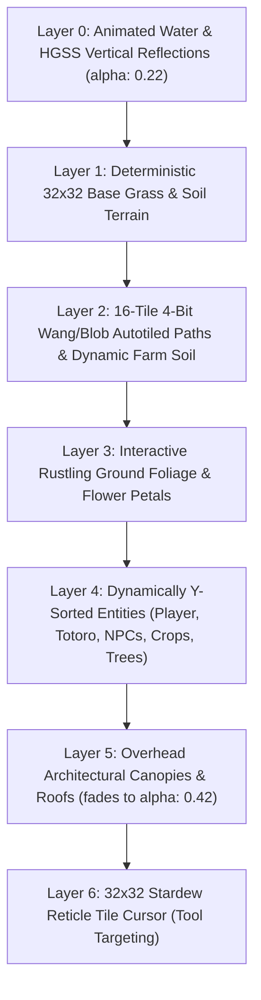
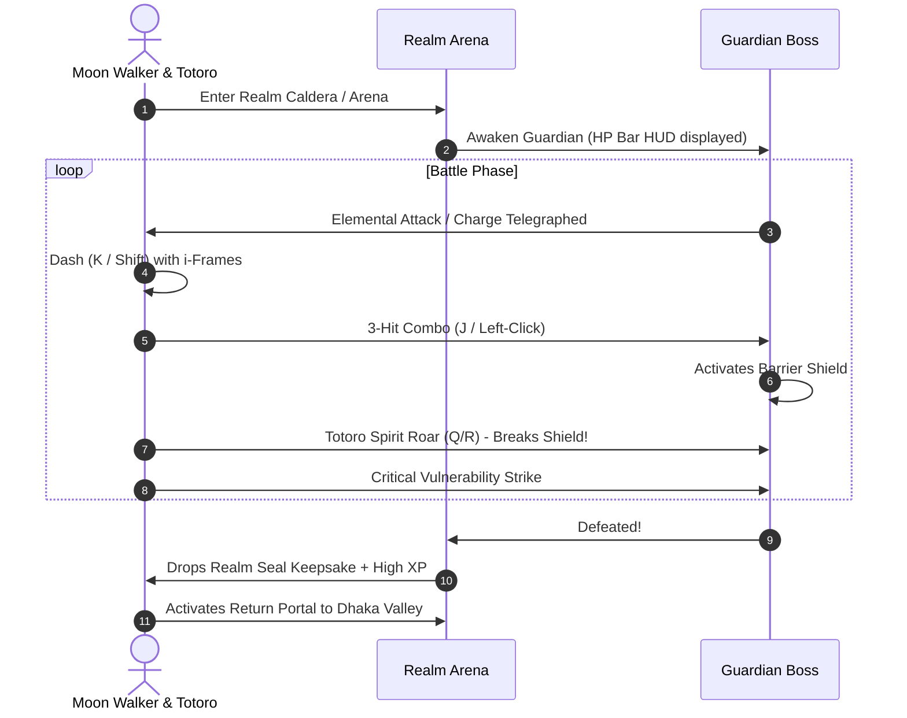

# 🌸 Totoro & Moon Walker: Chronicles of the Six Realms
## Universal Master Game Specification & AI Context Manifest
*Single Source of Truth for Architecture, Lore, World Maps, Mechanics, Characters, and Asset Pipelines*

> ⚠️ **MANDATORY INSTRUCTION FOR ALL FUTURE AI CODING SESSIONS & AGENTS**:
> This document is the definitive, comprehensive context document for **Totoro & Moon Walker: Chronicles of the Six Realms**. Any AI assistant or developer modifying, extending, refactoring, or updating this codebase **MUST UPDATE THIS FILE (`GAME_CONTEXT.md`)** in the exact same turn to reflect all changes, new mechanics, questlines, NPC dialogues, asset bindings, or configuration updates. Never let this document desynchronize from the repository state.

---

## 📑 Table of Contents
1. [Executive Summary & Game Overview](#1-executive-summary--game-overview)
2. [Technical Architecture & Stack](#2-technical-architecture--stack)
3. [World Map Directory (8 Playable Environments)](#3-world-map-directory-8-playable-environments)
4. [Protagonists & Companion System](#4-protagonists--companion-system)
5. [Complete Overworld Character Directory (32 NPCs)](#5-complete-overworld-character-directory-32-npcs)
6. [Dhaka Heritage Date Activities & Mini-Quests](#6-dhaka-heritage-date-activities--mini-quests)
7. [Stardew Valley 32×32 Grid & Farming Engine](#7-stardew-valley-3232-grid--farming-engine)
8. [Action RPG Combat, Guardian Bosses & Progression](#8-action-rpg-combat-guardian-bosses--progression)
9. [Atmosphere, Weather & Calendar Time Engine](#9-atmosphere-weather--calendar-time-engine)
10. [Audio Pipeline & SoundEngine Architecture](#10-audio-pipeline--soundengine-architecture)
11. [Hybrid External/Procedural Asset Adapter & Specifications](#11-hybrid-externalprocedural-asset-adapter--specifications)
12. [State Management, Quests & Persistence](#12-state-management-quests--persistence)
13. [Deployment, Build Commands & Verification Protocol](#13-deployment-build-commands--verification-protocol)
14. [Protocol for Future AI Modifications](#14-protocol-for-future-ai-modifications)

---

## 1. Executive Summary & Game Overview

**Totoro & Moon Walker: Chronicles of the Six Realms** (also known as *Dhaka Date RPG*) is a rich top-down 2D Life-Sim & Action RPG set in the vibrant cultural heart of Dhaka, Bangladesh (Curzon Hall, Fuller Road, TSC, Nilkhet, Charukola, and Dhanmondi Lake) intertwined with Ghibli fantasy realms. 

Players assume the role of **Moon Walker** (inspired by Satsuki Kusakabe from Studio Ghibli's *My Neighbor Totoro*), accompanied by the giant forest spirit **Totoro**. Together, they explore a nostalgic 16-bit retro world rendered on an authentic **Stardew Valley & Pokémon HeartGold/SoulSilver (HGSS) 32×32 pixel grid**. 

The narrative bridges real-world Dhaka romance and campus nostalgia (sipping clay-cup malai cha at TSC, crunching spicy Naga fuchka, exploring antique books at Nilkhet, listening to acoustic folk songs, riding painted cycle rickshaws, and stargazing from lantern rowboats on Dhanmondi Lake) with an epic multi-realm journey to heal a reality-shattering **Chrono-Fracture** across six mystical realms.

---

## 2. Technical Architecture & Stack

| Layer | Technology | Details |
| :--- | :--- | :--- |
| **Game Engine** | [Phaser 3.87.0](https://phaser.io/) | Canvas/WebGL 2D renderer, Arcade Physics, Custom Y-sorting, Multi-camera system |
| **Build & Tooling** | [Vite 8](https://vitejs.dev/) | Ultra-fast HMR dev server, ES module bundling, tree-shaking |
| **Language** | [TypeScript 7.x](https://www.typescriptlang.org/) | Strict typing, full interfaces for state, items, crops, and asset specs |
| **Testing** | [Vitest](https://vitest.dev/) | Unit & regression testing for state, combat calculations, and farming systems |
| **Audio Engine** | Web Audio API + HTML5 Audio | Dual-player 400ms cross-fading BGM player, 6-channel pooled SFX, Web Audio synth fallback |
| **Graphic Pipeline** | Hybrid External / Procedural | External PNG overrides with auto-integer 2× nearest-neighbor upscaling + procedural canvas fallback |
| **Hosting & CI/CD** | [Vercel](https://vercel.com/) | Live production deployment at `https://moonwalkersday.vercel.app` |

### Source Code Directory Layout
```
dhaka-date-rpg/
├── GAME_CONTEXT.md                  # Universal Master Game Specification (THIS FILE)
├── index.html                       # Application entry point with responsive retro UI HUD
├── package.json                     # Node dependencies, scripts, and build targets
├── tsconfig.json                    # TypeScript compiler options
├── vite.config.ts                   # Vite bundler configuration
├── public/                          # Static public assets
│   ├── assets/
│   │   ├── audio/                   # Compressed BGM tracks & 16-channel SFX
│   │   ├── sprites/characters/      # Normalized external character & companion spritesheets
│   │   └── tilesets/                # Normalized external tileset sheets (16x16 and 32x32)
└── src/
    ├── audio/
    │   └── SoundEngine.ts           # Web Audio synthesizer, BGM crossfader, and SFX pool
    ├── config/
    │   ├── assetSpecs.manifest.ts   # AI-readable asset requirements manifest
    │   ├── constants.ts             # World dimensions, coordinate anchors, tile constants
    │   ├── crops.db.ts              # Seasonal crops, growth stages, yields, sell values
    │   ├── items.db.ts              # Weapons, armor, keepsakes, food, materials database
    │   ├── recipes.db.ts            # Crafting recipes & material requirements
    │   └── worlds.db.ts             # 6 Realms + Curzon Interior + Farmhouse definitions
    ├── graphics/
    │   ├── CharacterSpriteGenerator.ts # Procedural pixel art character generator
    │   ├── CreatureSpriteGenerator.ts  # Procedural bosses, enemies, and farm animals
    │   ├── ExternalAssetAdapter.ts     # Universal external asset normalizer & 2x upscaler
    │   ├── GroundTileGenerator.ts      # 32x32 terrain, autotile bitmasks, water textures
    │   ├── LandmarkGenerator.ts        # Heritage buildings, stalls, rickshaws, props
    │   └── TextureGenerator.ts         # Central procedural texture builder
    ├── main.ts                      # Phaser game bootstrap & window lifecycle
    ├── scenes/
    │   └── DhakaValleyScene.ts      # Core scene coordinating rendering, dialogue, input & world state
    ├── state/
    │   ├── DateState.ts             # Romance affection, quest stages, inventory, world state
    │   ├── RPGStats.ts              # Combat stats (HP/SP/XP/Level/ATK/DEF), level curve
    │   └── SaveManager.ts           # LocalStorage serialization & cloud save engine
    ├── systems/
    │   ├── AtmosphereSystem.ts      # Real-time color grading, shadows, weather lighting
    │   ├── CombatSystem.ts          # Hitbox calculations, combos, dashes, cooldowns
    │   ├── FarmingSystem.ts         # 32x32 grid tilling, watering, crop growth simulation
    │   ├── ScheduleSystem.ts        # NPC waypoint pathfinding & dynamic 4-dir animation
    │   ├── TimeCalendarSystem.ts    # Day/Night clock, seasonal progression, minute events
    │   └── WeatherSystem.ts         # Rain particles, puddles, lightning, wind gusts
    ├── types/
    │   ├── rpg.types.ts             # Combat, stats, items, recipes, dialog interfaces
    │   └── stardew.types.ts         # 32x32 grid, farming, crops, calendar interfaces
    └── ui/
        └── UIController.ts          # DOM HUD controller (Bag, Craft, Dialogue, Quests, Stats)
```

---

## 3. World Map Directory (8 Playable Environments)

The game features **8 fully realized playable maps**. Outdoor realms use an **80 × 60 tile (2560 × 1920 px)** Stardew/HGSS layout; interior and pastoral farmstead maps use a **40 × 30 tile (1280 × 960 px)** layout.

| Map ID | Display Name & Subtitle | Size (Tiles & Px) | Atmosphere / Theme | Key Landmarks & Features |
| :--- | :--- | :--- | :--- | :--- |
| `dhaka` | **Dhaka Valley**<br>*Curzon Hall, TSC, Nilkhet & Dhanmondi Lake* | 80 × 60<br>(2560 × 1920) | Lush green, warm sunshine, falling Krishnachura petals | Curzon Hall facade, TSC Tea Stall, Nilkhet Boiwala, Charukola Art Studio, Mintu Rd Fountain Plaza, Rickshaw Tour, Dhanmondi Lake Pier & Stargazing Telescope, Realm Portal. |
| `forest` | **Whispering Emerald Forest**<br>*Ancient Spirit Groves & Briar Sanctuary* | 80 × 60<br>(2560 × 1920) | Deep moss green, luminous cyan bioluminescence | Ancient Spirit Altar, North Banyan Tree (Ananya Ghost), Southwest Marsh (Kofil Chacha), Northeast Ruins (Prof. Shamsher), Sylvan Briar Stag Boss Arena. |
| `sunken` | **Sunken Kingdom**<br>*Coral Temples, Tidepools & Lost Relics* | 80 × 60<br>(2560 × 1920) | Azure cyan, underwater caustic rays, tide ripples | Coral Pillars, Tidekeeper Marina Shrine, Luminous Coral Tidepools, Abyssal Coral Leviathan Caldera. |
| `ember` | **Emberfall Highlands**<br>*Obsidian Forges, Lava Bridges & Dragon Territory* | 80 × 60<br>(2560 × 1920) | Volcanic amber-orange, magma embers, obsidian rock | Basalt lava bridges, Master Blacksmith Kael's Forge, Volcanic Ore veins, Ignis the Magma Drake Caldera. |
| `frost` | **Kingdom of Eternal Frost**<br>*Frozen Starlight Observatory & Glacier Ruins* | 80 × 60<br>(2560 × 1920) | Crisp glacial blue, falling snowflakes, starlight | Frozen Brass Telescope, Astronomer Lyra's Observatory, Cryo Star Berry groves, Cryon the Frost Warden Barrier. |
| `astral` | **The Astral Realm**<br>*Floating Celestial Sanctuary & Nexus of Memory* | 80 × 60<br>(2560 × 1920) | Deep cosmic violet, floating stardust, golden nebula | Celestial Chronicler Dais, Memory Anchor Pedestals, Chrono-Fracture Archon Final Arena. |
| `curzon_interior` | **Curzon Hall: Faculty of Science**<br>*Auditorium, Bose Quantum Lab & Herbarium* | 40 × 30<br>(1280 × 960) | Teak parquet flooring, velvet runners, brass chandeliers | Central Mathematics Dais (Prof. Motahar Hossain), Bose Quantum Lab (Prof. Satyendra & Faiza), Botanical Herbarium & Chemistry Lab (Prof. Sultana, Dr. Kabir, Tanvir). |
| `farmhouse` | **Green Meadows Farmhouse**<br>*Chacha Rafiq’s Pastoral Sanctuary & Animal Pastures* | 40 × 30<br>(1280 × 960) | Pastoral meadow, rural fences, duckling pond, sunflowers | Chacha Rafiq's Barn & Silo, 32×32 Tilled Crop Plots, Cow Pasture (Shuravi), Goat Pen (Kalu), Hen Coop (Tuntuni), Duckling Pond (Piku). |

---

## 4. Protagonists & Companion System

### Moon Walker (Satsuki Kusakabe)
- **Visual Design**: Authentic Pokémon GBA/HGSS 16×32 native pixel art (upscaled 2× nearest-neighbor to 32×64 px). Short dark brown bob haircut, bright yellow collared short-sleeve shirt, orange-amber pinafore suspender dress, white ankle socks, dark brown loafers.
- **Role & Mechanics**: Player-controlled protagonist. Features 4-directional walk cycles (`player-walk-down`, `player-walk-left`, `player-walk-right`, `player-walk-up`). Controls parasol strikes, dash dodges, hoeing soil, watering crops, item interaction, and dialogue triggers.
- **Origin**: Inspired by Satsuki from Studio Ghibli's *My Neighbor Totoro*, embodying courageous curiosity, sisterly warmth, and devotion to nature.

### Totoro (Forest Spirit Avatar of Shared Affection)
- **Visual Design**: Authentic Ghibli giant grey forest spirit, scaled to a substantial 68×76 px footprint (~2.5 grid tiles tall). Slate-grey body, cream-colored belly with dark chevron markings, pointed rabbit-like ears, wide round white eyes with dark pupils and catchlights, whiskers, holding a green taro leaf umbrella overhead.
- **Role & Mechanics**: Follows Moon Walker through a 16-point trailing history array with natural rubber-band smoothing. Interacts during dialogues with comforting, whimsical commentary.
- **Combat Abilities**:
  - **Spirit Roar (`Q` / `R`)**: Emits a screen-shaking spiritual bellow that breaks enemy armor, stuns mobs in an AoE radius, and shatters Guardian boss barrier shields.
  - **Belly Slam**: Devastating body slam dealing heavy physical/spiritual damage.
  - **Swiftness Aura**: Temporarily boosts Moon Walker's movement speed by +40%.

---

## 5. Complete Overworld Character Directory (32 NPCs)

Every NPC features full 4-directional walk/idle frames, unique portrait icons, localized Dhaka personality, interactive dialogues, and reactive branching questlines.

### Dhaka Valley Overworld Citizens & Vendors
1. **Anamika** (`npc_anamika.png`, Portrait: 🥙): Moon Walker's vibrant, food-loving best friend. Stationed near TSC and Nilkhet. Obsessed with Star Kebab mutton kacchi, spicy brain masala, and cold falooda. Constantly awaiting her long-distance boyfriend Shuvra (arriving by launch from Barishal with fresh Guthia Sandesh). Later co-founds the "Nodi O Jamdani" fashion enterprise with Apshora.
2. **Ahona** (`npc_ahona.png`, Portrait: 😒 / 😢 / 💑): DU student caught in romantic heartbreak and rival tension with Rakin and Apshora. Can be consoled with Beli Gajra flower garlands, leading to heartfelt reconciliation.
3. **Apshora** (`npc_apshora.png`, Portrait: ✨ / 👗 / 👑): Aspiring textile artisan and fashion designer. With Moon Walker's encouragement and Anamika's marketing, launches the "Nodi O Jamdani" handloom studio at Charukola, eventually achieving international runway acclaim in Paris, London, and Dubai.
4. **Rakin** (`npc_rakin.png`, Portrait: 💌): Sincere DU student deeply in love with Ahona. Needs Moon Walker and Totoro's advice to overcome social anxiety and express his genuine feelings.
5. **Salat** (`npc_salat.png`, Portrait: 💬 / 😢 / 💑): Young woman waiting by the Mintu Road Fountain Plaza, feeling emotionally neglected by her workaholic software-engineer boyfriend Enan.
6. **Enan** (`npc_enan.png`, Portrait: 💼 / 📱 / 💑): Ambitious tech engineer glued to his smartphone screen. Totoro intervenes by confiscating or silencing his notifications, teaching him to look up and cherish the present moment with Salat.
7. **Arif (DU Physics Senior)** (`npc_walker1.png`, Portrait: 🎓): Senior physics scholar wandering Fuller Road, quoting wave equations while drinking tea.
8. **Nadia (Charukola Sketcher)** (`npc_walker2.png`, Portrait: 🖌️): Fine arts student sketching open-air terracotta murals, Krishnachura trees, and Totoro.
9. **Mimi (Campus Ginger Cat)** (`npc-cat`, Portrait: 🐱): Beloved stray campus cat that figure-eights around Moon Walker's ankles and curls up against Totoro's warm belly.
10. **Baki Bhai (Nilkhet Poet)** (`npc_walker3.png`, Portrait: 📜): Bohemian lyricist composing spontaneous Urdu and Bengali romantic couplets along the campus pavements.
11. **Sami (Street Photographer)** (`npc_photo.png`, Portrait: 📸): Candid street photographer capturing golden-hour snapshots of couples along Fuller Road and Dhanmondi Lake.
12. **Tania (Dhanmondi Jogger)** (`npc_jogger.png`, Portrait: 👟): Fitness jogger completing morning and evening laps around Ramna and Dhanmondi Lake.
13. **Tong-er Mama** (`npc_tea_vendor.png`, Portrait: ☕): Master tea vendor at the Fuller Road roadside stall, brewing aromatic cardamom-infused Matir Bhaar Malai Cha.
14. **TSC Acoustic Singer** (`npc_guitarist.png`, Portrait: 🎸): Folk guitarist at the TSC rotunda singing classic Bengali campus songs.
15. **Charukola Clay Artist** (`npc_clay_artist.png`, Portrait: 🎨): Terracotta artisan teaching couples how to paint personalized clay mugs.
16. **Nilkhet Boiwala** (`npc_book_vendor.png`, Portrait: 📚): Antique book merchant selling rare poetry anthologies with pressed flowers tucked inside.
17. **Phulwali** (`npc_phulwali.png`, Portrait: 🌸): Young flower seller crafting fragrant garlands of white Beli flowers and crimson roses.
18. **Mama's Naga Fuchka Vendor** (`npc_fuchka_vendor.png`, Portrait: 🥣): Street vendor preparing fiery, tamarind-soaked Naga chili fuchka in crisp puris.
19. **Pabnar Mishti Doi Vendor** (`npc_doi_vendor.png`, Portrait: 🏺): Vendor serving rich caramelized sweetened curd in earthen clay pots.

### Curzon Hall: Faculty of Science Interior NPCs
20. **Prof. Motahar Hossain** (`npc-prof-motahar`, Portrait: ♟️): Chair of Mathematics and chess master stationed at the Central Dais, challenging visitors to logical gambits.
21. **Prof. Satyendra (S.N. Bose)** (`npc_prof_satyendra.png`, Portrait: 🔬): Chair of Physics in the Bose Quantum Lab. Explains Bose-Einstein statistics and administers the Quantum Ground State Quiz (grants +60 XP & Quantum Keepsake).
22. **Faiza (Physics Undergrad)** (`npc_student_faiza.png`, Portrait: 💡): Energetic undergrad conducting laser diffraction and quantum optics experiments.
23. **Prof. Sultana (Botany Chair)** (`npc_prof_sultana.png`, Portrait: 🌿): Head of the Botanical Herbarium, identifying medicinal flora, tea varieties, and rare marsh seeds.
24. **Dr. Kabir (Chemistry Master)** (`npc_dr_kabir.png`, Portrait: ⚗️): Senior chemist synthesizing specialized fertilizers, pigments, and elemental reagents.
25. **Tanvir (Biochemistry Student)** (`npc_student_tanvir.png`, Portrait: 🧬): Graduate researcher studying agricultural enzymes and soil bio-enhancement.

### Green Meadows Farmhouse Pastoral NPCs & Animals
26. **Chacha Rafiq (Farm Master)** (`npc_farmer_rafiq.png`, Portrait: 🌾): Veteran farmer who gifts Moon Walker the Starter Hoe & Watering Can, teaching soil stewardship and seed sowing.
27. **Shuravi the Dairy Cow** (`npc-cow`, Portrait: 🐄): Placid Holstein dairy cow that responds with joyful moos and yields rich cream when brushed and petted.
28. **Kalu the Bengal Black Goat** (`npc-goat`, Portrait: 🐐): Playful pasture goat that loves head scratches and munches on leftover crop leaves.
29. **Tuntuni the Free-Range Hen** (`npc-chicken`, Portrait: 🐔): Cheerful farm hen that pecks at grain seeds and drops farm-fresh eggs.
30. **Piku the White Duckling** (`npc-duck`, Portrait: 🦆): Energetic duckling paddling in the farmhouse pond, splashing water on hot afternoons.

### Expedition Realms: Sages, Ghosts & Guardians
31. **Elder Banyan Sage** (`npc_sage.png`, Portrait: 🌿, Whispering Emerald Forest): Ancient guardian spirit offering the Forest Blessing (full HP/SP restore) and guidance on the Chrono-Fracture.
32. **Ananya the Weeping Petni** (`npc_ananya_ghost.png`, Portrait: 👻, Forest North Banyan): Grieving ghost whose sorrow stems from forgotten promises; consoled during the Ancient Spirit Altar seance.
33. **Kofil Chacha (Phantom Rickshaw Puller)** (`npc_kofil_ghost.png`, Portrait: 🛺, Forest Southwest Marsh): Ghostly rickshaw puller trapped in an eternal route; guided to rest with warm tea and compassion.
34. **Prof. Shamsher (Occult Investigator)** (`npc_shamsher.png`, Portrait: 📻, Forest Northeast Ruins): Paranormal researcher enchanted by the Nishi (Night Caller), rescued by Totoro's roar.
35. **Tidekeeper Marina** (`npc_marina.png`, Portrait: 🐚, Sunken Kingdom): Mermaid priestess protecting luminous coral reefs; grants the Ocean Blessing.
36. **Master Blacksmith Kael** (`npc_kael.png`, Portrait: ⚒️, Emberfall Highlands): Volcanic blacksmith who tempers legendary weapons using Volcanic Ember Ore.
37. **Astronomer Lyra** (`npc_lyra.png`, Portrait: ❄️, Kingdom of Eternal Frost): Celestial stargazer tracking the 4 Dhaka constellations; provides the Starlight Blessing.
38. **Celestial Chronicler** (`npc_chronicler.png`, Portrait: 🌟, Astral Sanctuary): Transcendent observer who reveals that memories forged in love are indestructible anchors against the void.

---

## 6. Dhaka Heritage Date Activities & Mini-Quests

The romance progression is measured through **Affection Hearts (0–100%)**, tracked in `DateState.ts`. Engaging in classic Dhaka date activities deepens the bond between Moon Walker and Totoro, unlocking special dialogue and keepsakes.

| Activity | Location & Coordinates | Description & Mechanics | Rewards & Impact |
| :--- | :--- | :--- | :--- |
| **Tong-er Malai Cha** | Fuller Road (`x: 272, y: 304`) | Savor piping-hot cardamom milk tea in earthen clay cups (`matir bhaar`). Features authentic tea clinking sound effects (`tea_clink.wav`). | +12 Affection, HP/SP restored, grants `item_malai_cha`. |
| **Mama's Naga Fuchka** | Curzon North (`x: 1584, y: 272`) | Street food tasting with crispy puris filled with spiced potato and fiery Naga chili tamarind water. | +15 Affection, grants `item_naga_fuchka`. |
| **Nilkhet Old Book Hunt** | Nilkhet Lane (`x: 1072, y: 272`) | Browse dusty bookshelves for vintage poetry collections; discover pressed Krishnachura blossoms between yellowed pages. | +15 Affection, grants `book_poetry` keepsake. |
| **Charukola Terracotta** | Charukola Wall (`x: 240, y: 752`) | Paint clay cups and terracotta ornaments together under the ancient banyan shade. | +18 Affection, grants `keepsake_painted_mug`. |
| **Beli Gajra Garland** | Flower Cart (`x: 1264, y: 528`) | Purchase hand-strung fragrant white Beli flower garlands and tie them around the wrist or hair. | +14 Affection, grants `flower_beli_garland`. |
| **Pabnar Mishti Doi** | Sweet Stall (`x: 1744, y: 272`) | Taste thick, creamy, caramelized sweet yogurt served in earthen pots. | +10 Affection, boosts stamina recovery. |
| **Grand Rickshaw Tour** | Fuller Roadway (`x: 1648, y: 816`) | Board an intricately painted cycle rickshaw for an automated scenic tour across Fuller Road with rhythmic rickshaw bells (`rickshaw_bell.wav`). | +25 Affection, full stamina recovery, panorama view. |
| **Stargazing Telescope** | Lake Pier (`x: 1776, y: 1328`) | Peer through the brass telescope at dusk to chart 4 custom celestial constellations: The Starry Rickshaw, The Crescent Moon, The Krishnachura, and The Guardian Spirit. | +22 Affection, charts constellations in skybox. |
| **Lantern Rowboat Finale** | Dhanmondi Lake (`x: 1904, y: 1328`) | The romantic climax of the date. Row across calm waters illuminated by floating paper lanterns and vertical water reflections. | +30 Affection, unlocks Date Completion Confession Cutscene. |
| **Bose Quantum Quiz** | Curzon Lab (`x: 330, y: 322`) | Answer Prof. Satyendra's physics quiz regarding Bose-Einstein Condensation. | +60 XP, grants `keepsake_quantum_slate`. |

---

## 7. Stardew Valley 32×32 Grid & Farming Engine

The farming simulation is integrated into **Green Meadows Farmhouse** and explorable soil patches in Dhaka Valley, built strictly upon Stardew Valley mechanics.

### The 7-Layer Rendering Pipeline


### Farming Grid Workflow
1. **Soil Preparation (Hoeing)**: Using the Hoe tool on untilled grass turf converts the tile into a **32×32 Tilled Soil cell**. Neighboring tilled cells connect seamlessly via 4-bit Wang bitmasking.
2. **Moisture System (Watering Can)**: Using the Watering Can transitions tilled soil into **Watered Soil** (dark, glistening loam). Soil retains moisture for 24 in-game hours before drying.
3. **Seed Sowing**: Sowing seasonal seeds binds a dynamic `CropEntity` instance to the cell grid.
4. **Growth Stages (0 to 5)**:
   - **Stage 0**: Seed packet in furrow.
   - **Stage 1**: Small green seedling sprout.
   - **Stage 2**: Established stalk / young plant.
   - **Stage 3**: Flowering / budding vegetation.
   - **Stage 4**: Full mature harvestable crop (golden glow particle indicator).
   - **Stage 5**: Regrowth state (for multi-harvest crops like Tea and Mango) or withered post-harvest soil.
5. **Harvesting**: Interacting with mature crops yields items into the inventory, awards Farming XP, and triggers item acquisition fanfares.

### Seasonal Crop Manifest (`src/config/crops.db.ts`)
| Crop ID | Crop Name | Seasons | Seed Item ID | Harvest Item ID | Growth Stages | Regrows? | Sell Price |
| :--- | :--- | :--- | :--- | :--- | :--- | :--- | :--- |
| `rajshahi_mango` | **Rajshahi Fazli Mango** | Summer | `seed_mango` | `fruit_mango` | 4 stages (3 days/stage) | Yes (2 days) | ৳120 |
| `sylhet_tea` | **Sylhet Camellia Tea Bush** | Spring, Monsoon, Autumn | `seed_tea` | `leaves_tea` | 4 stages (2 days/stage) | Yes (1 day) | ৳45 |
| `dhaka_jute` | **Golden Valley Jute** | Monsoon | `seed_jute` | `fiber_jute` | 5 stages (2 days/stage) | No | ৳85 |
| `beli_flower` | **Curzon Beli Garland Bloom** | Spring, Summer | `seed_beli` | `flower_beli` | 4 stages (1 day/stage) | Yes (2 days) | ৳60 |
| `naga_morich` | **Sreemangal Naga Fire Chili**| Summer, Autumn | `seed_naga` | `chili_naga` | 4 stages (2 days/stage) | Yes (3 days) | ৳150 |
| `spirit_dew_melon`| **Whispering Spirit Melon** | Spring, Summer, Autumn | `seed_spirit_melon` | `spirit_dew` | 5 stages (3 days/stage) | No | ৳280 |
| `frost_star_berry`| **Cryo Star Berry** | Winter | `seed_star_berry` | `frost_crystal` | 4 stages (2 days/stage) | Yes (2 days) | ৳220 |

---

## 8. Action RPG Combat, Guardian Bosses & Progression

Combat in the expedition realms combines active top-down hack-and-slash mechanics with companion coordination.

### Combat Mechanics & Keybindings
- **Attack (`J` / Left-Click)**: Three-hit parasol or blade combo. Combo step 1 = quick jab, step 2 = horizontal slash, step 3 = sweeping 360° spin finisher.
- **Dash / Dodge (`K` / Shift)**: Consumes 15 SP. Grants 280ms of invulnerability frames (i-frames) and bursts Moon Walker 95px forward with ghost trail particles.
- **Totoro Spirit Roar (`Q` / `R`)**: Consumes 30 SP. Stuns all surrounding enemies within 140px for 2.2s and instantly breaks Guardian barrier shields.
- **Totoro Belly Slam (`E` when prompted)**: Deals 2.5× physical crushing damage in an area.

### RPG Attributes & Formulas (`src/state/RPGStats.ts`)
- **Health Points (HP)**: Base 100 + `level * 18`. Drops to 0 triggers knocked-out revival at Curzon Hall.
- **Spirit Points (SP)**: Base 60 + `level * 8`. Used for dashes, skills, and parasol specials.
- **Attack Power (ATK)**: `Base (12 + level * 3) + Weapon Bonus`.
- **Defense (DEF)**: `Base (5 + level * 2) + Armor Bonus`. Damage taken formula: `Damage = Math.max(1, IncomingATK - DEF * 0.6)`.
- **Leveling**: XP required for next level: `Math.floor(100 * Math.pow(1.32, level - 1))`. Level cap: 50.

### Realm Enemies & Guardian Bosses (`src/config/worlds.db.ts`)


| Realm | Mob Enemy | Enemy Stats | Guardian Boss | Boss HP / ATK | Unique Drop / Seal |
| :--- | :--- | :--- | :--- | :--- | :--- |
| **Forest** | Briar Bogling | HP: 55, ATK: 10, Drop: `spirit_dew` | **Sylvan Briar Stag** | HP: 260, ATK: 18 | `seal_forest` (Forest Realm Seal) |
| **Sunken** | Tidepool Crabler | HP: 90, ATK: 16, Drop: `coral_shard` | **Abyssal Coral Leviathan** | HP: 420, ATK: 24 | `seal_sunken` (Sunken Realm Seal) |
| **Ember** | Cinder Hound | HP: 135, ATK: 22, Drop: `ember_ore` | **Ignis, the Magma Drake** | HP: 620, ATK: 32 | `seal_ember` (Ember Realm Seal) |
| **Frost** | Glacier Wraith | HP: 180, ATK: 28, Drop: `frost_crystal` | **Cryon, Warden of Eternal Frost**| HP: 850, ATK: 38 | `seal_frost` (Frost Realm Seal) |
| **Astral** | Void Echo | HP: 230, ATK: 34, Drop: `frost_crystal` | **Chrono-Fracture Archon** | HP: 1200, ATK: 45| `seal_astral` (Master Reality Seal) |

### Legendary Weapon Crafting (`src/config/recipes.db.ts`)
- **Coral Tideglaive**: 6× `coral_shard` + 1× `item_parasol` → ATK: +24, Water splash trail.
- **Emberfall Sunblade**: 8× `ember_ore` + 1× `coral_tideglaive` → ATK: +38, Fire ignition strikes.
- **Glacial Starlight Mail**: 10× `frost_crystal` + 4× `fiber_jute` → DEF: +28, Cold damage mitigation.
- **Starlight Crescent Blade**: `seal_forest` + `seal_sunken` + `seal_ember` + `seal_frost` → ATK: +65, Cosmic starlight cleave.

---

## 9. Atmosphere, Weather & Calendar Time Engine

### Atmosphere Lighting & Time Phases (`src/systems/AtmosphereSystem.ts`)
The world lighting transitions dynamically across 6 time phases:
1. **Morning (06:00 – 10:00)**: Warm amber-gold sunlight (`#fff3d1`), light tint `alpha: 0.12`, soft shadows casting west.
2. **Midday (10:00 – 15:00)**: Crisp white-neutral daylight (`#ffffff`), direct overhead contact shadows.
3. **Afternoon (15:00 – 17:30)**: Warm rich honey-orange tint (`#ffe2a0`), lengthening shadows casting east.
4. **Golden Hour / Sunset (17:30 – 19:30)**: Dramatic crimson-rose color grading (`#f472b6` & `#fb923c`), elongated shadows, lantern glows ignite.
5. **Evening / Dusk (19:30 – 22:00)**: Deep indigo ambient overlay (`#1e1b4b`, `alpha: 0.45`), streetlamps and tea-stall candles emit glowing warm radial circles.
6. **Midnight (22:00 – 06:00)**: Cosmic starry midnight blue (`#0f172a`, `alpha: 0.72`), fireflies emerge in green parks, Dhanmondi Lake reflects the crescent moon.

### Weather System (`src/systems/WeatherSystem.ts`)
- **Monsoon Rain**: Diagonal falling rain line streaks, animated splash rings (`puddles`), damp road reflectivity, rolling thunder audio (`sfx_thunder`), and lightning flashes that temporarily illuminate the scene.
- **Wind Gusts**: Periodically sweeps loose Krishnachura blossoms across Fuller Road from west to east.
- **Floating Spores / Snow**: Luminous cyan spores in Emerald Forest, heat embers in Emberfall, and gentle drifting snow crystals in Eternal Frost.

---

## 10. Audio Pipeline & SoundEngine Architecture

The audio engine (`src/audio/SoundEngine.ts`) delivers studio-quality retro immersion with seamless cross-fading and zero stuttering.

### Compressed BGM Tracks (LAME VBR Encoded)
All music tracks are compressed using high-efficiency LAME Variable Bitrate (VBR `-V 5` / `-V 6`, `-q 0`) with 44.1kHz stereo fidelity, preserving high-frequency warmth while reducing initial payload size:
1. **`spirited_away_piano.mp3`** (3.4 MB): Joe Hisaishi's *"One Summer's Day"* piano arrangement. Plays in Curzon Hall Interior, Kingdom of Eternal Frost, and Title Menu.
2. **`totoro_theme.mp3`** (3.5 MB): Joe Hisaishi's *"My Neighbor Totoro Main Theme"* Ghibli chill arrangement. Plays in Dhaka Valley Overworld, Green Meadows Farmhouse, and Whispering Emerald Forest.
3. **`game_bgm.mp3`** (2.5 MB): Original Dhaka Adventure OST. Plays in Sunken Kingdom, Emberfall Highlands, and Boss Arenas.
4. **`menu_theme.mp3`** (2.9 MB): Original Dhaka Lofi Beat (*Rain Over Curzon Hall*). Plays during Monsoon rain storms and evening strolls.

### Dual-Player Cross-Fading Architecture
```
[World Transition / Weather Event]
          │
          ▼
   SoundEngine.setTheme(newTheme)
          │
    ┌─────┴────────────────────────┐
    ▼                              ▼
Player A (Active Track)       Player B (Incoming Track)
  Volume: 0.85 ───► 0.00        Volume: 0.00 ───► 0.85
     (Fades out in 400ms)          (Fades in in 400ms)
```

### 16-Channel SFX Pool (`sfxAudioPool`)
SFX instances are pre-buffered into audio pools of up to 6 simultaneous voices to eliminate browser audio latency:
`slash.wav`, `thrust.wav`, `spin.wav`, `dash.wav`, `enemy_hit.wav`, `player_hurt.wav`, `level_up.wav`, `totoro_roar.wav`, `totoro_slam.wav`, `tea_clink.wav`, `crunch_fuchka.wav`, `rickshaw_bell.wav`, `water_splash.wav`, `portal_warp.wav`, `select.wav`, `item_get.wav`.

---

## 11. Hybrid External/Procedural Asset Adapter & Specifications

The game features a **Hybrid Graphic Pipeline** ensuring **Zero Downtime**:
- External PNG spritesheets are loaded if present in `public/assets/`.
- If an external PNG is missing or fails to load, `ExternalAssetAdapter.ts` intercepts the event and binds the procedural canvas generator from `TextureGenerator.ts` without interrupting gameplay.

### Universal Asset Specification Manifest (`src/config/assetSpecs.manifest.ts`)
Every visual entity is registered with standardized specifications:
- `id`: Internal texture key.
- `category`: `'tileset' | 'autotile' | 'character' | 'companion' | 'landmark' | 'stall' | 'tree' | 'crop' | 'enemy' | 'boss'`.
- `externalPath`: Relative path to target PNG in `public/assets/`.
- `fallbackProceduralKey`: Key of the procedural texture generated by `TextureGenerator.ts`.
- `logicalGridFootprint`: Footprint in 32×32 grid tiles (`cols`, `rows`) and collision box dimensions.
- `recommendedDownloadSpecs`: Preferred frame size, accepted native sizes, sheet layout, and search tags.

### Character Sheet Conventions
- **Human Characters (Moon Walker & 32 NPCs)**:
  - Frame layout: `4 cols × 4 rows`.
  - Row 0: Facing Down (Frames 0–3)
  - Row 1: Facing Left (Frames 4–7)
  - Row 2: Facing Right (Frames 8–11)
  - Row 3: Facing Up (Frames 12–15)
  - Scaling: Native 16×32 or 16×24 pixel art is automatically upscaled **2× nearest-neighbor** (`ctx.imageSmoothingEnabled = false`) to 32×64 or 32×48 px so pixels remain razor-sharp.
- **Totoro Companion**:
  - Footprint: `68×76 px` (~2.5 tiles tall).
  - Walk animation: Directional 2-frame or 4-frame waddle cycles with ear and umbrella physics.

### Standardized `@asset-spec` JSDoc Annotation Format
Whenever defining textures or sprites in source code, embed this machine-readable block:
```ts
/**
 * @asset-spec
 * @id prop-teastall
 * @external-png public/assets/sprites/stalls/tsc_teastall.png
 * @fallback-procedural prop-teastall (216x152)
 * @grid-footprint 6x3 tiles (192x96px solid collision base)
 * @visual-size 224x160px (or 112x80px native pixel art upscaled 2x)
 * @origin 0.5, 0.88
 * @frames 1 (static) or 2-4 horizontal frames (animated steam/lights)
 */
```

---

## 12. State Management, Quests & Persistence

All game progress is centralized in `DateState` and `RPGStats`, persisted to `localStorage` under key `'totoro_moonwalker_rpg_save_v2'` via `SaveManager.ts`.

### Key State Fields (`src/state/DateState.ts`)
```ts
export const DateState = {
  currentWorld: 'dhaka',            // Current active map ID
  playerPos: { x: 440, y: 720 },    // Player map coordinates
  totoroJoined: true,               // Whether Totoro is accompanying Moon Walker
  affection: 65,                    // Romance / date affection meter (0-100%)
  taka: 450,                        // Dhaka currency (৳ Taka)
  inventory: [],                    // Array of ItemInstance objects
  equippedWeapon: 'parasol',        // Currently equipped weapon ID
  equippedArmor: 'student_panjabi', // Currently equipped armor ID
  
  // Quest Flags & Progression Stages
  ahonaQuestStage: 0,               // Ahona & Rakin romance questline (0-4)
  apshoraQuestStage: 0,             // Apshora & Anamika fashion atelier (0-4)
  enanQuestStage: 0,                // Salat & Enan digital detox quest (0-5)
  forestSeanceComplete: false,      // Spirit seance for Ananya, Kofil & Shamsher
  boseQuizDone: false,              // Bose-Einstein quantum quiz solved
  bulliesDefeated: false,           // Fuller Road park security event
  
  // Realm Boss Defeat Flags
  bossDefeated_forest: false,
  bossDefeated_sunken: false,
  bossDefeated_ember: false,
  bossDefeated_frost: false,
  bossDefeated_astral: false
};
```

---

## 13. Deployment, Build Commands & Verification Protocol

### Essential Scripts (`package.json`)
- `npm run dev`: Launch local Vite development server on `http://localhost:3000/`.
- `npm run build`: Execute TypeScript type-checking (`tsc -b`) followed by production Vite build to `dist/`.
- `npm run test`: Run the Vitest test suite (`tests/` directory).
- `npm run typecheck`: Run standalone TypeScript syntax and type integrity check.

### Verification Checklist Before Commits
1. Run `npm run typecheck` — zero TypeScript errors.
2. Run `npm run test` — all test suites pass.
3. Run `npm run build` — bundle compiles cleanly with no missing assets.
4. Verify browser rendering via `http://localhost:3000/` or Chrome DevTools.
5. Deploy to Vercel production: `npx vercel --prod --yes`.
6. Live URL: `https://moonwalkersday.vercel.app`.

---

## 14. Protocol for Future AI Modifications

Whenever an AI model, pair programmer, or automated tool touches this repository:
1. **Read `GAME_CONTEXT.md` First**: Obtain full context on characters, maps, coordinates, and mechanics.
2. **Preserve Fallback Guarantees**: Never remove procedural fallbacks in `TextureGenerator.ts` or bypass `ExternalAssetAdapter.ts`.
3. **Preserve Dialogue Integrity**: Maintain the rich cultural Bengali and English dialogues, food names, and authentic Dhaka university landmarks.
4. **Mandatory Synchronization**: If you add an NPC, modify an item, alter world dimensions, or introduce a new system:
   - Update the code.
   - Update `src/config/assetSpecs.manifest.ts`.
   - **Immediately update this document (`GAME_CONTEXT.md`)** to reflect the new state.

*Last Updated: Current Session — Production Certified v2.5.0*
