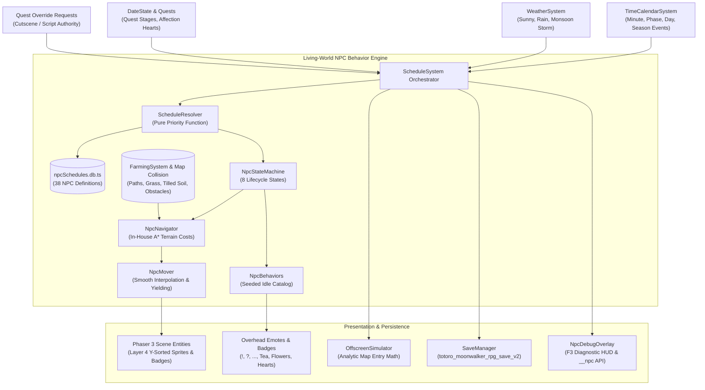
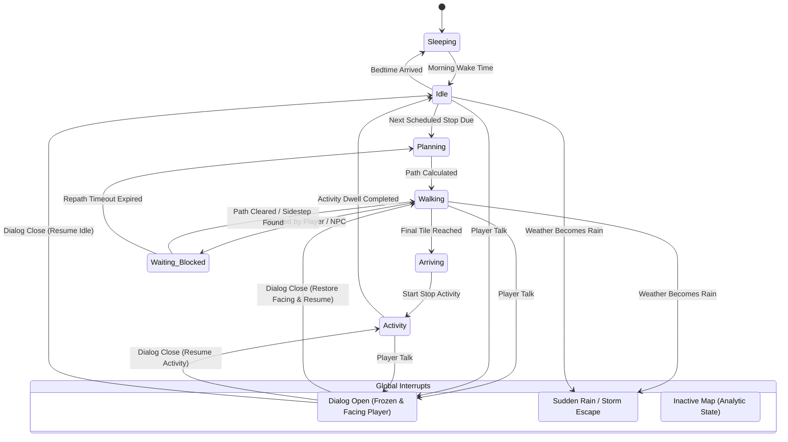

# Phase 2: Design Specification — Living-World NPC Behavior Engine

**Project**: *Totoro & Moon Walker: Chronicles of the Six Realms*  
**Date**: October 18, 2026  
**Author**: Systems & Gameplay Architecture Agent  

---

## 1. Architectural Overview & Component Diagram

The **Living-World NPC Behavior Engine** follows a strict separation of concerns into five modular layers:
1. **Planner Layer (`ScheduleResolver.ts`)**: Pure deterministic evaluation of calendar, clock, weather, quest stage, and affection into the active `ScheduleVariant` and current `ScheduleStop`.
2. **Navigation Layer (`NpcNavigator.ts`)**: In-house 2D grid A* pathfinding with discrete terrain costs (path, grass, flower beds, tilled soil, crops) and multi-map door warp routing.
3. **Movement & Physics Layer (`NpcMover.ts`)**: Tile-step advancement with smooth pixel interpolation, velocity-matched walk animations (Row 0=Down, Row 1=Left, Row 2=Right, Row 3=Up), obstacle yielding, and sidestepping.
4. **Behavior & State Layer (`NpcStateMachine.ts` / `NpcBehaviors.ts`)**: 8-state FSM handling sleeping, idling, noticing the player, sheltering from rain, and ambient idle activities (sweeping, brewing tea, sketching, petting animals).
5. **Presentation & Simulation Layer (`ScheduleSystem.ts` / `OffscreenSimulator.ts` / `NpcDebugOverlay.ts`)**: Active-map sprite orchestration, analytic offscreen coordinate resolution upon map entry, and F3 diagnostic HUD.



---

## 2. Core TypeScript Schemas (`src/types/npc.types.ts`)

```ts
export type Facing = 'down' | 'left' | 'right' | 'up';
export type DayPhase = 'dawn' | 'morning' | 'afternoon' | 'sunset' | 'night' | 'midnight';
export type SeasonId = 'spring' | 'summer' | 'monsoon' | 'autumn' | 'winter';
export type WeatherId = 'sunny' | 'breezy' | 'rainy' | 'monsoon' | 'storm' | 'foggy';
export type DayOfWeek = 'mon' | 'tue' | 'wed' | 'thu' | 'fri' | 'sat' | 'sun';
export type MapId = 'dhaka' | 'forest' | 'sunken' | 'ember' | 'frost' | 'astral' | 'curzon_interior' | 'farmhouse';

export type NpcState = 
  | 'sleeping' 
  | 'idle' 
  | 'planning' 
  | 'walking' 
  | 'waiting_blocked' 
  | 'arriving' 
  | 'activity' 
  | 'interacting' 
  | 'sheltering' 
  | 'offscreen';

export type ActivityId = 
  | 'none'
  | 'sleep'
  | 'sweep'
  | 'brew_tea'
  | 'sip_tea'
  | 'sketch'
  | 'compose_poetry'
  | 'take_photos'
  | 'jog_stretch'
  | 'play_guitar'
  | 'sell_fuchka'
  | 'sell_doi'
  | 'weave_garland'
  | 'browse_books'
  | 'sculpt_clay'
  | 'read_book'
  | 'study_quantum'
  | 'tend_herbarium'
  | 'mix_chemicals'
  | 'farm_feed_chickens'
  | 'farm_milk_cow'
  | 'farm_field_work'
  | 'graze'
  | 'nap_sun'
  | 'cat_purr'
  | 'shelter_rain';

export interface ScheduleCondition {
  seasons?: SeasonId[];
  days?: DayOfWeek[];
  dates?: { season: SeasonId; day: number }[]; // 1 to 28
  weather?: WeatherId[];
  isRaining?: boolean;
  affection?: { min?: number; max?: number }; // 0 to 100
  quest?: { flag: string; equals: unknown; min?: number; max?: number }[];
}

export interface ScheduleStop {
  id?: string;
  at: string | { phase: DayPhase; offsetMin?: number }; // e.g. "06:30" or { phase: 'morning', offsetMin: 15 }
  map: MapId;
  tile: { col: number; row: number }; // col (0-79 outdoor, 0-39 indoor), row (0-59 outdoor, 0-29 indoor)
  facing: Facing;
  activity?: ActivityId;
  dwellMin?: number;
  interruptible?: boolean; // defaults to true; if false, cannot talk
  dialogueKey?: string; // variant-specific dialogue node
}

export interface ScheduleVariant {
  id: string;
  priority: number; // Higher number wins; ties with overlapping conditions are validation errors
  when: ScheduleCondition;
  stops: ScheduleStop[];
}

export interface IdleBehaviorDef {
  id: ActivityId;
  weight: number;
  minDurationSec: number;
  maxDurationSec: number;
}

export interface MovementProfile {
  speedTilesPerSec: number; // e.g., Tania = 2.4, Baki Bhai = 1.4, Rafiq = 1.6
  stepStyle: 'tile-step' | 'smooth';
  idleBehaviors: IdleBehaviorDef[];
  noticePlayerRadiusTiles: number; // e.g. 2 tiles
  personalSpaceTiles: number; // e.g. 1 tile
  patience: {
    waitSec: number; // Wait duration before sidestepping/emoting (default 2.0s)
    repathAfterSec: number; // Duration before seeking alternative path (default 4.0s)
  };
  pathCosts: {
    path: number; // 1.0 (paved walkways)
    grass: number; // 2.0 (open turf)
    flowers: number; // 5.0 (flower beds discouraged)
    tilledSoil: number | 'blocked'; // 999.0 or blocked (never trample crops)
  };
}

export interface NpcScheduleDef {
  npcId: string;
  displayName: string;
  tier: 'A' | 'B' | 'C' | 'D'; // Tier A: Citizens, Tier B: Curzon, Tier C: Farm, Tier D: Realms
  home: { map: MapId; tile: { col: number; row: number } };
  sleep: { map: MapId; tile: { col: number; row: number } };
  movement: MovementProfile;
  variants: ScheduleVariant[];
  fallback: ScheduleStop[]; // Default schedule that is always valid
}
```

---

## 3. Deterministic Schedule Resolver Rules

### 3.1 Context Pure Function
The resolver is a pure function:
$$\text{resolveSchedule}(npcDef, ctx) \rightarrow \text{ScheduleVariant}$$
Where `ctx` contains:
- `clock`: `{ hour: number, minute: number, totalMinutes: number }`
- `season`: `SeasonId`
- `day`: `number` (1 to 28)
- `dayOfWeek`: `DayOfWeek` (`'mon'` to `'sun'`)
- `weather`: `WeatherId`
- `isRaining`: `boolean`
- `affection`: `number` (from `DateState.hearts` or `DateState.affection`)
- `questFlags`: `Record<string, unknown>` (from `DateState`)
- `activeOverride`: `ScheduleOverrideRequest | null`

### 3.2 Evaluation Order & Priority Hierarchy
1. **Scripted Override Request**: If a quest cutscene has issued a lock override (e.g. `playApshoraAnamikaPitchCutscene`), this override takes absolute precedence (Priority 9999).
2. **Condition Matching**: Filter all variants in `npcDef.variants` where **every** specified clause in `when` matches `ctx`.
3. **Numeric Priority Selection**: From all matching variants, select the variant with the highest `priority`.
4. **Tie Resolution**: If two matching variants share the exact same highest priority, the build-time validator flags this as a fatal authoring error. In production, the first defined variant is selected as a defensive fallback.
5. **Default Fallback**: If no variant matches, wrap `npcDef.fallback` in a synthesized fallback variant (`priority: 0`).

---

## 4. NPC Finite State Machine (8 States + Global Interrupts)



---

## 5. The 12 Walking Manners (Specifications)

1. **Facing & Direction Alignment**:
   - Travel direction strictly governs sprite row:
     - Down ($\Delta y > 0$): Row 0, frames 0–3
     - Left ($\Delta x < 0$): Row 1, frames 4–7
     - Right ($\Delta x > 0$): Row 2, frames 8–11
     - Up ($\Delta y < 0$): Row 3, frames 12–15
   - Idle pose is strictly Frame 0 of the current facing row.
   - Walk animation rate is dynamically scaled to actual ground speed: `animRate = (speed / 1.5) * baseRate`. Zero sliding or moonwalking.
2. **Personality Pacing**:
   - `Tania (jogger)`: 2.4 tiles/sec (fastest human).
   - `Moon Walker (player)`: 2.25 tiles/sec base, 2.75 tiles/sec swift.
   - `Arif / Anamika / Nadia`: 1.8 tiles/sec (standard brisk campus walk).
   - `Prof. Motahar / Chacha Rafiq / Baki Bhai`: 1.4 tiles/sec (measured elderly/poet stroll).
   - `Late Rush`: If an NPC is $> 15$ in-game minutes behind schedule, their speed increases by $+25\%$.
   - `Night Tiredness`: Between 22:00 and 02:00, walking speed decreases by $-15\%$.
3. **Terrain Path Preference (In-House A*)**:
   - Path cost grid:
     - Paved roads / autotile paths: **1.0**
     - Untilled grass / lawns: **2.0**
     - Flower beds / ornamental foliage: **5.0**
     - Tilled farm soil (`isTilled`): **999.0** (heavily penalized, path around)
     - Growing crops (`crop !== null`): **Blocked** (impassable)
     - Solid obstacles / water / fences: **Blocked**
4. **Orthogonal Movement Only**:
   - 4-directional cardinal movement ($N, S, E, W$). No cutting diagonally across corner colliders.
5. **Yielding & Non-Destructive Blocking**:
   - **NPC-vs-Player**: If the player stands on an NPC's target step, NPC enters `waiting_blocked` for `waitSec` (2.0s), displays a `"..."` emote. If still blocked, tests orthogonal sidestep tiles. If path remains completely closed after `repathAfterSec` (4.0s), requests a new A* path.
   - **NPC-vs-NPC**: The NPC with the lower `priority` yields and pauses for 1.2s to allow the higher-priority NPC to pass.
   - **Teleport Safety**: NPCs *never* visibly pop or teleport in front of the camera. Position snapping is strictly restricted to offscreen entities.
6. **Personal Space & Noticing**:
   - When Moon Walker enters `noticePlayerRadiusTiles` (2 tiles = 64 px), the NPC's head turns to face Moon Walker (HGSS-style look-at) with a tiny probability of an ambient greeting emote (`"👋"`, `"✨"`, `"☕"`).
   - When the player presses talk, the NPC immediately enters `interacting`, freezes in place, faces the player, and preserves their previous orientation. Upon dialogue dismissal, the previous facing is restored and the path resumes.
7. **Idle Flavor at Stops**:
   - While dwelling at a scheduled stop, NPCs cycle through weighted idle behaviors:
     - `Tong-er Mama`: Brewing tea, clinking matir bhaar, wiping counter.
     - `Baki Bhai`: Pacing 1 tile, writing in notepad, gazing at Krishnachura canopy.
     - `Nadia`: Sketching, sharpening charcoal, tilting head.
     - `Sami`: Adjusting camera lens, peering through viewfinder, checking light.
     - `Mimi`: Stretching, curling into a ball, licking paw.
8. **Pair & Group Walking (`walkWith`)**:
   - Reconciled couples (e.g. `Ahona & Rakin` at stage 4) or business partners (`Anamika & Apshora`) use leader-follower chaining. The follower uses the same 16-point trailing history buffer proven by Totoro, maintaining a 1.2-tile gap behind the leader.
9. **Doors & Multi-Map Transitions**:
   - When an NPC needs to cross from `dhaka` into `curzon_interior` or `farmhouse`:
     1. Paths to the exact doorway trigger tile.
     2. Fades out over 300ms.
     3. Unregisters from current active map scene.
     4. Spawns at destination map entrance door tile.
     5. Fades in and resumes pathing.
10. **Depth Sorting & Overhead Roofs**:
    - All NPCs exist on **Layer 4** with dynamic Y-sorting: `setDepth(y)`.
    - Under awnings (TSC rotunda, Curzon portico, stall roofs), NPCs trigger the same Layer 5 alpha transparency (0.42) as the player when standing under covered tiles.
11. **Animals & Pastoral Creatures (Tier C)**:
    - Farm animals (`Shuravi`, `Kalu`, `Tuntuni`, `Piku`) and `Mimi` use **roaming-in-bounds** state profiles rather than linear timetable routes:
      - Day: Roams within pasture fences, duckling pond, or campus lawns.
      - Night: Automatically moves inside barn, goat shed, or hen coop.
      - Rain: Retreats to covered sheds immediately.
      - Totoro Proximity: Mimi seeks out Totoro when within 4 tiles, purring and napping against his belly.
12. **Context-Sensitive Dialogue Pacing**:
    - NPCs select dialogue based on `dialogueKey` matching `(timeOfDay, weather, affectionTier)`.
    - All existing original dialogues and quest choice trees are preserved 100% as fallbacks.

---

## 6. Offscreen Simulation Math

When the player enters a map:
1. For every NPC whose active variant places them on this map at the current in-game time $T$:
   - If $T$ is within stop $S_i$'s dwell window:
     $$\text{tile} = S_i.\text{tile}, \quad \text{facing} = S_i.\text{facing}, \quad \text{state} = \text{'activity'}$$
   - If the NPC is currently en-route between stop $S_{i-1}$ (departed at $T_{\text{dep}}$) and stop $S_i$ (arrives at $T_{\text{arr}}$):
     $$\text{progress} = \frac{T - T_{\text{dep}}}{T_{\text{arr}} - T_{\text{dep}}}$$
     $$\text{pathIndex} = \lfloor \text{progress} \times (\text{totalPathNodes} - 1) \rfloor$$
     $$\text{tile} = \text{cachedPath}[\text{pathIndex}]$$
2. The NPC is spawned directly at this calculated coordinate with zero visible sliding or teleportation.

---

## 7. Weather, Atmosphere & Night-Gated Spirits

- **Kalbaishakhi Monsoon Rain / Storm**:
  - Automatically switches all Tier A/B/C NPCs to their `rain` variant.
  - Vendors retreat under stall roofs; Tania suspends jogging; Sami shoots from under the TSC rotunda; farm animals enter the barn.
  - NPCs render an umbrella accessory (procedurally drawn fallback if external asset is absent).
- **Golden Hour / Dusk (17:30 – 19:30)**:
  - Street photographers congregate near Dhanmondi Lake; Nilkhet Boiwala packs vintage books; street lamps begin warm flickering.
- **Midnight (22:00 – 06:00)**:
  - Human citizens retire to home/dormitory tiles or are marked off-map.
  - Whispering Emerald Forest night spirits become active:
    - `Ananya the Weeping Petni`: Spawns at North Banyan (`x: 740, y: 380`).
    - `Kofil Chacha`: Glides along southwest marsh route with phantom rickshaw.
    - `Prof. Shamsher`: Records EVP static at the Northeast Ruins.
    - When it rains at night, spirit aura opacity and particle emission increase by $+50\%$.
