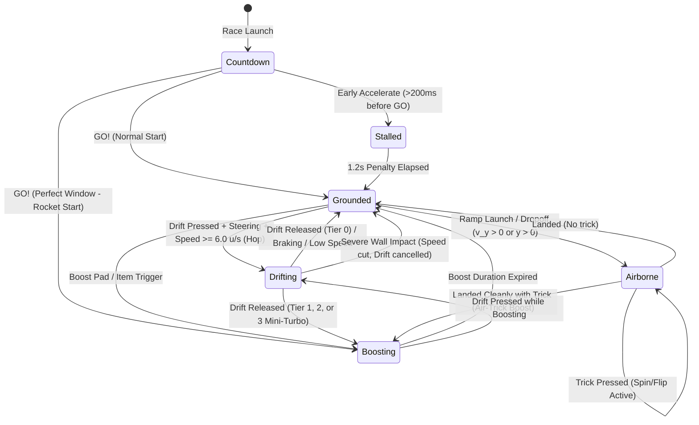

# Kart Architecture & State Machine Design Specification (M2)

**Author:** Minigame Core Architecture Team  
**Date:** October 26, 2026  
**Milestone:** M2 — Kart Feel Architecture  
**Document Ref:** `docs/rickshaw-race/02-design.md`

---

## 1. High-Level Subsystem Architecture

The M2 architecture strictly preserves the decoupling of **pure physics math**, **action-mapped input**, and **Three.js rendering**:

```mermaid
flowchart TD
    subgraph InputLayer ["Input Layer (Action Map)"]
        RawKeys["Keyboard Events (WASD / Arrows / Shift / K / Space / Esc / C / R)"]
        RawPad["Standard Gamepad API (Sticks / Triggers / Bumpers)"]
        RawTouch["Mobile Touch Screen (Steering Zones / Drift / Gas / Bell)"]
        ActionMap["RaceInput (Unified Action State)"]
        RawKeys --> ActionMap
        RawPad --> ActionMap
        RawTouch --> ActionMap
    end

    subgraph SimulationCore ["Simulation Core (Pure Kinematics - 60Hz Fixed Step)"]
        FixedStep["FixedStepLoop (16.66ms Accumulator)"]
        SurfaceQuery["SurfaceModel (Analytic Zones / Mesh Query Bridge)"]
        CollisionWorld["CollisionWorld (Analytic Bounds / Mesh-BVH Bridge)"]
        DriftSys["DriftSystem (Hop, Arc, 3-Tier Charge)"]
        BoostSys["BoostSystem (Unified Priority & Duration Refresh)"]
        AirModel["AirModel (Gravity, Ramps, Tricks)"]
        Countdown["StartCountdown (3-2-1-GO Window)"]
        KartController["KartController (Master Kinematic Integrator)"]

        FixedStep --> KartController
        ActionMap --> KartController
        SurfaceQuery --> KartController
        CollisionWorld --> KartController
        DriftSys --> KartController
        BoostSys --> KartController
        AirModel --> KartController
        Countdown --> KartController
    end

    subgraph RenderAudioLayer ["Presentation Layer (Three.js & Web Audio)"]
        Visuals["KartVisuals (Lean, Slip Angle, Wheel Spin, Hop, Flip)"]
        Camera["ChaseCamera (Spring-Arm, Drift Sway, FOV Kick, Shake)"]
        Effects["Effects (Pooled InstancedMesh Particles & Skid Decals)"]
        Audio["RaceAudio (Engine Loop Pitch-Shift, SFX Pooling)"]
        Hud["RaceHud (Speedometer, Drift Gauge, Mobile UI)"]
        Tuning["RaceTuningPanel (F5 Live Sliders & Presets)"]

        KartController -.->|Interpolated KartState| Visuals
        KartController -.->|Interpolated KartState| Camera
        KartController -.->|Telemetry & State| Effects
        KartController -.->|Speed & Events| Audio
        KartController -.->|Speed & Boost| Hud
        Tuning -.->|Live Constant Overrides| KartController
    end
```



---

## 2. Kart State Machine Finite State Machine (FSM)

The kart transitions across 5 mutually coordinated operational modes:



---

## 3. Data Flow & Interface Specifications

### 3.1 SurfaceQuery Interface (M2 Analytic $\rightarrow$ M3 Mesh Bridge)
```ts
export interface SurfaceQueryResult {
  type: SurfaceType;
  maxSpeedMultiplier: number;
  accelerationMultiplier: number;
  steerMultiplier: number;
  frictionMultiplier: number;
  isBoostPad: boolean;
  isRamp: boolean;
  rampAngleRad?: number;
}

export interface ISurfaceQuery {
  query(x: number, z: number): SurfaceQueryResult;
}
```
*ADR Rationale:* M2 implements `AnalyticSurfaceModel` querying circular and rectangular mathematical boundaries. In M3, this identical interface is implemented by `MeshSurfaceQuery` using Raycasting or BVH texture lookups without changing a single line of `KartController` math!

### 3.2 CollisionWorld Interface (M2 Analytic $\rightarrow$ M3 Mesh Bridge)
```ts
export interface CollisionResult {
  collided: boolean;
  normalX: number;
  normalZ: number;
  penetration: number;
  wallType: 'boundary' | 'obstacle';
}

export interface ICollisionWorld {
  checkCollision(x: number, z: number, radius: number): CollisionResult | null;
}
```
*ADR Rationale:* In M2, boundary walls and obstacle pillars are checked via analytic 2D ray-plane and circle intersection. In M3, `ThreeMeshBvhCollisionWorld` implements `ICollisionWorld` against full track meshes.

---

## 4. Extension Points for Future Milestones

- **M3 (Track Pipeline):** `SurfaceQuery` and `CollisionWorld` receive track BVH meshes; checkpoints plug into `KartController` distance tracker.
- **M4 (AI & Race Director):** `KartController` is instantiated once per AI racer with synthetic `KartInput` generated from waypoint-following controllers.
- **M5 (Items & Combat):** `KartController` exposes `stun(durationSec)` and `hitReaction(type)` stubs already wired into M2 collision and drift-cancel routines.
